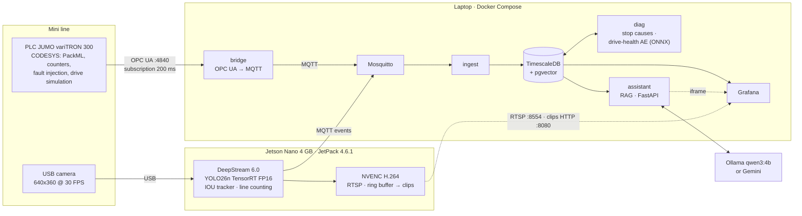
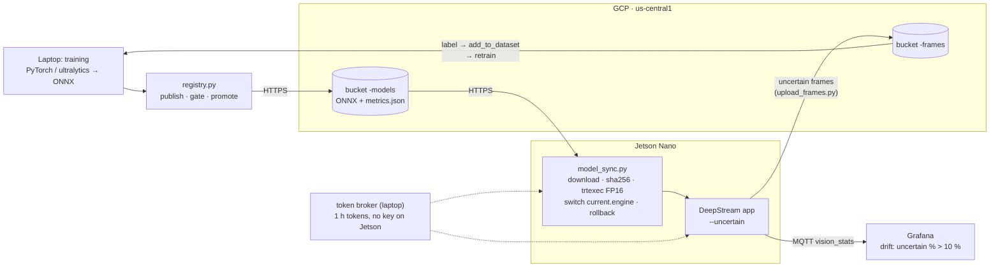

# LineSight

Edge AI for packaging-line downtime diagnostics. A camera watches a mini
bottle line, a YOLO model runs on an NVIDIA Jetson Nano with TensorRT, and
every stop of the line is linked to a video clip, PLC signals from the
30 seconds before it, and an assistant that answers *why the line stopped
and how to fix it*.

> Status: **stages 0–6 done** · next: Stage 7 – final documentation and results

## Architecture

**Runtime: from the line to the answer.** The Jetson only sees; everything that stores, reasons or shows runs on the
laptop (4 GB shared RAM on the Nano). Camera and PLC meet only in the database – the cause of a stop is never known
by construction.



- **Jetson:** DeepStream runs detection (TensorRT FP16), tracking and line counting at 30 FPS; the hardware encoder
  (NVENC) produces the RTSP stream and a RAM ring buffer from which a clip around each event is cut, without costing
  model FPS. Events go out over MQTT.
- **PLC:** PackML state machine with stop codes and a simulated conveyor drive; the bridge subscribes over OPC UA and
  republishes every change to MQTT.
- **Laptop:** `ingest` writes both streams to TimescaleDB; `diag` turns state history into stop events with a cause and
  a camera confidence, and scores drive health with an ONNX autoencoder; `assistant` answers "why did it stop and what
  do I do" from SQL (the stop) plus pgvector (manual, past stops); Grafana shows all of it.

**MLOps: model versions and the retraining loop.**



- A new model reaches the Jetson only through the registry: published with its metrics, promoted only if it passes the
  quality gate (or with `--force` and a written reason). The Jetson downloads the ONNX, checks sha256, builds the
  TensorRT engine itself (an engine is tied to the GPU) and switches a symlink – rollback is a switch, ~1 s.
- The Jetson holds no long-lived Google secret: a broker on the laptop issues 1 h tokens.
- Drift signal: share of uncertain detections per minute; uncertain frames go to a bucket and become training data.

| Device | Role |
|---|---|
| Jetson Nano 4 GB (JetPack 4.6.1) | camera, TensorRT engine, DeepStream pipeline, RTSP H.264, event clips, event publishing |
| Laptop (RTX 3050 Ti Laptop 4 GB, Docker) | training (PyTorch), ONNX export, MQTT broker, OPC UA → MQTT bridge, TimescaleDB, Grafana, RAG assistant |
| PLC (JUMO variTRON 300, CODESYS V3.5) | PackML state machine, simulated production, fault injection, OPC UA server |
| Ultralytics Platform | image labeling only |
| GCP | model version registry, frames for retraining, optional assistant API |

Detection classes: `bottle`, `missing_cap`, `fallen` (jam).

## Stages

| # | Stage | Status |
|---|---|---|
| 0 | Jetson setup, camera, repository, backlog | done |
| 1 | Dataset, training, ONNX → TensorRT, FP32/FP16/INT8 benchmark | done |
| 2 | GStreamer/DeepStream pipeline, tracking, counting, RTSP, event clips | done |
| 3 | CODESYS PackML state machine, OPC UA → MQTT → TimescaleDB, Grafana | done |
| 4 | Stop diagnostics (PLC + camera + clip) and drive-health model (PyTorch autoencoder, ONNX) | done |
| 5 | RAG assistant (pgvector, local LLM / Gemini) with evaluation set and validated LLM judge | done |
| 6 | GCP: model registry, edge model sync, drift signal, active learning, quality gate, canary + rollback | done |
| 7 | Architecture diagram, results, final documentation | in progress |

MVP = stages 1–3.

## Results so far

Detector: YOLO26n, own dataset (214 images, 536 boxes, split 150/43/21),
trained locally (PyTorch, ultralytics), deployed as a TensorRT FP16 engine
with a 384x640 input (camera is 640x360) on the Jetson Nano.

| Model | Device | val mAP50-95 | test mAP50-95 | Speed | Memory |
|---|---|---|---|---|---|
| PyTorch, 640, end-to-end head | laptop | 0.788 | 0.778 | 11.8 ms | – |
| **TensorRT FP16, 384x640, NMS head** | **Jetson Nano** | **0.771** | **0.764** | **34.4 FPS (28.8 ms GPU)** | **20 MiB** |

- TensorRT is lossless vs ONNX (FP32: 0.002 px; FP16: same decisions).
- 384x640 instead of 640x640: −41% compute, same accuracy.
- FP16 gives 1.23x, not 2x: convolutions are 71% of FP32 time (Amdahl),
  FP16 adds 25 reformat layers and slower activations (per-layer profile).
- INT8 brings nothing on the Nano (Maxwell GPU has no INT8 hardware).
- The ~0.012 mAP gap comes from the exported head: the NMS-free head needs
  the ONNX `Mod` op, which TensorRT 8.2 cannot parse.

Details: [docs/etap-1-model.md](docs/etap-1-model.md).

### Video pipeline on the Jetson (stage 2)

```
USB camera (YUY2 640x360@30) ─► nvvideoconvert (VIC) ─► nvstreammux ─► nvinfer (YOLO26n FP16, C++ parser)
  ─► nvtracker (IOU) ─► [pyds probe: line counting, class vote] ─► nvdsosd ─► nvv4l2h264enc (NVENC) ─► tee
       ├─► RTSP server  rtsp://<jetson>:8554/linesight
       ├─► ring buffer  splitmuxsink, 15 x 2 s in /dev/shm
       └─► MP4 (optional)
event (missing_cap / fallen) ─► clip 10 s before / 5 s after the line crossing (ffmpeg concat, no re-encode)
```

| Measurement | Result |
|---|---|
| Live pipeline (detection + tracking + OSD + RTSP + ring buffer) | **30 FPS**, 1.9 GB RAM, GPU 61–99 % |
| DeepStream vs TensorRT + Python, mAP50-95 val / test | 0.754 / 0.760 (vs 0.771 / 0.764; preprocessing differences) |
| Counting, manual test (truth 3/2/2 bottle/missing_cap/fallen) | 3/2/1 |
| Glass-to-glass latency to VLC on the laptop | ~620 ms, of which **73 ms** is the Jetson pipeline (GStreamer latency tracer) – the rest is mostly the VLC client |
| Event clip | 17 s, line crossing at 10 s, plays from the first frame |

- Counting: tracker IDs, direction-aware line crossing with ±20 px hysteresis, class decided by a
  majority vote over the track 5 s after the crossing (a hand on the bottle neck flips single frames).
- NVENC is a separate hardware block: RTSP and clips cost no FPS and no GPU time for the model.
- Ring buffer in RAM (tmpfs) – continuous writes do not wear the SD card.

Details: [docs/etap-2-wideo.md](docs/etap-2-wideo.md).

### PLC and data pipeline (stage 3)

```
Jetson: line-crossing event ──MQTT──┐
                                    ├─► Mosquitto ─► ingest ─► TimescaleDB ─► Grafana
PLC (PackML) ─OPC UA─► bridge ─MQTT─┘
```

All laptop services run from one `infra/docker-compose.yml`: `mosquitto`, `bridge`, `db`, `ingest`, `grafana`.

| Part | What it does |
|---|---|
| PLC (CODESYS, variTRON 300) | PackML subset (11 states, standard numbering), stop reasons (jam → Held, no product → Suspended, fault → Aborted), counter, measured cycle time, manual fault injection |
| `bridge/` | OPC UA subscription (200 ms) → MQTT `linesight/plc/<signal>`, QoS 1, retained; reconnects after PLC loss in ~5 s |
| `ingest/` | MQTT → TimescaleDB; persistent session, write before ack, duplicates dropped by a unique key |
| TimescaleDB | hypertables `plc_signal` (narrow: one row per change), `vision_event` (time = line crossing), `link_status`; `signals_before(t, '30 s')` returns the window plus each signal's value at its start |
| Grafana | provisioned datasource (read-only DB user) and dashboard: PackML state timeline with stop reason, link status, pieces/min PLC vs camera, cycle time, camera events as annotations |

| Measurement | Result |
|---|---|
| Clock offset vs NTP (laptop / Docker container / Jetson) | +1.8 / +6.5 / −1.1 ms (laptop was −1042 ms before fixing Windows time) |
| PLC loss (cable pulled) | status offline, back online ~5 s after reconnect |
| Production rate after cycle-time fix | 40 / 40 / 39 pieces/min (was exactly 30: timer quantised to the 200 ms task) |
| MQTT publishing on the Jetson | no FPS cost (30.0 FPS) |

- A bug found by cross-checking: the PLC reported the *set* cycle time, the dashboard's per-minute counter
  increments showed the real rate was 25 % lower. Cycle time is now measured with `TIME()`.
- Camera and PLC are not linked automatically: the cause of a stop must not be known by construction.

Details: [docs/etap-3-plc-dane.md](docs/etap-3-plc-dane.md).

### Stop diagnostics and drive health (stage 4)

**Why did the line stop?** A `diag` service turns the PackML state history into stop events (leaving Execute → back
in Execute; a chain of states is one stop; stops separated by < 2 s of running are merged). Each stop gets a cause from
the PLC stop code and a **confidence from the camera**: `confirmed` (e.g. a fallen bottle seen 4 s before a jam),
`plc_only`, or `contradicted` (PLC says "no product", the camera saw bottles). Evidence (signals 30 s before, camera
counts) is stored as JSON, plus a link to the event clip served by the Jetson. Grafana: stop table and Pareto charts.

| Live test (15.11) | Result |
|---|---|
| Jams with / without a fallen bottle, no product, fault | all classified as expected after 2 rule fixes found live (camera offline is missing data, not evidence; a fallen bottle cannot confirm the *next* jam) |
| Pareto of the day | jams most frequent (6), faults most expensive (6.4 min of 9) |

**Drive health (predictive maintenance).** The PLC simulates the conveyor drive per piece: mean and peak torque,
current, motor temperature (thermal inertia), bearing wear, and a **cold-start trap** (cold grease = up to +12 % torque,
as much as medium wear). A script drives the line over OPC UA for a 4.5 h data session (8918 pieces, 3 wear episodes).
Time-based split; threshold = 99.9 % quantile of normal validation data; alarm after 20 pieces above it.

| Method | Test: wear at alarm | False alarms / h | Normal time in alarm |
|---|---|---|---|
| B1 EWMA on torque | 5 %*, 16 % | 1.10 | 6.6 % (every cold start) |
| B2 regression torque ~ temperature + EWMA | 19 %, 16 % | 0.55 | 0.2 % |
| **Autoencoder on 7 window features (PyTorch, own training loop)** | **17 %, 14 %** | **0** | **0 %** |

\* the cold start, not the wear. A first autoencoder on raw windows lost to B2 (29–30 %): it learned to reproduce
per-piece noise. The gain over B2 is small (3 episodes); the real gain is margin – 100–300× the threshold under wear.
Deployed as ONNX (329 weights) in the `diag` container with onnxruntime; training and serving share one feature file.
Live: alarm at ~15 % wear, Grafana shows health %, a drive schematic (Canvas) and score / threshold.

Details: [docs/etap-4-diagnostyka.md](docs/etap-4-diagnostyka.md).

### RAG assistant with evaluation (stage 5)

**Why did the line stop at 9:04, and what do I do?** A specific stop is fetched **deterministically with SQL** (the stop
event with cause, confidence and clip, PLC signals from the 30 s before it, drive health) – embeddings cannot tell 9:04
from 9:07. Vector search (pgvector in the same TimescaleDB, `multilingual-e5-small`, PL/EN) is used only for text: the
line manual written for the project (33 sections) and similar past stops. The stop's cause is appended to the vector
query, so the manual hit is the right procedure. Answer: `qwen3:4b-instruct` in Ollama on the laptop GPU (4 GB VRAM:
instruct variant, flash attention, q8_0 KV cache → 37/37 layers on GPU, ~6 s) or Gemini 3.5 Flash Lite; every fact
cites a source; "I don't know" when the sources do not cover it. FastAPI service in Docker, embedded as a panel in
Grafana: click a stop → the assistant answers about it.

**Evaluation:** a scripted 25-min session in front of the camera produced every stop type and confidence (jam with
and without a fallen bottle, contradicted "no product", drive wear → alarm → fault). 28 questions (19 PL / 9 EN) with
required facts, gold manual sections and reference answers; deterministic metrics plus an LLM judge that labels each
claim supported / unsupported / contradicted. **The judge was validated against 12 human labels first** – the first
prompt passed "the stop was confirmed" for a PLC-only stop; claim-by-claim: 11/12 agreement, 4/5 hallucinations caught,
0 false alarms.

| Run | Right stop | Recall@4 | Required facts (PL / EN) | Hallucinated answers | Latency |
|---|---|---|---|---|---|
| no RAG (qwen3:4b) | – | – | 10 % (11 / 8) | – (refuses 91 % of answerable) | 3.8 s |
| RAG v2 (qwen3:4b) | 100 % | 100 % | 82 % (92 / 62) | 43 % | 5.8 s |
| **RAG v3 (qwen3:4b, local)** | **100 %** | **100 %** | **85 % (94 / 68)** | **14 %** | 5.8 s |
| RAG v3 (Gemini 3.5 Flash Lite) | 100 % | 100 % | 94 % (100 / 83) | 0 %* | 1.4 s |

\* same model answers and judges – optimistic. v2 → v3 changed the **data in the context**, not the model: confidence
spelled out ("the camera did NOT confirm"), times as "X s before / after the stop" instead of signed numbers, the chain of
causes numbered. The evaluation also found two **pipeline bugs** upstream of the LLM: a second stop cause lost when the
PLC passed through Execute for one 200 ms cycle, and real stops deleted when the 24 h recomputation window crossed a
NULL state before a PLC restart. Open: EN → PL retrieval for some questions; counting questions need SQL, not RAG.

Details: [docs/etap-5-rag.md](docs/etap-5-rag.md).

### Cloud MLOps on GCP (stage 6)

**Model registry in Cloud Storage.** Every version is immutable: `yolo26n/vN/model.onnx` + `metrics.json` (val/test
metrics, sha256, git commit, dataset split, deploy parameters, quality-gate result); `deployments/jetson-01.json` says
which version the device should run, with the previous one for rollback. No MLflow or Vertex AI – one model, one
device, two JSON files are enough.

**Jetson pulls and builds.** `model_sync.py` (Python 3.6, stdlib only) downloads the pointed ONNX, checks sha256,
builds the FP16 engine with `trtexec` *on the device* (TensorRT plans are tied to the GPU and TensorRT version),
tests it (≥ 15 qps) and switches a `current.engine` symlink atomically. Update v1 → v2: 2.6 s download + 876 s
build. **Rollback: 1 s** – engines of earlier versions stay on disk.

**No service-account keys.** The org policy (secure-by-default) blocks JSON keys, so the laptop impersonates the
`jetson-edge` service account and hands out 1-hour tokens to the Jetson (`cloud/token_broker.py`, Docker). The edge
identity can read models and only *create* frames – overwrite, read, list and delete are rejected (verified 8/8).

**Drift signal without labels.** Every minute the Jetson publishes the share of detections just above the deploy
threshold (0.45–0.6) and the mean confidence → MQTT → TimescaleDB → Grafana. Normal light: 0–3 %; new light
(side lamp, motion, hands): up to 27 %.

**Active learning → retraining → gate → canary.** Uncertain frames (rate-limited) go to a frames bucket; 209 of them
+ 40 *random* new-domain test images (not selected by v1) → v2 with the same recipe. The quality gate, fixed
before training, required ≥ v1 − 0.02 on the frozen old test and ≥ v1 + 0.02 mAP50-95 on the new-domain test:

| | old test (21) | new-domain test (40) | online, weak light: uncertain detections | mean confidence |
|---|---|---|---|---|
| v1 | 0.778 | 0.749 | 18.5 % | 0.732 |
| v2 | 0.770 (✓) | 0.765 (+0.016, **✗**) | **4.3 %** | **0.784** |

The registry refused to promote v2; a forced canary (reason recorded) showed 4× fewer uncertain detections and half
as many fragmented tracks. **v1 stays in production** – the rules were set before measuring; the lesson is that 40
random images are too small and too easy a test for edge cases, so the next iteration needs a larger, model-independent
edge-case test set.

Details: [docs/etap-6-gcp.md](docs/etap-6-gcp.md).

## Repository layout

```
linesight/
├── docs/       stage-by-stage notes (Polish); docs/kb = line manual for the assistant
├── training/   laptop: dataset, training, ONNX export, v1/v2 comparison + gate (stages 1, 6)
├── jetson/     Jetson: image capture, TensorRT engines, benchmarks, GCS client, model sync, frame upload (stages 1–2, 6)
├── deepstream/ Jetson: DeepStream app, C++ parser, configs, tests (stage 2)
├── laptop/     laptop helpers (latency stopwatch)                (stage 2)
├── plc/        CODESYS sources (PackML state machine)           (stage 3)
├── bridge/     laptop, Docker: OPC UA → MQTT bridge             (stage 3)
├── ingest/     laptop, Docker: MQTT → TimescaleDB               (stage 3)
├── diag/       laptop, Docker: stop events, cause rules, drive-health inference (stage 4)
├── anomaly/    laptop: drive dataset, baselines, PyTorch autoencoder, shared features (stage 4)
├── assistant/  laptop, Docker: RAG assistant – retrieval, stop context, LLM, FastAPI (stage 5)
├── eval/       laptop: 28-question evaluation set, runner, LLM judge, results (stage 5)
├── cloud/      laptop: model registry (Cloud Storage), token broker for the Jetson (stage 6)
├── tools/      clock offset (SNTP), OPC UA browser, data-session scenarios (stages 3–5)
└── infra/      docker-compose, Mosquitto, DB schema, Grafana    (stage 3)
```

Folders are added when their first file appears.

## Documentation

- [Stage 0 – Jetson setup, camera, memory](docs/etap-0-jetson.md)
- [Stage 1 – dataset, training, TensorRT engines, benchmark](docs/etap-1-model.md)
- [Stage 2 – DeepStream, tracking, counting, RTSP, event clips](docs/etap-2-wideo.md)
- [Stage 3 – PackML, OPC UA, MQTT, TimescaleDB, Grafana](docs/etap-3-plc-dane.md)
- [Stage 4 – stop diagnostics, drive-health model](docs/etap-4-diagnostyka.md)
- [Stage 5 – RAG assistant, evaluation](docs/etap-5-rag.md)
- [Stage 6 – GCP: model registry, drift, retraining, canary](docs/etap-6-gcp.md)
- [Backlog](docs/backlog.md)

## Not in the repository

Model weights and engines (`.pt`, `.onnx`, `.engine`), datasets, training
runs and video clips are ignored by Git (see `.gitignore`). Model versions
live in `gs://linesight-514914-models` (stage 6).
