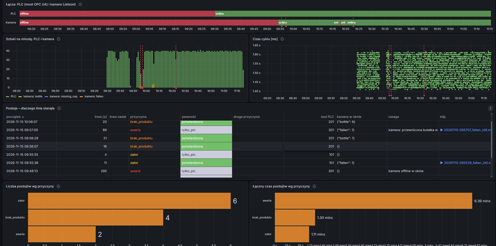
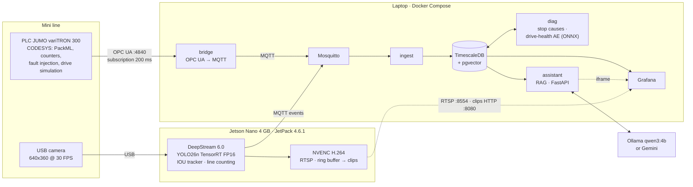
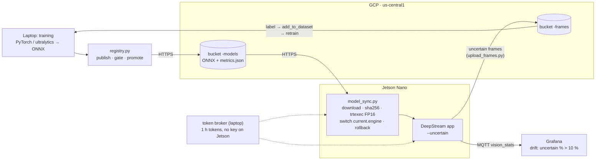

# LineSight

[](https://github.com/grzegorzczy/linesight/actions/workflows/tests.yml)

**Why did the packaging line stop, and how do I fix it?** LineSight answers that on the edge: a YOLO model on an
NVIDIA Jetson Nano watches a mini bottle line, a real PLC (CODESYS, PackML) reports machine states, and every stop is
linked to its cause, a confidence from the camera, the PLC signals from the 30 s before it, a video clip – and an
assistant that explains it with cited sources.

Built end to end by one person as a portfolio project: dataset, training, TensorRT, DeepStream, PLC program,
time-series pipeline, anomaly model, RAG with evaluation, GCP model registry. Every number below was measured on the
hardware.



*Grafana (Polish UI): every stop with its cause (`zator` = jam, `brak_produktu` = no product, `awaria` = fault),
camera confidence (`potwierdzona` = confirmed by the camera, `tylko_plc` = PLC only) and a link to the event clip.*

## Key results

| Area | Result | Stage |
|---|---|---|
| Detector on the Jetson Nano | YOLO26n, TensorRT FP16, 384x640: **34.4 FPS**, test mAP50-95 **0.764** (PyTorch: 0.778); INT8 gives nothing on the Nano's Maxwell GPU – measured and explained | [1](docs/etap-1-model.md) |
| Live video pipeline | DeepStream: detection + tracking + counting + RTSP H.264 + clip ring buffer at **30 FPS**, **73 ms** pipeline latency; H.265 measured – no gain at 640x360 | [2](docs/etap-2-wideo.md), [7](docs/etap-7-final.md) |
| PLC → database | OPC UA → MQTT → TimescaleDB, reconnects in ~5 s after a cable pull; a dashboard cross-check found the PLC reporting set instead of real cycle time (25 % off) | [3](docs/etap-3-plc-dane.md) |
| Drive health (predictive maintenance) | PyTorch autoencoder (own training loop) on torque/current/temperature features: wear alarm at **14–17 %**, **0 false alarms/h** vs 1.10/h for an EWMA baseline fooled by cold starts | [4](docs/etap-4-diagnostyka.md) |
| Assistant (RAG) | Right stop **100 %** (SQL, not embeddings), required facts **85 %** with a local 4B model (94 % Gemini); hallucinated answers **43 % → 14 %** by changing the data in the context, judged by an LLM judge validated on human labels | [5](docs/etap-5-rag.md) |
| MLOps on GCP | Registry with a quality gate fixed before training; the Jetson builds its own engine; **rollback in 1 s**; v2 was rejected by the gate despite 4× fewer uncertain detections online – and stayed rejected | [6](docs/etap-6-gcp.md) |

All results and tables: [docs/results.md](docs/results.md).

## Architecture

**Runtime: from the line to the answer.** The Jetson only sees; everything that stores, reasons or shows runs on the
laptop (4 GB shared RAM on the Nano). Camera and PLC meet only in the database – the cause of a stop is never known
by construction.



- **Jetson:** DeepStream runs detection (TensorRT FP16), tracking and line counting at 30 FPS; the hardware encoder
  (NVENC) produces the RTSP stream and a RAM ring buffer from which a clip around each event is cut, without costing
  model FPS. Events go out over MQTT.
- **PLC:** PackML state machine with stop codes and a simulated conveyor drive; the bridge subscribes over OPC UA and
  republishes every change to MQTT.
- **Laptop:** `ingest` writes both streams to TimescaleDB; `diag` turns state history into stop events with a cause and
  a camera confidence, and scores drive health with an ONNX autoencoder; `assistant` answers "why did it stop and what
  do I do" from SQL (the stop) plus pgvector (manual, past stops); Grafana shows all of it.

**MLOps: model versions and the retraining loop.**



- A new model reaches the Jetson only through the registry: published with its metrics, promoted only if it passes the
  quality gate (or with `--force` and a written reason). The Jetson downloads the ONNX, checks sha256, builds the
  TensorRT engine itself (an engine is tied to the GPU) and switches a symlink – rollback is a switch, ~1 s.
- The Jetson holds no long-lived Google secret: a broker on the laptop issues 1 h tokens.
- Drift signal: share of uncertain detections per minute; uncertain frames go to a bucket and become training data.

| Device | Role |
|---|---|
| Jetson Nano 4 GB (JetPack 4.6.1) | camera, TensorRT engine, DeepStream pipeline, RTSP H.264, event clips, event publishing |
| Laptop (RTX 3050 Ti Laptop 4 GB, Docker) | training (PyTorch), ONNX export, MQTT broker, OPC UA → MQTT bridge, TimescaleDB, Grafana, RAG assistant |
| PLC (JUMO variTRON 300, CODESYS V3.5) | PackML state machine, simulated production, fault injection, OPC UA server |
| Ultralytics Platform | image labeling only |
| GCP | model version registry, frames for retraining, optional assistant API |

Detection classes: `bottle`, `missing_cap`, `fallen` (jam).

## Running it

Hardware: Jetson Nano 4 GB (JetPack 4.6.1), USB camera, a Windows laptop with Docker Desktop and an NVIDIA GPU,
a CODESYS PLC with an OPC UA server.

1. **PLC** – create a CODESYS project with the objects from `plc/src`, add *Symbol Configuration* with
   *Support OPC UA features* and all of `GVL_Line` selected, download and start
   ([stage 3](docs/etap-3-plc-dane.md)).
2. **Laptop** – `docker compose -f infra/docker-compose.yml up -d` (PLC address: `OPCUA_URL`, default
   `opc.tcp://192.168.0.244:4840`); Grafana on http://localhost:3000. The assistant uses Ollama on the host
   (`qwen3:4b-instruct`) or Gemini (`LLM_BACKEND=gemini`, `GEMINI_API_KEY`).
3. **Jetson** – `python3 jetson/model_sync.py` (pull the model from the registry via the laptop token broker, build the
   TensorRT engine),
   `python3 jetson/serve_clips.py &`, then
   `cd deepstream && python3 linesight_app.py --rtsp --clips --mqtt <laptop IP>`;
   stream on `rtsp://<jetson>:8554/linesight`.

Without GCP: build the engine from a local ONNX ([stage 1](docs/etap-1-model.md)) – the registry is optional.

## Limitations

- **Small data.** 214 labelled images, test sets of 21 and 40 images: differences of ~0.01 mAP are within noise.
  The numbers show the method (gates and rules fixed before measuring), not a better model.
- **Simulated drive.** Torque, current and temperature come from a physical model in the PLC with 3 wear
  episodes – the pipeline is real, the motor is not.
- **One bench.** One camera, controlled light, one line; no multi-site or multi-camera test.
- **Hardware-bound.** The line runs on a JUMO variTRON 300; the ST code uses only the `Standard` library and moves
  to CODESYS Control Win by pasting the objects.

## Repository layout

```
linesight/
├── docs/       stage-by-stage notes (Polish); docs/kb = line manual for the assistant
├── training/   laptop: dataset, training, ONNX export, v1/v2 comparison + gate (stages 1, 6)
├── jetson/     Jetson: image capture, TensorRT engines, benchmarks, GCS client, model sync, frame upload (stages 1–2, 6)
├── deepstream/ Jetson: DeepStream app, C++ parser, configs, tests (stage 2)
├── laptop/     laptop helpers (latency stopwatch)                (stage 2)
├── plc/        CODESYS sources (PackML state machine)           (stage 3)
├── bridge/     laptop, Docker: OPC UA → MQTT bridge             (stage 3)
├── ingest/     laptop, Docker: MQTT → TimescaleDB               (stage 3)
├── diag/       laptop, Docker: stop events, cause rules, drive-health inference (stage 4)
├── anomaly/    laptop: drive dataset, baselines, PyTorch autoencoder, shared features (stage 4)
├── assistant/  laptop, Docker: RAG assistant – retrieval, stop context, LLM, FastAPI (stage 5)
├── eval/       laptop: 28-question evaluation set, runner, LLM judge, results (stage 5)
├── cloud/      laptop: model registry (Cloud Storage), token broker for the Jetson (stage 6)
├── tools/      clock offset (SNTP), OPC UA browser, data-session scenarios (stages 3–5)
└── infra/      docker-compose, Mosquitto, DB schema, Grafana    (stage 3)
```

Folders are added when their first file appears.

## Documentation

- [Results by stage – all numbers](docs/results.md)
- [Cold start – the whole line step by step (Polish)](docs/uruchomienie.md)
- [Stage 0 – Jetson setup, camera, memory](docs/etap-0-jetson.md)
- [Stage 1 – dataset, training, TensorRT engines, benchmark](docs/etap-1-model.md)
- [Stage 2 – DeepStream, tracking, counting, RTSP, event clips](docs/etap-2-wideo.md)
- [Stage 3 – PackML, OPC UA, MQTT, TimescaleDB, Grafana](docs/etap-3-plc-dane.md)
- [Stage 4 – stop diagnostics, drive-health model](docs/etap-4-diagnostyka.md)
- [Stage 5 – RAG assistant, evaluation](docs/etap-5-rag.md)
- [Stage 6 – GCP: model registry, drift, retraining, canary](docs/etap-6-gcp.md)
- [Stage 7 – link status fix, H.264 vs H.265](docs/etap-7-final.md)
- [Job-ad coverage analysis](docs/analiza.md)
- [Backlog](docs/backlog.md)

## Not in the repository

Model weights and engines (`.pt`, `.onnx`, `.engine`), datasets, training
runs and video clips are ignored by Git (see `.gitignore`). Model versions
live in `gs://linesight-514914-models` (stage 6).
