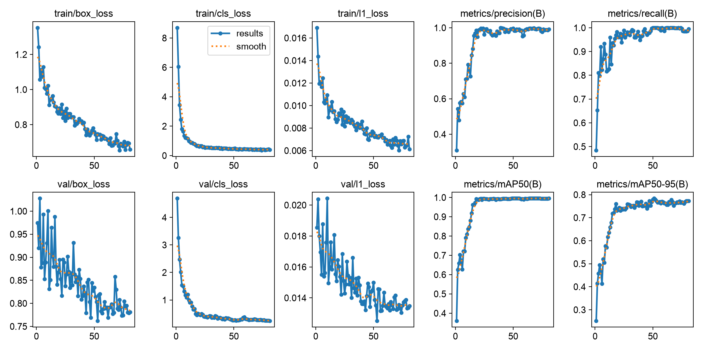
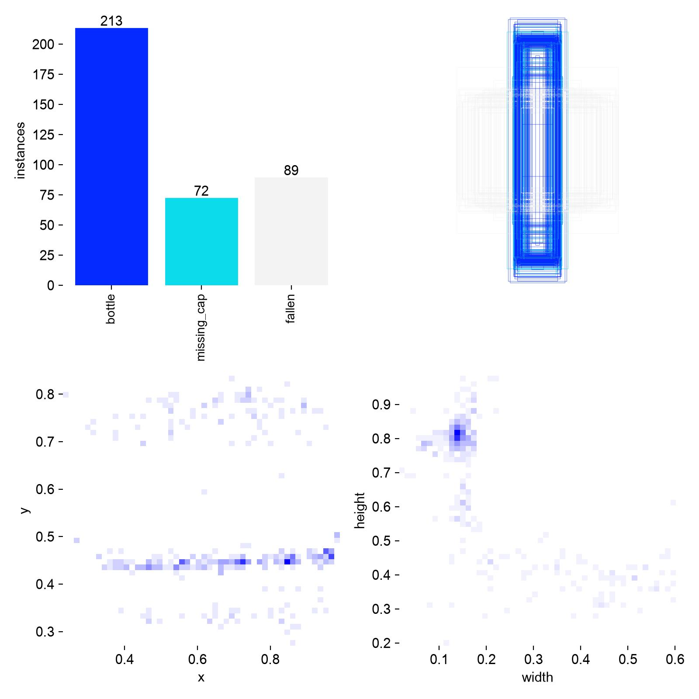
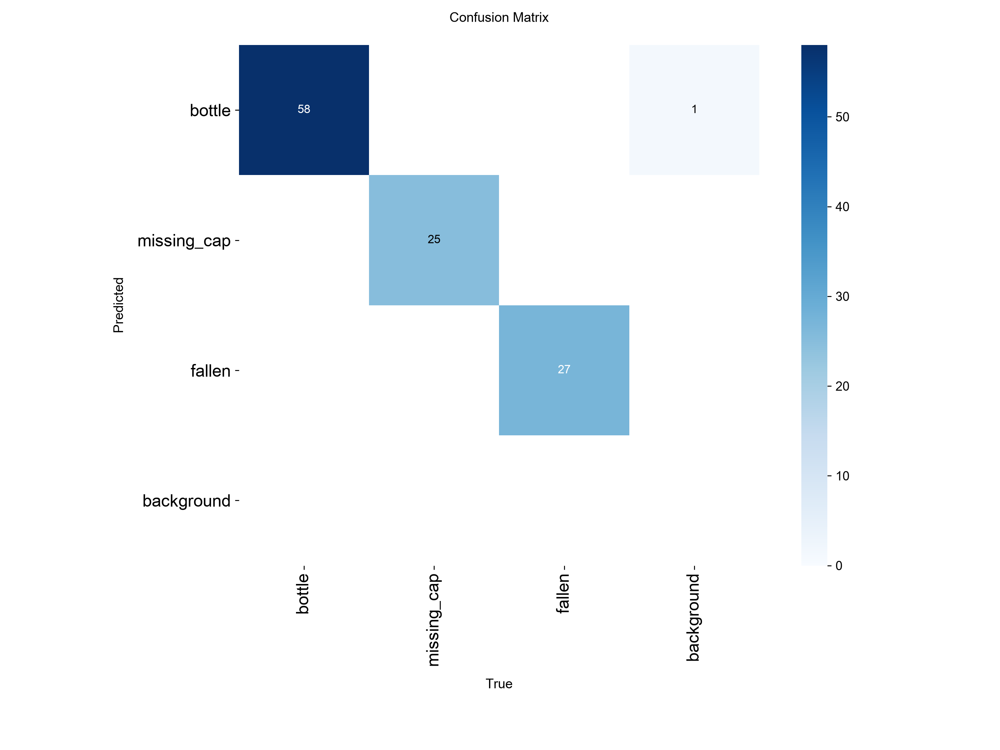
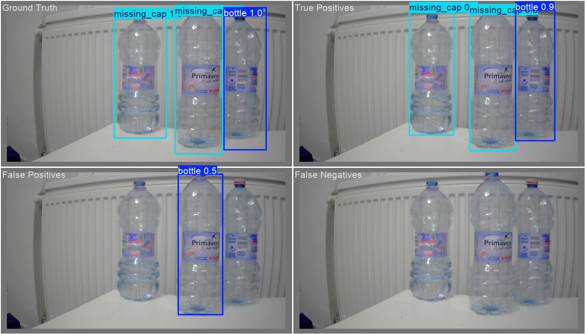
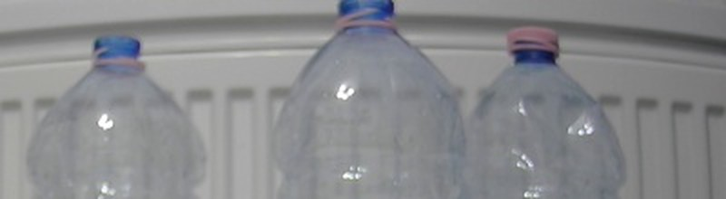
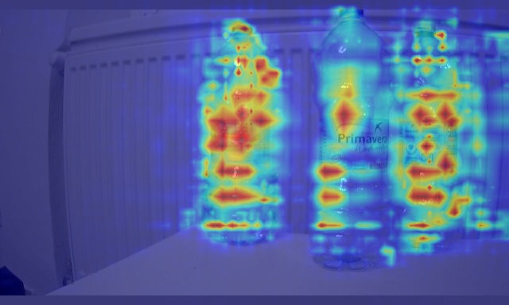
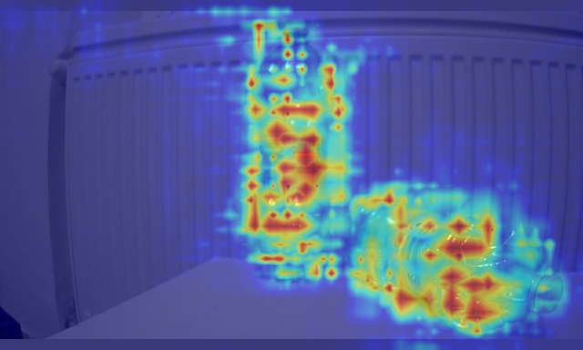
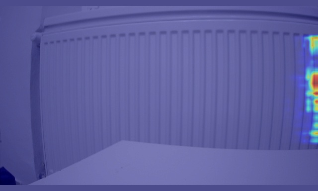

# Etap 1 – model: scena, środowisko, zgodność z TensorRT

Status: w trakcie (od 10.11.2026)

## Cel etapu
Własny detektor butelek (3 klasy) wytrenowany na laptopie, przeniesiony na
Jetsona jako silnik TensorRT i zmierzony w trzech precyzjach (FP32/FP16/INT8).

Wymagania z ogłoszenia: wizja komputerowa na linii pakującej, trening
w PyTorch, optymalizacja modeli pod NVIDIA Jetson (ONNX → TensorRT).

## Mapa: gdzie jesteśmy

Model przechodzi przez dwa urządzenia z różnymi wersjami CUDA. Łączy je
plik ONNX – niezależny od frameworka opis sieci (warstwy + wagi).

```
LAPTOP (Windows)                              JETSON NANO (Ubuntu 18.04)
Python 3.12, PyTorch 2.11 + CUDA 12.8         JetPack 4.6.1: CUDA 10.2, TensorRT 8.2.1
RTX 3050 Ti 4 GB                              GPU Maxwell, 4 GB współdzielone z CPU

  zdjęcia ─► trening (ultralytics) ─► .pt
                                       │
                         eksport ONNX  ▼
                                    model.onnx ──scp──► trtexec / TensorRT
                                                          │ budowa silnika
                                                          ▼ (tylko na Jetsonie)
                                                        model.engine ─► inferencja
```

| Pojęcie | Co to jest | Gdzie |
|---|---|---|
| **CUDA** | Platforma NVIDII do obliczeń na GPU. Wersja zależy od sterownika i biblioteki, która jej używa | Laptop: 12.8 (w kole PyTorch), Jetson: 10.2 (w JetPacku) |
| **PyTorch** | Framework do trenowania sieci. Koło `+cu128` ma w sobie biblioteki CUDA 12.8 – nie instalujemy CUDA osobno | Laptop |
| **ultralytics** | Biblioteka z modelami YOLO: trening, walidacja, eksport jedną komendą | Laptop |
| **ONNX** | Format wymiany modeli. Opset = wersja zestawu operacji; starszy odbiorca rozumie tylko starsze opsety | Plik przenoszony laptop → Jetson |
| **TensorRT** | Optymalizator i silnik inferencji NVIDII. Łączy warstwy, dobiera kernele pod konkretne GPU, obniża precyzję (FP16/INT8) | Jetson: 8.2.1 |
| **Silnik (.engine)** | Wynik budowy TensorRT. Związany z GPU i wersją TensorRT – budujemy go na Jetsonie, nie na laptopie | Jetson |
| **trtexec** | Narzędzie z TensorRT: buduje silnik z ONNX i mierzy jego wydajność | Jetson |

Dlaczego test zgodności (E1-02) przed zbieraniem zdjęć: TensorRT 8.2 pochodzi
z 2021 r. Nowsze architektury YOLO mogą eksportować operacje, których jego
parser ONNX nie zna. Sprawdzamy to na wagach bazowych, zanim w model
zainwestujemy dzień pracy.

## E1-01 – scena

### Zmiana kamery: RealSense → kamera USB ASUS

RealSense (etap 0) miała ręczną ekspozycję, ale scena była pod światło:
ciemna sylwetka butelki na jasnym tle. Druga kamera dała od razu lepszy
obraz, więc zmieniliśmy ją przed zebraniem pierwszego zdjęcia. Zmiana
kamery po zebraniu zbioru oznaczałaby nowy zbiór (inny obraz = inny rozkład
danych).

| Komenda (Jetson) | Do czego służy |
|---|---|
| `v4l2-ctl --list-devices` | Kamera i jej węzeł `/dev/videoN` |
| `v4l2-ctl -d /dev/video0 --list-formats-ext` | Formaty, rozdzielczości, FPS |
| `v4l2-ctl -d /dev/video0 -l` | Ustawienia kamery z zakresami |
| `lsusb` | Urządzenia USB (identyfikator producenta) |

Wynik:

| Format | Rozdzielczości @ 30 FPS |
|---|---|
| YUYV (surowy) | tylko 640x360 |
| MJPG | 1920x1080, 1280x720, 640x360 |
| H.264 (koder w kamerze) | 1920x1080, 1280x720, 640x360 |

Wybór: **YUYV 640x360 @ 30 FPS** – bez dekodowania, ten sam potok co
wcześniej. 360 px w pionie wystarcza: model i tak skaluje wejście do 640
z wypełnieniem (letterbox).

Ustawienia kamery: brightness, contrast, saturation, hue, balans bieli,
`power_line_frequency`, `exposure_absolute` (10–2000). **Brak
`exposure_auto` i `gain`.**

### Pomiar FPS i test ekspozycji

| Komenda | Wynik |
|---|---|
| `v4l2-ctl -d /dev/video0 --set-fmt-video=width=640,height=360,pixelformat=YUYV --stream-mmap --stream-count=300` przy `exposure_absolute=200` | 25 → 29 fps (rozgrzewanie) |
| to samo przy `exposure_absolute=2000` (teoretycznie 200 ms = 5 FPS) | 30 fps |
| zmiana 10 ↔ 2000 przy podglądzie na żywo | jasność bez zmian |

Wniosek: **kamera ignoruje `exposure_absolute` i ma własną automatyczną
ekspozycję.** Butelka przesuwana w realnym tempie była ostra, więc przy
obecnym świetle kamera dobiera wystarczająco krótki czas. Jedyna dźwignia
przeciw rozmyciu: więcej światła od przodu.

Znane ograniczenie (temat na rozmowę): automatyczna ekspozycja zmienia
jasność, gdy zmienia się zawartość kadru albo światło dzienne. W systemie
produkcyjnym wybralibyśmy kamerę przemysłową z ręczną ekspozycją i stałe
oświetlenie. Tutaj kompensujemy to zróżnicowaniem zbioru (różne pory dnia
w treningu i w zbiorze testowym).

### Podgląd na żywo: Jetson → laptop

Pulpit Jetsona jest wyłączony, więc obraz wysyłamy po sieci. Przy okazji
pierwszy potok ze sprzętowym koderem H.264 (wstęp do E2-05).

```
gst-launch-1.0 -e v4l2src device=/dev/video0 ! \
  video/x-raw,format=YUY2,width=640,height=360,framerate=30/1 ! \
  nvvidconv ! 'video/x-raw(memory:NVMM),format=I420' ! \
  nvv4l2h264enc insert-sps-pps=1 iframeinterval=30 bitrate=4000000 ! \
  h264parse ! rtph264pay config-interval=1 pt=96 ! \
  udpsink host=192.168.0.203 port=5000 sync=false
```

| Element | Rola |
|---|---|
| `v4l2src` | Odczyt z kamery |
| `nvvidconv` | Kopiuje klatkę do pamięci NVMM, z której czyta sprzętowy koder |
| `nvv4l2h264enc` | Sprzętowy koder H.264 (NVENC). `insert-sps-pps=1` + `iframeinterval=30` = klatka kluczowa z nagłówkami co sekundę, więc odbiornik może dołączyć w dowolnym momencie |
| `rtph264pay` + `udpsink` | Pakowanie w RTP i wysyłka UDP na laptop; `sync=false` – bez czekania na zegar |

Odbiór: VLC z plikiem `jetson.sdp` (opis strumienia RTP: port 5000,
H.264, typ ładunku 96). Wynik: obraz z opóźnieniem poniżej ok. 0,5 s;
koder zgłasza `H264: Profile = 66` (Baseline).

Weryfikacja wersji: właściwości `nvv4l2h264enc` sprawdzone na Jetsonie
(`gst-inspect-1.0 nvv4l2h264enc`) – źródło prawdy dla zainstalowanej wersji L4T.

### Ostrość, balans bieli, kadr

| Ustawienie | Wartość | Jak |
|---|---|---|
| Ostrość | ręczna | pierścień na obiektywie, potem zablokowany taśmą |
| Balans bieli | 5500 K, automatyka wyłączona | `v4l2-ctl -d /dev/video0 -c white_balance_temperature_auto=0 -c white_balance_temperature=5500` |
| Ekspozycja | automatyczna (ograniczenie kamery) | – |
| Tło | kaloryfer, okno poza kadrem | ustawienie stanowiska |

Balans bieli blokujemy, bo automatyka zmienia kolory, gdy w kadrze pojawia
się więcej lub mniej butelek – model widziałby tę samą butelkę w różnych
kolorach. Ustawienia `v4l2-ctl` znikają po restarcie lub odłączeniu kamery;
w E1-03 trafią do skryptu zbierania zdjęć.

Kolejne kadry i co poprawialiśmy:
1. Pokój w tle, butelka 1,5 l zajmuje cały kadr → za blisko, tło niejednolite.
2. Dwie butelki, ucięte dno → model musi widzieć cały obiekt.
3. Okno u góry kadru → zaburza automatyczną ekspozycję.
4. **Kaloryfer jako tło, całe butelki, okno poza kadrem → zaakceptowane.**


Zasady od teraz: kamery nie ruszamy (pozycja, kąt, ostrość). Butelek nie
stawiamy wyżej ani bliżej niż na zdjęciu. Do obejrzenia po treningu: paski
kaloryfera prześwitują przez przezroczyste butelki.

Zdjęcie sceny (30 klatek, bo automatyczna ekspozycja potrzebuje chwili po
starcie; bierzemy ostatnią):

```
gst-launch-1.0 v4l2src device=/dev/video0 num-buffers=30 ! \
  video/x-raw,format=YUY2,width=640,height=360,framerate=30/1 ! \
  jpegenc ! multifilesink location=scena_%02d.jpg
```

### Problemy po drodze

| Objaw | Przyczyna | Rozwiązanie |
|---|---|---|
| `Device '/dev/video0' is busy` | Osierocony `gst-launch` (PPID 1, brak terminala) – okno zamknięte bez Ctrl+C | `sudo fuser -v /dev/video0`, `ps -fp <PID>`, `kill <PID>` albo `pkill gst-launch` |
| VLC nie otwiera `jetson.sdp` | Plik miał 0 bajtów (Notatnik nie zapisał) | Plik tworzony w cmd blokiem `echo ... > plik` |
| `scp: No such file` | Zdjęcie nie powstało, bo kamera była zajęta | Zwolnić kamerę, `ls -l`, potem `scp` |
| Pobieranie PyTorch przerwane (`Operation cancelled by user`) | Wklejony blok komend – kolejne linie trafiły do działającego `pip` jako klawisze | Długie komendy wklejamy pojedynczo |

## E1-05 – środowisko treningowe (laptop)

Zrobione przed E1-02, bo eksport ONNX wymaga ultralytics.

| Komenda (laptop, cmd) | Do czego służy |
|---|---|
| `python --version` | 3.12.4 – wspierany przez PyTorch i ultralytics |
| `nvidia-smi` | Karta, sterownik 595.95, najwyższa obsługiwana CUDA: 13.2 |
| `python -m venv .venv` | Osobne środowisko Pythona w folderze projektu (`.venv/` w `.gitignore`) |
| `.venv\Scripts\activate` | Włącza środowisko (prefiks `(.venv)`); w każdym nowym oknie od nowa |
| `pip install torch torchvision --index-url https://download.pytorch.org/whl/cu128` | PyTorch z CUDA 12.8 (ok. 2,8 GB). Sterownik 595 obsługuje CUDA do 13.2, więc koło cu128 działa |
| `pip install ultralytics onnx` | YOLO + biblioteka ONNX do eksportu |
| `python -c "import torch; print(torch.__version__, torch.cuda.is_available(), torch.cuda.get_device_name(0))"` | Czy PyTorch widzi GPU |
| `yolo checks` | Pełny raport środowiska ultralytics |
| `pip list \| findstr /i "torch ultralytics onnx"` | Wersje do `requirements.txt` |

Kolejność ma znaczenie: PyTorch przed ultralytics. W odwrotnej pip dociągnie
PyTorch z PyPI, czyli wersję bez CUDA dla Windows.

Wynik `yolo checks`:

| Co | Wartość |
|---|---|
| Ultralytics | 8.4.208 |
| PyTorch | 2.11.0+cu128 |
| CUDA (w PyTorch) | 12.8 |
| GPU | NVIDIA GeForce RTX 3050 Ti Laptop GPU, 4096 MiB |
| CPU / RAM | i5-12500H, 16 wątków / 15,7 GB |
| Dysk | ok. 17 GB wolne – nie trzymamy kopii zbioru ani starych `runs/` |

Wersje przypięte w [`training/requirements.txt`](../training/requirements.txt).
Odtworzenie środowiska: `pip install -r training/requirements.txt` w nowym
`.venv`. Plik zawiera tylko pakiety instalowane ręcznie – pełny
`pip freeze` (ok. 40 pozycji) byłby nieczytelny i zależny od Windows.

## E1-02 – zgodność architektur z TensorRT 8.2

Cel: przejść całą drogę `.pt` → ONNX → silnik TensorRT na gotowych wagach
(COCO) trzech kandydatów, zanim zbierzemy zdjęcia i wytrenujemy model.

### Eksport ONNX (laptop)

Opset: dokumentacja parsera ONNX dla TensorRT 8.2 (onnx-tensorrt, gałąź
`8.2-GA`, `docs/operators.md`): *„TensorRT 8.2 supports operators up to
Opset 13”*. Domyślny opset nowego ultralytics jest wyższy.

| Komenda (laptop, `training\e1-02`, aktywne `.venv`) | Do czego służy |
|---|---|
| `yolo export model=yolov8n.pt format=onnx opset=13 imgsz=640 simplify=True` | Eksport; wagi bazowe pobierają się same. To samo dla `yolo11n.pt`, `yolo26n.pt` |
| `python -c "import onnx; ..."` (opset i kształt wyjścia) | Kontrola, czy w pliku jest opset 13 |
| `scp yolov8n.onnx yolo11n.onnx yolo26n.onnx grzegorz@192.168.0.124:~/e1-02/` | Kopiowanie na Jetsona |

Parametry: `imgsz=640` (stałe wejście 640x640 – prostokątne 640x384
w E1-07), `simplify=True` (onnxslim upraszcza graf), bez `half` (precyzję
ustawia TensorRT) i bez `dynamic` (stały rozmiar jest prostszy dla TRT 8.2).

Wynik: trzy pliki z opsetem 13, wszystkie z wyjściem `[1, 84, 8400]`
(4 współrzędne ramki + 80 klas COCO, 8400 kandydatów; NMS poza modelem).
YOLO26n też wyeksportował się z głowicą wymagającą NMS, a nie w wariancie
end-to-end (NMS-free) – ultralytics 8.4.208 podaje ten kształt już na
starcie eksportu, bez ostrzeżeń.

### Budowa silnika FP16 (Jetson)

```
/usr/src/tensorrt/bin/trtexec --onnx=yolov8n.onnx --saveEngine=yolov8n_fp16.engine \
  --fp16 --workspace=1024 2>&1 | tee build_yolov8n.log
grep -E "PASSED|FAILED|Throughput|GPU Compute Time: min" build_*.log
```

| Flaga | Znaczenie |
|---|---|
| `--fp16` | TensorRT może liczyć w 16 bitach tam, gdzie to szybsze |
| `--workspace=1024` | 1024 MB pamięci roboczej na budowę (składnia TRT 8.2; nowsze wersje: `--memPoolSize`) |
| `2>&1 \| tee plik.log` | Wynik na ekran i do pliku jednocześnie |

Przebieg budowy w logu: lista `[GpuLayer]` (parsowanie udane, warstwy po
łączeniu – `PWN(...)` to kilka operacji w jednym kernelu) → `Init cuBLAS`,
`Init cuDNN` → autotuning (bez `--verbose` nic nie wypisuje przez kilka-
kilkanaście minut) → zapis silnika → pomiar ok. 3 s → `&&&& PASSED`.

Komunikat `Some tactics do not have sufficient workspace memory to run` to
informacja (`[I]`), nie błąd: część implementacji nie zmieściła się
w 1024 MB i została pominięta. Porównanie 1024 vs 2048 MB – w E1-08.

Tryb mocy: `sudo nvpmodel -q` → **MAXN (tryb 0)**. Zegary dynamiczne
(bez `jetson_clocks`) – wszystkie trzy modele w tych samych warunkach,
więc porównanie między nimi jest uczciwe; do E1-08 ustalimy stałe zegary.

### Wyniki (FP16, 640x640, batch 1, Jetson Nano MAXN)

| Model | Silnik | Throughput | GPU Compute (średnio) | Latency (średnio) | Budowa | Plik silnika | Parametry | GFLOPs | mAP50-95 COCO* |
|---|---|---|---|---|---|---|---|---|---|
| YOLOv8n | PASSED | **20,7 qps** | **47,5 ms** | 48,2 ms | ok. 12 min | 13 MB | 3,2 M | 8,7 | 37,3 |
| YOLO11n | PASSED | 19,6 qps | 50,1 ms | – | ok. 14 min | 9,4 MB | 2,6 M | 6,5 | 39,5 |
| YOLO26n | PASSED | 20,0 qps | 49,2 ms | 49,9 ms | ok. 15 min | **9,0 MB** | **2,4 M** | **5,5** | **40,9** |

\* z dokumentacji Ultralytics, nie nasz pomiar.

YOLOv8n w szczegółach: kopiowanie CPU→GPU 0,49 ms, GPU→CPU 0,29 ms,
obliczenia 47,5 ms – **98% czasu to obliczenia na GPU**. Rozrzut
48,1–48,4 ms (stabilnie).

Pojęcia:
- **Throughput (qps)** – inferencje na sekundę; przy batch 1 ≈ maks. FPS
  samego modelu (bez kamery, NMS, trackingu).
- **Latency** – czas jednej inferencji z kopiowaniem danych.
- **GPU Compute Time** – samo liczenie na GPU.

### Wnioski

1. **Wszystkie trzy architektury działają z TensorRT 8.2** przy opset 13.
   Ryzyko ⚠ z backlogu zamknięte.
2. **FLOPs ≠ czas działania.** YOLOv8n ma najwięcej obliczeń (8,7 GFLOPs),
   a jest najszybszy; YOLO26n ma o 37% mniej i nie jest szybszy. Na GPU
   Maxwell liczy się, jak dobrze TensorRT łączy i optymalizuje konkretne
   warstwy – proste sploty YOLOv8 lepiej niż nowsze bloki. Różnice są małe
   (3-5%).
3. **ok. 20 FPS < 30 FPS kamery** przy 640x640, a to jeszcze bez NMS
   i trackingu. Skoro 98% czasu to obliczenia, przyspiesza tylko mniej
   obliczeń: wejście 640x384 (40% wejścia 640x640 to pasy letterboxa przy
   kamerze 640x360), stałe zegary, INT8 (do sprawdzenia na Maxwellu),
   w etapie 2 – inferencja co N-tą klatkę z trackingiem.

### Decyzja: YOLO26n

- szybkość praktycznie równa najszybszemu (20,0 vs 20,7 qps, ok. 3%);
- najwyższa dokładność na COCO (40,9 vs 37,3 dla YOLOv8n) – ważne dla
  małego szczegółu, jakim jest brak nakrętki;
- najmniej parametrów i najmniejszy silnik (9,0 MB) przy 4 GB współdzielonej
  pamięci;
- bez DFL (warstwa z softmaxem, słabo obsługiwana przez akceleratory brzegowe);
- wyjście `[1, 84, 8400]` jak w YOLOv8/11 – parser DeepStream (E2-03) ten sam
  dla każdej z trzech, więc wybór nie dokłada ryzyka.

Zastrzeżenie: na TensorRT 8.2 używamy wariantu z NMS, nie NMS-free.
Alternatywa przy twardym wymogu FPS: YOLOv8n (+3% szybkości, -3,6 pkt mAP).

## E1-03 – zbieranie zdjęć

### Skrypt `jetson/capture.py`

Działa na Jetsonie (tam jest kamera), zwykłym Pythonem 3.6 z OpenCV 4.1.1
z JetPacka – bez TensorRT. Sprawdzenie, czy OpenCV ma GStreamer:

```
python3 -c "import cv2; print(cv2.__version__); print([l.strip() for l in cv2.getBuildInformation().splitlines() if 'GStreamer' in l])"
# 4.1.1
# ['GStreamer:                   YES (1.14.5)']
```

| Element | Rola |
|---|---|
| GStreamer `tee` | Jedna kamera, dwóch odbiorców naraz: OpenCV (zapis) i koder H.264 (podgląd w VLC) |
| `appsink drop=true max-buffers=1` | OpenCV dostaje zawsze najnowszą klatkę |
| `set_white_balance()` | 5500 K przy każdym starcie (v4l2 nie pamięta po restarcie) |
| rozgrzewka 2 s | automatyczna ekspozycja się stabilizuje |
| `--interval` (domyślnie 8 s) | czas na przestawienie butelek; 1,5 s okazało się za mało |
| `session.txt` | data, tag, ustawienia i potok – po miesiącu wiadomo, skąd jest zdjęcie |
| `finally: cap.release()` | Ctrl+C zawsze zwalnia kamerę |

Zdjęcia: `~/dataset/raw/<data>_<godzina>_<tag>/` na Jetsonie, kopia na
laptopie w `data/raw/` (poza repozytorium – `.gitignore`).

Kod trafia na Jetsona przez `git clone` / `git pull`, nie przez wklejanie
w `nano` (wcięcia Pythona). Git na Ubuntu 18.04 to 2.17 – nie zna
`git switch`, zamiast tego `git checkout`.

Podgląd: najpierw uruchamiamy skrypt, potem ▶ w VLC. VLC czeka na dane
RTP tylko kilka sekund i sam się zatrzymuje.

### Sesje

| Sesja | Zdjęć | Ustawienie |
|---|---|---|
| `bottle` | 40 | 1–3 butelki z nakrętkami, różne miejsca i obroty |
| `missing_cap` | 50 | 1–2 butelki bez nakrętki (nakrętki poza kadrem) |
| `fallen` | 50 | 1–2 leżące (oba kierunki, skos), reszta stoi |
| `mixed` | 60 | wszystkie stany, butelki na krawędziach kadru, stykające się, zasłonięte |
| `empty` | 15 | samo tło – negatywy bez etykiet |
| **razem** | **215** | 9,6 MB, wieczór 10.11.2026, światło sztuczne |

Do uzupełnienia w razie potrzeby po etykietowaniu: sesja przy świetle
dziennym (automatyczna ekspozycja) i dodatkowe zdjęcia klasy z najmniejszą
liczbą obiektów.

Trzy jednakowe butelki, bez puszek i innych opakowań: linia rozlewa jeden
produkt, a obiekt spoza klas rozmywałby zbiór.

Komendy:

```
# Jetson
cd ~/linesight && git pull
python3 jetson/capture.py --tag bottle --count 40
for d in ~/dataset/raw/*/; do echo "$(ls "$d"*.jpg | wc -l)  $(basename "$d")"; done
du -sh ~/dataset/raw

# laptop (bez \ na końcu ścieżki docelowej – w Windows \" psuje cudzysłów)
scp -r grzegorz@192.168.0.124:~/dataset/raw/* "C:\Users\Grzesiek\Desktop\linesight\data\raw"
```

Zasady etykietowania: [`etykietowanie.md`](etykietowanie.md).

## E1-04 – etykietowanie (Ultralytics Platform)

### Podział przed etykietowaniem

`training/make_upload_zip.py` dzieli zdjęcia **warstwowo po sesjach**
(ok. 70/20/10, ziarno 42) i pakuje je do ZIP z folderami `train/ val/
test/` – Platform zachowuje podział z folderów. Lista plików z przypisaniem:
`training/splits/split_v1.csv` (w repozytorium). Dzielimy przed
etykietowaniem i zamrażamy zbiór testowy: wyniki kolejnych treningów są
porównywalne, a model nigdy nie widzi zdjęć testowych.

Wszystkie trzy części są etykietowane – test to „klucz odpowiedzi”, bez
niego nie ma mAP. Różnica: na teście nie trenujemy i nie dobieramy
ustawień, patrzymy na niego raz, na końcu.

### Etykietowanie

Platform: `Annotate → New Dataset` (Detect, Private) → ZIP → klasy w
kolejności `bottle`, `missing_cap`, `fallen` (indeksy 0, 1, 2). Ramki: SAM
(`S`) lub ręcznie (`V`); przy przezroczystych butelkach SAM łapie tło, więc
ramki poprawiane ręcznie do krawędzi butelki. Zasady:
[`etykietowanie.md`](etykietowanie.md).

Usunięte 1 zdjęcie z ręką w kadrze: `20261110_214546_mixed_0028.jpg`
(test) – `split_v1.csv` zaktualizowany do 214 pozycji.

### Wynik (z eksportu NDJSON)

| Część | Zdjęcia | Z ramkami | bottle | missing_cap | fallen |
|---|---|---|---|---|---|
| train | 150 | 140 | 213 | 72 | 89 |
| val | 43 | 40 | 58 | 25 | 27 |
| test | 21 | 19 | 29 | 10 | 13 |
| **razem** | **214** | **199** | **300** | **107** | **129** |

15 zdjęć bez ramek = sesja `empty` (negatywy, w tym kilka z leżącą
nakrętką – trudne negatywy). Nierównowaga klas ok. 2,8 : 1 (bottle stoi
prawie na każdym zdjęciu). Decyzja: **nie dorabiamy zdjęć na zapas** –
trenujemy, patrzymy na AP każdej klasy osobno i uzupełniamy dane tam, gdzie
model się myli (podejście data-centric).

### Pobranie na laptopa

Platform eksportuje tylko NDJSON (opis zbioru + rekord na zdjęcie: nazwa,
podział, ramki, link do pobrania ważny 7 dni). `training/prepare_dataset.py`
sprawdza rekordy (liczby, zgodność z `split_v1.csv`, zapomniane etykiety)
i funkcją `convert_ndjson_to_yolo` z ultralytics tworzy foldery YOLO
w `data/datasets/linesight-<hash>/` z `data.yaml`. Uwaga: w folderach
pliki mają nazwy ze skrótu treści (hash) – oryginalne nazwy są w NDJSON.

```
python training\make_upload_zip.py
python training\prepare_dataset.py data\export\linesight.ndjson
```

## E1-06 – trening i ocena modelu

### Komendy (laptop, aktywne `.venv`)

```
python training\train.py        # trening + ocena best.pt na val i jeden raz na test
python training\evaluate.py     # analiza na val: próg conf, błędy TP/FP/FN, mapy aktywacji
```

Wyniki: `runs\detect\yolo26n_v1\` (`runs/` poza repozytorium):
`weights/best.pt`, `summary.json`, `results.png`, `results.csv`, `labels.jpg`,
`analysis/report.md`.

### Transfer learning: co właściwie trenujemy

Startujemy z YOLO26n wytrenowanego na COCO (80 klas: ludzie, auta, butelki…).
Sieć ma dwie części:

| Część | Co umie po COCO | Co się dzieje u nas |
|---|---|---|
| backbone + neck (większość wag) | wyciąga cechy: krawędzie, kształty, materiały, przezroczystość | przenosimy i delikatnie dostrajamy |
| głowica detekcji | 80 wyjść klas | wymieniona na 3 wyjścia (`bottle`, `missing_cap`, `fallen`) i uczona od nowa |

Po treningu model zna **tylko nasze 3 klasy** – z COCO zostaje „umiejętność
patrzenia”, nie lista klas. Dlatego 214 zdjęć wystarcza; od zera trzeba by
dziesiątek tysięcy.

### Ustawienia `train.py`

| Ustawienie | Wartość | Dlaczego |
|---|---|---|
| `epochs` | 100 | maksymalna liczba przejść przez zbiór treningowy |
| `patience` | 30 | **early stopping**: stop, gdy mAP na val nie rośnie przez 30 epok – chroni przed uczeniem się na pamięć i oszczędza czas |
| `imgsz` | 640 | jak w teście TensorRT (E1-02); wejście prostokątne w E1-07 |
| `batch` | 16 | mieści się w 4 GB VRAM dla wariantu nano |
| `seed`, `deterministic` | 42, tak | powtórzony trening daje (prawie) te same liczby |
| `workers` | 4 | Windows: każdy proces ładujący dane zajmuje sporo RAM |
| augmentacje | domyślne ultralytics | mozaika (4 zdjęcia w jednym; wyłączana na ostatnie 10 epok – `close_mosaic=10`), odbicie poziome, zmiany jasności i koloru; przy 150 zdjęciach treningowych to główna ochrona przed przeuczeniem |

`best.pt` = wagi z epoki z najwyższym **mAP50-95 na val** (w ultralytics
8.4.208 wagi miary wyboru to `[P, R, mAP50, mAP50-95] = [0, 0, 0, 1]`).
`last.pt` = ostatnia epoka.

Co widać w konsoli w każdej epoce:
- **straty treningowe** (`box_loss` – położenie i rozmiar ramki, `cls_loss` – klasa)
  – mają spadać,
- **walidacja** na 43 zdjęciach: `P R mAP50 mAP50-95` – mają rosnąć,
- `GPU_mem` – zajętość VRAM.

### Metryki: co znaczą

**IoU** (Intersection over Union) = pole części wspólnej ramki modelu
i ramki z etykiety / pole ich sumy. 1 = idealnie, 0 = rozłączne. Predykcja
jest **trafieniem (TP)**, jeśli ma dobrą klasę i IoU ≥ progu (zwykle 0,5).

| Wynik | Znaczenie | Na linii |
|---|---|---|
| **TP** | dobra klasa, dobre miejsce | poprawna diagnoza |
| **FP** (fałszywy alarm) | ramka tam, gdzie nic nie ma, albo zła klasa | niepotrzebny alarm / postój – operatorzy przestają ufać systemowi |
| **FN** (przeoczenie) | obiekt bez ramki | przewrócona butelka nie wykryta = zator bez diagnozy; brak nakrętki przechodzi dalej |

| Metryka | Wzór / definicja | Pytanie, na które odpowiada |
|---|---|---|
| **Precision (P)** | TP / (TP + FP) | ile alarmów modelu jest prawdziwych? |
| **Recall (R)** | TP / (TP + FN) | ile prawdziwych obiektów model znalazł? |
| **F1** | 2·P·R / (P + R) | jedna liczba łącząca P i R; jej maksimum wyznacza próg pewności |
| **AP** | pole pod krzywą precision–recall dla jednej klasy | jak dobrze klasa wypada przy wszystkich progach pewności naraz |
| **mAP50** | średnie AP po klasach przy IoU ≥ 0,5 | czy model znajduje obiekty mniej więcej w dobrym miejscu |
| **mAP50-95** | średnie mAP przy IoU 0,50; 0,55; …; 0,95 | czy ramki są **dokładne** – kluczowe dla śledzenia i liczenia sztuk w etapie 2 |

Wysokie mAP50 przy niskim mAP50-95 = model znajduje butelki, ale ramki są
luźne (np. przez niespójne etykiety – dlatego zasady w `etykietowanie.md`).

Dla linii pakującej **recall klas `fallen` i `missing_cap` jest ważniejszy niż
precision**: przeoczony zator kosztuje więcej niż jeden fałszywy alarm.
Precision nie może jednak spaść za nisko – zbyt częste fałszywe alarmy
operatorzy zaczną ignorować.

### Wykresy i pliki: co z nich czytamy

| Plik | Co pokazuje | Decyzja, którą wspiera |
|---|---|---|
| `results.png` | straty i metryki w każdej epoce | **przeuczenie**: strata na val rośnie, a na train spada → mniej epok / więcej danych / augmentacja |
| `labels.jpg` | liczba ramek na klasę, mapy położenia i rozmiaru ramek | czy dane są zrównoważone; czy butelki stoją głównie po jednej stronie kadru |
| `confusion_matrix_normalized.png` | które klasy model myli; wiersz/kolumna „background” = fałszywe alarmy / przeoczenia | np. `missing_cap` mylone z `bottle` → więcej zdjęć szyjki |
| `BoxPR_curve.png` | precision vs recall dla każdej klasy | która klasa jest najsłabsza |
| `BoxF1_curve.png` | F1 vs próg pewności | **próg conf do wdrożenia** |
| `val_batchX_labels.jpg` / `_pred.jpg` | etykiety i predykcje obok siebie | szybki przegląd wzrokowy |
| `analysis/val_errors/` | każde zdjęcie z zaznaczonymi TP / FP / FN | analiza błędów na konkretnych przypadkach |
| `analysis/cam/*_cam.jpg` | **mapy aktywacji LayerCAM**: gdzie sieć „patrzy” | czy model patrzy na szyjkę i nakrętkę, a nie na kaloryfer (*shortcut learning*) |
| `analysis/report.md` | tabele, próg conf, najgorsze zdjęcia, czasy | treść do dokumentacji |

**Dwa progi, często mylone:**
- **conf** – minimalna pewność predykcji. Walidacja liczy mAP przy conf = 0,001
  (cała krzywa PR); do wdrożenia wybieramy próg z maksimum F1 na val.
- **IoU w NMS** – kiedy dwie ramki uznać za tę samą butelkę i zostawić jedną
  (domyślnie 0,7 w walidacji). To inny próg niż IoU ≥ 0,5 przy liczeniu TP.

### Dlaczego liczymy to właśnie teraz

1. **Wybór wag** – `best.pt` wybieramy na val, nie na ostatniej epoce.
2. **Decyzje o danych** (data-centric) – AP na klasę, macierz pomyłek
   i najgorsze zdjęcia mówią, czy dorabiać zdjęcia i jakie. Lepsze niż
   dorabianie „na zapas” przed treningiem.
3. **Zaufanie do modelu** – mapy aktywacji pokazują, czy model nauczył się
   właściwych cech, zanim zainwestujemy w TensorRT i DeepStream.
4. **Próg conf do wdrożenia** – trafi do konfiguracji DeepStream (etap 2).
5. **Punkt odniesienia dla E1-08** – po konwersji do TensorRT FP16/INT8
   porównamy mAP z wynikiem PyTorch. Bez tej liczby nie wiadomo, ile
   dokładności kosztuje przyspieszenie.

### Val a test

| Część | Zdjęcia | Rola |
|---|---|---|
| train | 150 | model się na nich uczy |
| val | 43 | ocena co epokę, wybór `best.pt`, próg conf, analiza błędów – **tu wolno podejmować decyzje** |
| test | 21 | **jedna** ocena na końcu, na zdjęciach nigdy nieużytych do decyzji – nieobciążona miara |

Uczciwe zastrzeżenie: test ma 21 zdjęć (ok. 52 obiekty), więc jedna pomyłka
przesuwa wynik o kilka punktów. W produkcji: większy zbiór testowy albo
walidacja krzyżowa (k-fold). Tu jako świadome ograniczenie MVP.

Czego nie liczymy: mAP dla małych / średnich / dużych obiektów (COCO: mały
< 32×32 px, duży > 96×96 px). Butelki mają ok. 80×280 px – prawie wszystkie
są „duże”, więc ta miara nic nie mówi.

### Wyniki (`runs/detect/yolo26n_v1`)

Trening: 81 ze 100 epok, ok. 4 min na RTX 3050 Ti. Najlepszy mAP50-95 na val
w 51. epoce; przez kolejne 30 epok (`patience=30`) bez poprawy, więc early
stopping. `best.pt` = epoka 51.

| zbiór | P | R | mAP50 | mAP50-95 |
|---|---|---|---|---|
| val (43 zdjęcia, 110 obiektów) | 0,983 | 1,000 | 0,995 | 0,788 |
| test (21 zdjęć, 52 obiekty) | 0,965 | 0,989 | 0,987 | 0,778 |

| klasa | mAP50-95 val | mAP50-95 test | F1 val przy conf 0,48 |
|---|---|---|---|
| bottle | 0,852 | 0,794 | 0,986 |
| missing_cap | 0,768 | 0,793 | 1,000 |
| fallen | 0,743 | 0,746 | 0,993 |

- **Próg do wdrożenia: conf = 0,48** (maksimum średniego F1 na val = 0,993).
  Przy nim na val: TP 110, FP 1, FN 0.
- Na teście R bottle = 0,966: jedna z 29 butelek przeoczona.
- Czas na laptopie: 1,8 ms preprocessing + 11,8 ms inferencja + 1,2 ms
  postprocessing na zdjęcie (PyTorch, FP32, 640).

#### Krzywe treningu (`results.png`)



- Straty na val (box, cls, l1) spadają razem ze stratami na train do końca
  treningu. Klasycznego przeuczenia nie ma.
- mAP50 dochodzi do ok. 0,99 już około 20. epoki. mAP50-95 rośnie do ok. 0,76
  w tym samym czasie, potem stoi w przedziale 0,75–0,78.
- Wniosek: wykrywanie i klasy model opanował w ~20 epokach. Kolejne 60 epok
  poprawiało już tylko dopasowanie ramek i to minimalnie. Najbardziej
  prawdopodobna granica to dokładność samych etykiet: ręczne ramki na
  przezroczystych butelkach różnią się o kilka pikseli, a mAP50-95 liczy
  także IoU 0,90 i 0,95, gdzie kilka pikseli to już błąd.

#### Dane (`labels.jpg`, część train)



- 213 bottle / 72 missing_cap / 89 fallen.
- Wszystkie butelki stoją w jednym pasie (środek ramki y ≈ 0,45) i w x od 0,3
  do 1,0. Lewa część kadru jest prawie pusta.
- Ramki stojących butelek są wąskie i wysokie (w ≈ 0,14, h ≈ 0,8), ramki
  przewróconych szerokie i niskie (w 0,3–0,6, h 0,3–0,45). Kształt ramki sam
  w sobie mocno sugeruje klasę `fallen`.
- Odbicie poziome w augmentacji (`fliplr=0.5`, domyślne) częściowo uzupełnia
  lewą stronę kadru. Sprawdzenie w etapie 2: zliczanie butelek przy lewej
  krawędzi na wideo.

#### Macierz pomyłek



- Przy conf = 0,48 (`analysis/val_errors/confusion_matrix.png`): 58 / 25 / 27
  poprawnych, **zero pomyłek między klasami**, zero przeoczeń, jeden fałszywy
  alarm (`bottle` bez obiektu w etykietach).
- Uwaga na `confusion_matrix_normalized.png` z `val_metrics/`: kolumna
  „background” (0,27 / 0,45 / 0,28) sumuje się do 1. To **udział** klas wśród
  fałszywych alarmów, a nie odsetek fałszywych alarmów. Nie znaczy, że 45%
  predykcji `missing_cap` jest fałszywych.

#### Jedyny błąd na val: `mixed_0056`





- Klasy rozróżnia szczegół u góry butelki: nakrętka jest różowa; bez niej
  widać niebieski gwint szyjki i różowy pierścień gwarancyjny pod nim.
- Środkowa butelka (bez nakrętki) dostała dwie ramki: `missing_cap` 0,8 (TP)
  i `bottle` 0,5 (FP). Jej szyjka dotyka górnej krawędzi kadru, więc cecha
  rozstrzygająca klasę jest częściowo ucięta i model „waha się” między klasami.
- Etykiety są poprawne (sprawdzone na oryginalnym zdjęciu).
- Wnioski: (1) w etapie 2 ustawić kadr tak, żeby szyjki nie dotykały górnej
  krawędzi; (2) tracking i tak łączy ramki jednego obiektu w jeden tor –
  w diagnostyce reguła „dwie klasy na jednym torze → wyższa pewność”.

#### Mapy aktywacji (LayerCAM, `analysis/cam/`)

| zdjęcie z butelkami | przewrócona butelka | puste stanowisko |
|---|---|---|
|  |  |  |

- Na zdjęciach z butelkami aktywacja leży na butelkach (korpus, etykieta,
  przetłoczenia, odblaski). Kaloryfer między butelkami jest ciemny: model nie
  nauczył się tła zamiast obiektu.
- Aktywacja **nie** skupia się na szyjce. Mapa pokazuje, gdzie sieć ma silne
  cechy dla detekcji, a nie wprost, czym rozstrzyga klasę. Że klasa
  `missing_cap` opiera się na szyjce, wskazują wyniki: zero pomyłek
  `bottle` ↔ `missing_cap` i jedyny błąd klasy dokładnie tam, gdzie szyjka
  była ucięta.
- **Puste stanowisko (`empty_0013`)**: jedyna aktywność to pas przy prawej
  krawędzi kadru, na samych żebrach kaloryfera (w oryginale nic tam nie ma).
  Pionowe żebra mają kształt stojącej butelki, a prawa strona to miejsce,
  gdzie butelki w treningu stały najczęściej. Pod progiem 0,48 nie daje ramki,
  ale to pierwszy kandydat na fałszywy alarm przy zmianie światła lub tła
  i przy INT8 (kwantyzacja przesuwa pewności). Kontrola: E1-08 (mAP i FP silnika
  INT8) oraz etap 2 (wideo pustej sceny).

#### Wnioski

1. Ograniczeniem jest dokładność ramek (mAP50-95 ≈ 0,78), nie wykrywanie
   (R = 1,000 na val, 0,989 na test). Dla linii liczy się, czy butelka
   i defekt zostały wykryte; ramka przesunięta o kilka pikseli nie zmienia
   decyzji.
2. Nie dorabiamy zdjęć `missing_cap`: F1 klasy na val = 1,000.
3. Test ma 21 zdjęć: jedna pomyłka to kilka punktów. Różnice val/test
   (np. bottle 0,852 vs 0,794) mieszczą się w tym rozrzucie.
4. Scena jest kontrolowana (jedno tło, jedno światło, jeden typ butelki).
   Wynik mierzy dopasowanie do tego stanowiska, nie ogólność modelu.
5. Do eksportu (E1-07): `best.pt` z epoki 51, próg conf 0,48.

## E1-07 – eksport ONNX i silniki TensorRT

### Eksport (laptop)

```
python training\export_onnx.py
```

`best.pt` (epoka 51) -> `models\yolo26n_v1_<rozmiar>.onnx`, opset 13,
`simplify=True`, bez `dynamic`. Skrypt sprawdza graf (`onnx.checker`), opset
i kształty.

| Wariant | Wejście | Wyjście | Obliczenia | Po co |
|---|---|---|---|---|
| 640x640 | `[1, 3, 640, 640]` | `[1, 7, 8400]` | 5,4 GFLOPs | punkt odniesienia z E1-02 |
| 384x640 | `[1, 3, 384, 640]` | `[1, 7, 5040]` | 3,2 GFLOPs | kamera daje 640x360; w kwadracie ~40% to szare pasy |

- `7` = 4 współrzędne ramki + 3 klasy. `5040` = 48·80 + 24·40 + 12·20
  (kandydaci z trzech skal, krok 8 / 16 / 32 px).
- Szerokość w obu wariantach to 640, więc butelka ma tyle samo pikseli –
  znikają tylko pasy. mAP nie powinien się zmienić (sprawdzenie w E1-08).

### Budowa silników (Jetson)

```
# LAPTOP
scp models\yolo26n_v1_640x640.onnx models\yolo26n_v1_384x640.onnx grzegorz@192.168.0.124:~/linesight/models/
# SSH1
cd ~/linesight && git fetch && git checkout etap1/e1-07-eksport && mkdir -p models
nohup bash jetson/build_engines.sh > models/build_all.log 2>&1 &
tail -f models/build_all.log      # Ctrl+C wychodzi z podglądu, budowa trwa dalej
```

`nohup … &` – proces w tle, odporny na zerwanie SSH. Sprawdzone w praktyce:
laptop wyłączył się w trakcie budowy, a Jetson dokończył wszystkie silniki;
wynik w `models/build_all.log` i `models/<silnik>.log`.

### Wyniki (`trtexec`, batch 1, MAXN, zegary dynamiczne, workspace 1024 MB)

| Silnik | Throughput | Czas GPU (średnio) | Rozmiar | Budowa |
|---|---|---|---|---|
| 640x640 FP32 | 15,9 qps | 62,2 ms | 15 MB | 7 min |
| 640x640 FP16 | 20,8 qps | 47,6 ms | 9,0 MB | 14,5 min |
| 384x640 FP32 | 27,1 qps | 36,6 ms | 14 MB | 6,5 min |
| 384x640 INT8 (bez kalibracji, test) | 27,0 qps | 36,8 ms | – | 11,5 min |
| **384x640 FP16** | **32,7 qps** | **30,2 ms** | **8,3 MB** | 13 min |

Wnioski:
1. **Rozmiar wejścia daje najwięcej**: FP32 62,2 -> 36,6 ms (−41%), tyle samo
   co spadek obliczeń (5,4 -> 3,2 GFLOPs). Czas skaluje się liniowo z liczbą
   operacji.
2. **FP16 daje 1,2–1,3x, nie 2x.** Przy małym modelu część czasu to dostęp
   do pamięci (współdzielona z CPU) i uruchamianie wielu małych kerneli,
   których połowa precyzji nie przyspiesza. Do potwierdzenia w E1-08
   (`--dumpProfile`, stałe zegary).
3. **384x640 FP16 przekracza 30 FPS kamery, ale z małym zapasem** – to sam
   GPU. Przygotowanie klatki, kopiowanie i dekodowanie wyjścia + NMS dochodzą
   w potoku, dlatego w etapie 2 preprocessing idzie przez DeepStream na
   sprzęcie.
4. Max 66 ms przy 384x640 FP16 przy medianie 29,7 ms – pojedynczy skok
   (zmiana zegara). Pomiar ok. 3 s, więc percentyl 99% ≈ maksimum.
5. 640x640 FP16 = 20,8 qps, zgodnie z E1-02 (~20 qps) – pomiar powtarzalny.

### INT8 na Jetsonie Nano

```
cd ~/linesight/models
/usr/src/tensorrt/bin/trtexec --onnx=yolo26n_v1_384x640.onnx --int8 --workspace=1024 > int8_test.log 2>&1
grep -iE "int8|warn|Throughput|GPU Compute Time: min|PASSED|FAILED" int8_test.log
```

Wynik z logu:
```
[W] [TRT] Int8 support requested on hardware without native Int8 support, performance will be negatively affected.
Throughput: 26.9578 qps   (FP32: 27.07 qps)
```

- GPU Nano (Maxwell, compute capability 5.3) nie ma sprzętowych instrukcji
  INT8. TensorRT buduje silnik, ale wybiera implementacje FP32 – wynik równy
  FP32, wolniejszy od FP16. NVIDIA potwierdza na forum: na Nano dostępne są
  tylko FP32 i FP16; INT8 – od Xaviera (Volta) wzwyż.
- Bez kalibracji `trtexec` przyjmuje sztuczne zakresy wartości – taki silnik
  służy tylko do pomiaru szybkości, więc go nie zapisujemy.
- **Decyzja: bez kalibracji INT8.** Kalibrator (Python API, pycuda na
  Pythonie 3.6) kosztowałby dzień pracy dla wyniku bez zysku. Wdrażamy
  **384x640 FP16**. Na Orin/Xavier INT8 z kalibracją byłby pierwszym krokiem.

## E1-08 – benchmark i dokładność silników na Jetsonie

### Szybkość przy stałych zegarach

```
cd ~/linesight && git pull
bash jetson/bench_engines.sh       # jetson_clocks, trtexec --loadEngine, tegrastats; logi w models/bench_<data>/
```

| Flaga / komenda | Znaczenie |
|---|---|
| `sudo jetson_clocks --store` / `jetson_clocks` / `--restore` | zapis zegarów, stałe maksimum CPU/GPU/EMC, przywrócenie |
| `--loadEngine=` | pomiar gotowego silnika (bez budowy) |
| `--warmUp=2000 --duration=20` | 2 s rozgrzewki, 20 s pomiaru (domyślnie 0,2 s i 3 s) |
| `--useSpinWait` | CPU aktywnie czeka na GPU – stabilniejszy pomiar |
| `tegrastats --interval 500 --logfile` | RAM, obciążenie GPU (`GR3D_FREQ`), temperatury co 0,5 s |

Flagi sprawdzone w `trtexec --help` na Jetsonie (TensorRT 8.2.1).

| Silnik | Throughput | Czas GPU min / mediana / max | Opóźnienie całkowite | Kopia CPU→GPU |
|---|---|---|---|---|
| **384x640 FP16** | **33,9 qps** | 29,15 / 29,21 / 29,29 ms | 29,5 ms | 0,30 ms |
| 384x640 FP32 | 27,4 qps | 36,01 / 36,11 / 36,23 ms | 36,4 ms | 0,30 ms |
| 640x640 FP16 | 21,1 qps | 46,83 / 46,94 / 47,02 ms | 47,5 ms | 0,50 ms |
| 640x640 FP32 | 16,1 qps | 61,39 / 61,51 / 61,72 ms | 62,0 ms | 0,51 ms |

- Rozrzut min–max 0,15–0,3 ms (wcześniej skoki do 66 ms) – zmienne zegary
  (DVFS) były przyczyną.
- Mniejsze wejście: −41% (FP32) i −38% (FP16) – tyle co spadek GFLOPs.
- Kopie danych to ok. 1% czasu (wejście FP32 2,9 MB, wyjście 141 kB);
  wąskim gardłem są obliczenia GPU.
- 33,9 qps = zapas ok. 13% nad 30 FPS kamery – tylko dla samej sieci.

### Pamięć i obciążenie

```
grep -h "MemUsageChange" models/bench_*/*.log | grep -iE "deserial|ExecutionContext"
grep -o "RAM [0-9]*" models/bench_*/tegrastats.log | sort -k2 -n | tail -1
grep -o "GR3D_FREQ [0-9]*%" models/bench_*/tegrastats.log | sort | uniq -c | sort -rn | head -3
```

| Silnik | Wagi + taktyki | Pamięć robocza (aktywacje) | Razem |
|---|---|---|---|
| **384x640 FP16** | 6 MiB | 14 MiB | **20 MiB** |
| 384x640 FP32 | 12 MiB | 21 MiB | 33 MiB |
| 640x640 FP16 | 7 MiB | 20 MiB | 27 MiB |
| 640x640 FP32 | 13 MiB | 29 MiB | 42 MiB |

- RAM: 422 MB przed testem, szczyt 1558 MB. Przyrost ok. 1,1 GB to prawie
  w całości biblioteki CUDA / cuDNN / cuBLAS, nie model. Wniosek na etap 2:
  jeden proces z TensorRT (DeepStream), nie kilka – każdy ładuje biblioteki
  osobno.
- `GR3D_FREQ 99%` przez cały pomiar (154 próbki ≈ 77 s), 0–1% przy ładowaniu
  i przerwach. GPU w pełni zajęte – na drugi model przy 30 FPS miejsca nie ma.
  `GR3D_FREQ` to czas zajętości GPU, nie liczba pracujących rdzeni.

### Profil warstw: dlaczego FP16 daje 1,23x, nie 2x

```
sudo jetson_clocks
for p in fp16 fp32; do /usr/src/tensorrt/bin/trtexec --loadEngine=yolo26n_v1_384x640_$p.engine --warmUp=2000 --duration=10 --dumpProfile --separateProfileRun > profile_$p.log 2>&1; done
sudo jetson_clocks --restore
# suma "Avg. Time" wg typu warstwy (wiersz Total pomijamy)
for f in profile_fp16.log profile_fp32.log; do awk '/Layer +Time/{on=1;next} on && /Total/{next} on && $NF ~ /^[0-9.]+$/ && $(NF-1) ~ /^[0-9.]+$/ {t=$(NF-1); if($0~/Reformatting/)r+=t; else if($0~/PWN/)p+=t; else if($0~/[Cc]onv/)c+=t; else o+=t} END{printf "Conv %.2f | PWN %.2f | Reformatting %.2f | inne %.2f | suma %.2f ms\n",c,p,r,o,c+p+r+o}' $f; done
```

`--dumpProfile` – czas każdej warstwy po fuzji; `--separateProfileRun` –
profil w osobnym przebiegu, bez wpływu na główny pomiar.

| Grupa warstw | FP32 | FP16 | Zmiana |
|---|---|---|---|
| Conv (sploty) | 26,05 ms (71%) | 16,59 ms (56%) | −9,46 ms (1,57x) |
| PWN – SiLU i inne operacje element po elemencie | 5,61 ms (15%) | 6,64 ms (22%) | +1,03 ms |
| Reformatting – konwersje formatu | 1,13 ms (2 warstwy) | 3,10 ms (25 warstw) | +1,97 ms |
| inne (Split, Concat, Resize, MaxPool…) | 3,92 ms | 3,44 ms | −0,48 ms |
| **Suma** | **36,70 ms** | **29,77 ms** | **1,23x** |

1. **Prawo Amdahla**: sploty to 71% czasu FP32. Nawet gdyby przyspieszyły
   2x, a reszta nie, wyszłoby 23,7 ms, czyli maksymalnie ok. 1,55x.
2. Sploty przyspieszyły 1,57x, nie 2x – część jest ograniczona pamięcią;
   pierwszy splot (3 kanały wejścia) został w FP32 (1,63 vs 1,64 ms).
3. FP16 ma koszty, których FP32 nie ma: 25 warstw `Reformatting CopyNode`
   (przepisanie tensora między implementacjami o różnym formacie danych)
   i wolniejsze aktywacje SiLU, niepołączone ze splotem – razem ok. 3 ms,
   ok. 30% zysku ze splotów.

### Workspace 1024 vs 2048 MB

```
nohup /usr/src/tensorrt/bin/trtexec --onnx=yolo26n_v1_384x640.onnx --saveEngine=yolo26n_v1_384x640_fp16_ws2048.engine --fp16 --workspace=2048 > yolo26n_v1_384x640_fp16_ws2048.log 2>&1 &
wait %1; grep -E "PASSED|FAILED|sufficient" yolo26n_v1_384x640_fp16_ws2048.log
sudo jetson_clocks
/usr/src/tensorrt/bin/trtexec --loadEngine=yolo26n_v1_384x640_fp16_ws2048.engine --warmUp=2000 --duration=20 --useSpinWait 2>&1 | grep -E "Throughput|GPU Compute Time: min"
sudo jetson_clocks --restore
```

`wait %1` – czeka na koniec zadania nr 1 z `jobs` (budowa w tle).

| Silnik 384x640 FP16 | Throughput | Czas GPU min – max | Mediana |
|---|---|---|---|
| workspace 1024 MB | 33,85 qps | 29,15 – 29,29 ms | 29,21 ms |
| **workspace 2048 MB** | **34,38 qps** | **28,66 – 28,83 ms** | **28,77 ms** |

- +1,6% (−0,44 ms). Przedziały min–max się nie pokrywają, więc to realna
  różnica, nie szum pomiaru: przy większym limicie TensorRT wybrał szybszą
  implementację części warstw.
- Ostrzeżenie `Some tactics do not have sufficient workspace` zostaje także
  przy 2048 MB – pominięte taktyki chcą więcej niż połowę RAM Jetsona.
- Workspace to limit pamięci na czas **budowy** (autotuning). Zastrzeżenie:
  autotuning nie jest w pełni deterministyczny – ponowna budowa przy 1024 MB
  mogłaby wybrać inne taktyki; różnica 1,6% jest na granicy tego efektu.
- Decyzja: wdrażamy `yolo26n_v1_384x640_fp16_ws2048.engine` (szybszy, ta sama
  dokładność – graf i precyzja bez zmian).

### Dokładność silników (val i test)

```
# LAPTOP
scp -r data\datasets\linesight-5b628dbc\images\val data\datasets\linesight-5b628dbc\images\test grzegorz@192.168.0.124:~/linesight/data/eval/
# SSH1
for p in fp16 fp32; do for s in val test; do python3 jetson/trt_dump.py models/yolo26n_v1_384x640_$p.engine data/eval/$s models/out_384x640_${p}_$s.npz; done; done
# LAPTOP (aktywne .venv)
scp grzegorz@192.168.0.124:~/linesight/models/out_384x640_*.npz models\
python training\eval_trt.py
```

- `jetson/trt_dump.py` (Python 3.6): silnik przez API TensorRT, pamięć GPU
  przez `ctypes` → `libcudart` (`cudaMalloc`, `cudaMemcpy`, `cudaFree`) – bez
  instalowania pycuda. Letterbox jak w ultralytics. Zapis surowych wyjść
  `[7, 5040]` do `.npz`.
- `training/eval_trt.py`: ten sam letterbox, NMS (conf 0,001, IoU 0,7)
  i dopasowanie ramek (jak `match_predictions` w ultralytics) dla wszystkich
  wariantów. ONNX uruchamiany na laptopie przez onnxruntime jako odniesienie.

| Wariant | VAL mAP50 | VAL mAP50-95 | TEST mAP50 | TEST mAP50-95 | VAL TP/FP/FN (najlepszy próg) |
|---|---|---|---|---|---|
| PyTorch 640, głowica end-to-end (E1-06) | 0,995 | 0,788 | 0,987 | 0,778 | 110/1/0 (0,48) |
| ONNX 640x640, głowica z NMS | 0,995 | 0,772 | 0,967 | 0,764 | 109/1/1 (0,45) |
| ONNX 384x640, głowica z NMS | 0,995 | 0,776 | 0,964 | 0,756 | 108/1/2 (0,45) |
| TensorRT FP32 384x640 | 0,995 | 0,776 | 0,964 | 0,756 | 108/1/2 (0,45) |
| **TensorRT FP16 384x640** | **0,995** | **0,771** | **0,964** | **0,764** | **108/1/2 (0,45)** |

Różnica surowych wyjść względem ONNX: TensorRT FP32 – ramki 0,002 px,
pewności 0,0000; FP16 – ramki do 6,6 px, pewności do 0,035 (pojedynczy,
słaby kandydat; decyzje TP/FP/FN identyczne).

Wnioski:
1. **TensorRT jest bezstratny**: FP32 = ONNX co do 0,002 px. **FP16** zmienia
   mAP50-95 o −0,005 (val) i +0,008 (test) – szum, te same decyzje.
2. **Prostokątne wejście jest za darmo**: 640x640 vs 384x640 różnią się
   w obie strony w granicach szumu.
3. **Spadek o ok. 0,012 mAP50-95 i 2 przeoczenia na val to koszt głowicy.**
   YOLO26 ma dwie głowice: one-to-one (end-to-end, bez NMS – nią liczy
   ultralytics w walidacji) i one-to-many (wymaga NMS – ta trafia do ONNX
   przy domyślnym `nms=None`). Progiem tych przeoczeń nie odzyskamy.
4. **Próg do wdrożenia: conf = 0,45** – maksimum F1 na val dla potoku z NMS
   (te same TP/FP/FN co 0,48). Próg 0,80 z testu ignorujemy: próg wybiera się
   na val, test służy tylko do raportu.
5. Czas w Pythonie na Jetsonie: przygotowanie zdjęcia na CPU 12–15 ms
   (≈ 40% czasu sieci), sieć z kopiami ok. 34 ms → ok. 21 FPS. Preprocessing
   musi przejść na GPU (DeepStream, etap 2).

### Głowica end-to-end na TensorRT 8.2 – test

```
python training\export_onnx.py --e2e                 # LAPTOP: nms=False -> wyjście [1, 300, 6]
/usr/src/tensorrt/bin/trtexec --onnx=yolo26n_v1_384x640_e2e.onnx --fp16 --workspace=1024 > e2e_test.log 2>&1
```

```
[TRT] No importer registered for op: Mod. Attempting to import as plugin.
[E] [TRT] ModelImporter.cpp:773: While parsing node number 375 [Mod -> "/model.23/Mod_output_0"]
```

Głowica end-to-end wybiera `TopK` najlepszych wyników z płaskiej tablicy
kandydaci × klasy, a `Mod` (reszta z dzielenia) zamienia pozycję na numer
klasy. Parser ONNX w TensorRT 8.2 nie obsługuje `Mod` (ultralytics sam
wyłącza tę głowicę dla TensorRT < 8.5). Na Nano zostaje głowica z NMS; NMS
zrobi DeepStream (`nvinfer`). Obejście – zamiana `Mod(a, b)` na
`a − (a / b)·b` w grafie (onnx-graphsurgeon) – w backlogu, poza MVP.

## E1-09 – pytania z rozmowy technicznej (etap 1)

**1. Na val mAP50 = 0,995, a mAP50-95 = 0,788. Co mówi ta różnica i jak
poprawić drugą liczbę?**

mAP50 liczy trafienie już przy IoU ≥ 0,5, czyli sprawdza, czy obiekt został
znaleziony i dobrze sklasyfikowany. mAP50-95 uśrednia progi IoU od 0,5 do
0,95, więc mierzy, jak ciasno ramka przylega. Model znajduje prawie
wszystko (R = 1,0), a gubi punkty na dokładności ramek przy wysokich
progach IoU. Na krzywych mAP50 stoi od ok. 20. epoki, a mAP50-95 rośnie
już ledwie. Najbardziej prawdopodobna granica to same etykiety: ręczne
ramki na przezroczystych butelkach różnią się o kilka pikseli, a przy
IoU 0,95 to już błąd. Co zrobić, w kolejności: (1) sprawdzić rozkład IoU
trafień i poprawić etykiety (spójna reguła: krawędź szkła, nie cień);
(2) większa rozdzielczość, jeśli koszt na Jetsonie pozwala; (3) więcej
danych z różnymi położeniami. Dla linii ważniejsze jest mAP50 i recall:
ramka przesunięta o 3 px nie zmienia decyzji „brak nakrętki”.

**2. FP16 przyspieszyło silnik tylko 1,23x, a INT8 nie dało nic. Dlaczego?**

FP16: z profilu warstw (`--dumpProfile`) sploty to 71% czasu w FP32. Nawet
gdyby przyspieszyły 2x, a reszta nie, wyszłoby maks. ok. 1,55x (prawo
Amdahla). W praktyce sploty przyspieszyły 1,57x (pierwszy, z 3 kanałami
wejścia, został w FP32), a FP16 dodało koszty: 25 warstw `Reformatting`
(konwersje formatu danych między implementacjami, +2 ms) i wolniejsze
aktywacje SiLU, niepołączone ze splotem i ograniczone przepustowością
pamięci (+1 ms). Razem zjadły ok. 30% zysku. INT8: GPU Jetsona Nano
(Maxwell, compute capability 5.3) nie ma instrukcji INT8. TensorRT
ostrzega „Int8 support requested on hardware without native Int8 support”
i wybiera implementacje FP32 – wynik 27,0 qps = FP32. Dlatego nie
robiliśmy kalibracji. Na Xavier/Orin INT8 z kalibracją byłby pierwszym
krokiem.

**3. Na Jetsonie mAP50-95 = 0,771, w walidacji ultralytics 0,788. Skąd
różnica i jak ustaliłeś przyczynę?**

Rozdzieliłem trzy podejrzane czynniki, oceniając wszystkie warianty tym
samym kodem (ten sam letterbox, NMS, dopasowanie ramek):
- TensorRT: silnik FP32 = ONNX co do 0,002 px – wykluczony.
- FP16: mAP50-95 −0,005 na val, +0,008 na test, te same TP/FP/FN – szum,
  wykluczony.
- Prostokątne wejście 384x640: ONNX 640x640 ma ten sam wynik w granicach
  szumu – wykluczone.

Zostaje głowica. YOLO26 ma dwie głowice: one-to-one (end-to-end, bez NMS;
nią liczy walidacja ultralytics) i one-to-many (wymaga NMS; trafia do ONNX
przy domyślnym `nms=None`). Eksport z `nms=False` dał głowicę end-to-end,
ale parser TensorRT 8.2 nie obsługuje operatora `Mod`, którego ona używa
(test na Jetsonie: „No importer registered for op: Mod”). Koszt: ok.
0,012 mAP50-95 i 2 przeoczenia na 110 obiektów val. Obejście (zamiana
`Mod` w grafie ONNX) jest w backlogu.

**4. Jak wybrałeś próg 0,45 i dlaczego nie 0,80 z testu?**

Próg to maksimum średniego F1 na zbiorze **walidacyjnym**, policzone dla
potoku, który naprawdę działa na Jetsonie (głowica z NMS). Próg 0,48
z E1-06 był dobrany na wyjściach głowicy end-to-end, która ma inny rozkład
pewności. Test służy wyłącznie do jednorazowego, nieobciążonego raportu.
Gdybym dobrał na nim próg, wynik testu przestałby być niezależny: zbiór
staje się częścią strojenia. Przy 21 zdjęciach próg 0,80 i tak jest
przypadkowy – na val 0,45 i 0,48 dają identyczne TP/FP/FN.

**5. `trtexec` robi 34 FPS, a skrypt w Pythonie ok. 21 FPS. Gdzie ginie czas
i co z tym zrobisz w produkcji?**

`trtexec` mierzy sam silnik na gotowym tensorze w GPU. Skrypt dokłada:
przygotowanie zdjęcia na CPU w numpy (letterbox, BGR→RGB, transpozycja,
/255) – 12–15 ms, czyli ok. 40% czasu sieci; synchroniczne kopie i
wywołania z Pythona; dekodowanie 5040 kandydatów i NMS. Wszystko po kolei,
bez nakładania się etapów. W produkcji (etap 2): DeepStream – dekodowanie
i skalowanie klatki na sprzęcie (NVDEC/VIC, `nvvideoconvert`),
normalizacja i inferencja w `nvinfer` na GPU, NMS w `nvinfer`, a etapy
potoku GStreamer działają równolegle (klatka n+1 jest przygotowywana,
gdy sieć liczy klatkę n). Jeden proces z TensorRT, bo biblioteki CUDA
zajmują ok. 1 GB RAM na proces.

## Do zrobienia w etapie 1
- [x] E1-01 – scena
- [x] E1-02 – zgodność z TensorRT 8.2 (wybrany YOLO26n)
- [x] E1-03 – skrypt zbierania zdjęć (215 zdjęć)
- [x] E1-04 – etykietowanie (214 zdjęć, 536 ramek)
- [x] E1-05 – środowisko treningowe
- [x] E1-06 – trening (mAP50 0,987 / mAP50-95 0,778 na teście, conf 0,48)
- [x] E1-07 – eksport i silniki (384x640 FP16: 32,7 qps; INT8 bez zysku na Nano)
- [x] E1-08 – benchmark (384x640 FP16, workspace 2048: 34,4 qps, 20 MiB, mAP jak ONNX)
- [x] E1-09 – dokumentacja i pytania
