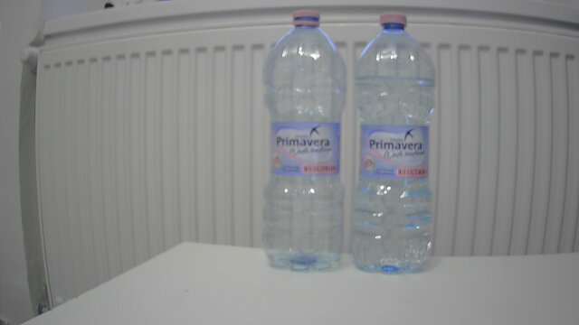

# Etap 1 – model: scena, środowisko, zgodność z TensorRT

Status: w trakcie (od 10.11.2026)

## Cel etapu
Własny detektor butelek (3 klasy) wytrenowany na laptopie, przeniesiony na
Jetsona jako silnik TensorRT i zmierzony w trzech precyzjach (FP32/FP16/INT8).

Wymagania z ogłoszenia: wizja komputerowa na linii pakującej, trening
w PyTorch, optymalizacja modeli pod NVIDIA Jetson (ONNX → TensorRT).

## Mapa: gdzie jesteśmy

Model przechodzi przez dwa urządzenia z różnymi wersjami CUDA. Łączy je
plik ONNX – niezależny od frameworka opis sieci (warstwy + wagi).

```
LAPTOP (Windows)                              JETSON NANO (Ubuntu 18.04)
Python 3.12, PyTorch 2.11 + CUDA 12.8         JetPack 4.6.1: CUDA 10.2, TensorRT 8.2.1
RTX 3050 Ti 4 GB                              GPU Maxwell, 4 GB współdzielone z CPU

  zdjęcia ─► trening (ultralytics) ─► .pt
                                       │
                         eksport ONNX  ▼
                                    model.onnx ──scp──► trtexec / TensorRT
                                                          │ budowa silnika
                                                          ▼ (tylko na Jetsonie)
                                                        model.engine ─► inferencja
```

| Pojęcie | Co to jest | Gdzie |
|---|---|---|
| **CUDA** | Platforma NVIDII do obliczeń na GPU. Wersja zależy od sterownika i biblioteki, która jej używa | Laptop: 12.8 (w kole PyTorch), Jetson: 10.2 (w JetPacku) |
| **PyTorch** | Framework do trenowania sieci. Koło `+cu128` ma w sobie biblioteki CUDA 12.8 – nie instalujemy CUDA osobno | Laptop |
| **ultralytics** | Biblioteka z modelami YOLO: trening, walidacja, eksport jedną komendą | Laptop |
| **ONNX** | Format wymiany modeli. Opset = wersja zestawu operacji; starszy odbiorca rozumie tylko starsze opsety | Plik przenoszony laptop → Jetson |
| **TensorRT** | Optymalizator i silnik inferencji NVIDII. Łączy warstwy, dobiera kernele pod konkretne GPU, obniża precyzję (FP16/INT8) | Jetson: 8.2.1 |
| **Silnik (.engine)** | Wynik budowy TensorRT. Związany z GPU i wersją TensorRT – budujemy go na Jetsonie, nie na laptopie | Jetson |
| **trtexec** | Narzędzie z TensorRT: buduje silnik z ONNX i mierzy jego wydajność | Jetson |

Dlaczego test zgodności (E1-02) przed zbieraniem zdjęć: TensorRT 8.2 pochodzi
z 2021 r. Nowsze architektury YOLO mogą eksportować operacje, których jego
parser ONNX nie zna. Sprawdzamy to na wagach bazowych, zanim w model
zainwestujemy dzień pracy.

## E1-01 – scena

### Zmiana kamery: RealSense → kamera USB ASUS

RealSense (etap 0) miała ręczną ekspozycję, ale scena była pod światło:
ciemna sylwetka butelki na jasnym tle. Druga kamera dała od razu lepszy
obraz, więc zmieniliśmy ją przed zebraniem pierwszego zdjęcia. Zmiana
kamery po zebraniu zbioru oznaczałaby nowy zbiór (inny obraz = inny rozkład
danych).

| Komenda (Jetson) | Do czego służy |
|---|---|
| `v4l2-ctl --list-devices` | Kamera i jej węzeł `/dev/videoN` |
| `v4l2-ctl -d /dev/video0 --list-formats-ext` | Formaty, rozdzielczości, FPS |
| `v4l2-ctl -d /dev/video0 -l` | Ustawienia kamery z zakresami |
| `lsusb` | Urządzenia USB (identyfikator producenta) |

Wynik:

| Format | Rozdzielczości @ 30 FPS |
|---|---|
| YUYV (surowy) | tylko 640x360 |
| MJPG | 1920x1080, 1280x720, 640x360 |
| H.264 (koder w kamerze) | 1920x1080, 1280x720, 640x360 |

Wybór: **YUYV 640x360 @ 30 FPS** – bez dekodowania, ten sam potok co
wcześniej. 360 px w pionie wystarcza: model i tak skaluje wejście do 640
z wypełnieniem (letterbox).

Ustawienia kamery: brightness, contrast, saturation, hue, balans bieli,
`power_line_frequency`, `exposure_absolute` (10–2000). **Brak
`exposure_auto` i `gain`.**

### Pomiar FPS i test ekspozycji

| Komenda | Wynik |
|---|---|
| `v4l2-ctl -d /dev/video0 --set-fmt-video=width=640,height=360,pixelformat=YUYV --stream-mmap --stream-count=300` przy `exposure_absolute=200` | 25 → 29 fps (rozgrzewanie) |
| to samo przy `exposure_absolute=2000` (teoretycznie 200 ms = 5 FPS) | 30 fps |
| zmiana 10 ↔ 2000 przy podglądzie na żywo | jasność bez zmian |

Wniosek: **kamera ignoruje `exposure_absolute` i ma własną automatyczną
ekspozycję.** Butelka przesuwana w realnym tempie była ostra, więc przy
obecnym świetle kamera dobiera wystarczająco krótki czas. Jedyna dźwignia
przeciw rozmyciu: więcej światła od przodu.

Znane ograniczenie (temat na rozmowę): automatyczna ekspozycja zmienia
jasność, gdy zmienia się zawartość kadru albo światło dzienne. W systemie
produkcyjnym wybralibyśmy kamerę przemysłową z ręczną ekspozycją i stałe
oświetlenie. Tutaj kompensujemy to zróżnicowaniem zbioru (różne pory dnia
w treningu i w zbiorze testowym).

### Podgląd na żywo: Jetson → laptop

Pulpit Jetsona jest wyłączony, więc obraz wysyłamy po sieci. Przy okazji
pierwszy potok ze sprzętowym koderem H.264 (wstęp do E2-05).

```
gst-launch-1.0 -e v4l2src device=/dev/video0 ! \
  video/x-raw,format=YUY2,width=640,height=360,framerate=30/1 ! \
  nvvidconv ! 'video/x-raw(memory:NVMM),format=I420' ! \
  nvv4l2h264enc insert-sps-pps=1 iframeinterval=30 bitrate=4000000 ! \
  h264parse ! rtph264pay config-interval=1 pt=96 ! \
  udpsink host=192.168.0.203 port=5000 sync=false
```

| Element | Rola |
|---|---|
| `v4l2src` | Odczyt z kamery |
| `nvvidconv` | Kopiuje klatkę do pamięci NVMM, z której czyta sprzętowy koder |
| `nvv4l2h264enc` | Sprzętowy koder H.264 (NVENC). `insert-sps-pps=1` + `iframeinterval=30` = klatka kluczowa z nagłówkami co sekundę, więc odbiornik może dołączyć w dowolnym momencie |
| `rtph264pay` + `udpsink` | Pakowanie w RTP i wysyłka UDP na laptop; `sync=false` – bez czekania na zegar |

Odbiór: VLC z plikiem `jetson.sdp` (opis strumienia RTP: port 5000,
H.264, typ ładunku 96). Wynik: obraz z opóźnieniem poniżej ok. 0,5 s;
koder zgłasza `H264: Profile = 66` (Baseline).

Weryfikacja wersji: właściwości `nvv4l2h264enc` sprawdzone na Jetsonie
(`gst-inspect-1.0 nvv4l2h264enc`) – źródło prawdy dla zainstalowanej wersji L4T.

### Ostrość, balans bieli, kadr

| Ustawienie | Wartość | Jak |
|---|---|---|
| Ostrość | ręczna | pierścień na obiektywie, potem zablokowany taśmą |
| Balans bieli | 5500 K, automatyka wyłączona | `v4l2-ctl -d /dev/video0 -c white_balance_temperature_auto=0 -c white_balance_temperature=5500` |
| Ekspozycja | automatyczna (ograniczenie kamery) | – |
| Tło | kaloryfer, okno poza kadrem | ustawienie stanowiska |

Balans bieli blokujemy, bo automatyka zmienia kolory, gdy w kadrze pojawia
się więcej lub mniej butelek – model widziałby tę samą butelkę w różnych
kolorach. Ustawienia `v4l2-ctl` znikają po restarcie lub odłączeniu kamery;
w E1-03 trafią do skryptu zbierania zdjęć.

Kolejne kadry i co poprawialiśmy:
1. Pokój w tle, butelka 1,5 l zajmuje cały kadr → za blisko, tło niejednolite.
2. Dwie butelki, ucięte dno → model musi widzieć cały obiekt.
3. Okno u góry kadru → zaburza automatyczną ekspozycję.
4. **Kaloryfer jako tło, całe butelki, okno poza kadrem → zaakceptowane.**



Zasady od teraz: kamery nie ruszamy (pozycja, kąt, ostrość). Butelek nie
stawiamy wyżej ani bliżej niż na zdjęciu. Do obejrzenia po treningu: paski
kaloryfera prześwitują przez przezroczyste butelki.

Zdjęcie sceny (30 klatek, bo automatyczna ekspozycja potrzebuje chwili po
starcie; bierzemy ostatnią):

```
gst-launch-1.0 v4l2src device=/dev/video0 num-buffers=30 ! \
  video/x-raw,format=YUY2,width=640,height=360,framerate=30/1 ! \
  jpegenc ! multifilesink location=scena_%02d.jpg
```

### Problemy po drodze

| Objaw | Przyczyna | Rozwiązanie |
|---|---|---|
| `Device '/dev/video0' is busy` | Osierocony `gst-launch` (PPID 1, brak terminala) – okno zamknięte bez Ctrl+C | `sudo fuser -v /dev/video0`, `ps -fp <PID>`, `kill <PID>` albo `pkill gst-launch` |
| VLC nie otwiera `jetson.sdp` | Plik miał 0 bajtów (Notatnik nie zapisał) | Plik tworzony w cmd blokiem `echo ... > plik` |
| `scp: No such file` | Zdjęcie nie powstało, bo kamera była zajęta | Zwolnić kamerę, `ls -l`, potem `scp` |
| Pobieranie PyTorch przerwane (`Operation cancelled by user`) | Wklejony blok komend – kolejne linie trafiły do działającego `pip` jako klawisze | Długie komendy wklejamy pojedynczo |

## E1-05 – środowisko treningowe (laptop)

Zrobione przed E1-02, bo eksport ONNX wymaga ultralytics.

| Komenda (laptop, cmd) | Do czego służy |
|---|---|
| `python --version` | 3.12.4 – wspierany przez PyTorch i ultralytics |
| `nvidia-smi` | Karta, sterownik 595.95, najwyższa obsługiwana CUDA: 13.2 |
| `python -m venv .venv` | Osobne środowisko Pythona w folderze projektu (`.venv/` w `.gitignore`) |
| `.venv\Scripts\activate` | Włącza środowisko (prefiks `(.venv)`); w każdym nowym oknie od nowa |
| `pip install torch torchvision --index-url https://download.pytorch.org/whl/cu128` | PyTorch z CUDA 12.8 (ok. 2,8 GB). Sterownik 595 obsługuje CUDA do 13.2, więc koło cu128 działa |
| `pip install ultralytics onnx` | YOLO + biblioteka ONNX do eksportu |
| `python -c "import torch; print(torch.__version__, torch.cuda.is_available(), torch.cuda.get_device_name(0))"` | Czy PyTorch widzi GPU |
| `yolo checks` | Pełny raport środowiska ultralytics |
| `pip list \| findstr /i "torch ultralytics onnx"` | Wersje do `requirements.txt` |

Kolejność ma znaczenie: PyTorch przed ultralytics. W odwrotnej pip dociągnie
PyTorch z PyPI, czyli wersję bez CUDA dla Windows.

Wynik `yolo checks`:

| Co | Wartość |
|---|---|
| Ultralytics | 8.4.208 |
| PyTorch | 2.11.0+cu128 |
| CUDA (w PyTorch) | 12.8 |
| GPU | NVIDIA GeForce RTX 3050 Ti Laptop GPU, 4096 MiB |
| CPU / RAM | i5-12500H, 16 wątków / 15,7 GB |
| Dysk | ok. 17 GB wolne – nie trzymamy kopii zbioru ani starych `runs/` |

Wersje przypięte w [`training/requirements.txt`](../training/requirements.txt).
Odtworzenie środowiska: `pip install -r training/requirements.txt` w nowym
`.venv`. Plik zawiera tylko pakiety instalowane ręcznie – pełny
`pip freeze` (ok. 40 pozycji) byłby nieczytelny i zależny od Windows.

## E1-02 – zgodność architektur z TensorRT 8.2

Cel: przejść całą drogę `.pt` → ONNX → silnik TensorRT na gotowych wagach
(COCO) trzech kandydatów, zanim zbierzemy zdjęcia i wytrenujemy model.

### Eksport ONNX (laptop)

Opset: dokumentacja parsera ONNX dla TensorRT 8.2 (onnx-tensorrt, gałąź
`8.2-GA`, `docs/operators.md`): *„TensorRT 8.2 supports operators up to
Opset 13”*. Domyślny opset nowego ultralytics jest wyższy.

| Komenda (laptop, `training\e1-02`, aktywne `.venv`) | Do czego służy |
|---|---|
| `yolo export model=yolov8n.pt format=onnx opset=13 imgsz=640 simplify=True` | Eksport; wagi bazowe pobierają się same. To samo dla `yolo11n.pt`, `yolo26n.pt` |
| `python -c "import onnx; ..."` (opset i kształt wyjścia) | Kontrola, czy w pliku jest opset 13 |
| `scp yolov8n.onnx yolo11n.onnx yolo26n.onnx grzegorz@192.168.0.124:~/e1-02/` | Kopiowanie na Jetsona |

Parametry: `imgsz=640` (stałe wejście 640x640 – prostokątne 640x384
w E1-07), `simplify=True` (onnxslim upraszcza graf), bez `half` (precyzję
ustawia TensorRT) i bez `dynamic` (stały rozmiar jest prostszy dla TRT 8.2).

Wynik: trzy pliki z opsetem 13, wszystkie z wyjściem `[1, 84, 8400]`
(4 współrzędne ramki + 80 klas COCO, 8400 kandydatów; NMS poza modelem).
YOLO26n też wyeksportował się z głowicą wymagającą NMS, a nie w wariancie
end-to-end (NMS-free) – ultralytics 8.4.208 podaje ten kształt już na
starcie eksportu, bez ostrzeżeń.

### Budowa silnika FP16 (Jetson)

```
/usr/src/tensorrt/bin/trtexec --onnx=yolov8n.onnx --saveEngine=yolov8n_fp16.engine \
  --fp16 --workspace=1024 2>&1 | tee build_yolov8n.log
grep -E "PASSED|FAILED|Throughput|GPU Compute Time: min" build_*.log
```

| Flaga | Znaczenie |
|---|---|
| `--fp16` | TensorRT może liczyć w 16 bitach tam, gdzie to szybsze |
| `--workspace=1024` | 1024 MB pamięci roboczej na budowę (składnia TRT 8.2; nowsze wersje: `--memPoolSize`) |
| `2>&1 \| tee plik.log` | Wynik na ekran i do pliku jednocześnie |

Przebieg budowy w logu: lista `[GpuLayer]` (parsowanie udane, warstwy po
łączeniu – `PWN(...)` to kilka operacji w jednym kernelu) → `Init cuBLAS`,
`Init cuDNN` → autotuning (bez `--verbose` nic nie wypisuje przez kilka-
kilkanaście minut) → zapis silnika → pomiar ok. 3 s → `&&&& PASSED`.

Komunikat `Some tactics do not have sufficient workspace memory to run` to
informacja (`[I]`), nie błąd: część implementacji nie zmieściła się
w 1024 MB i została pominięta. Porównanie 1024 vs 2048 MB – w E1-08.

Tryb mocy: `sudo nvpmodel -q` → **MAXN (tryb 0)**. Zegary dynamiczne
(bez `jetson_clocks`) – wszystkie trzy modele w tych samych warunkach,
więc porównanie między nimi jest uczciwe; do E1-08 ustalimy stałe zegary.

### Wyniki (FP16, 640x640, batch 1, Jetson Nano MAXN)

| Model | Silnik | Throughput | GPU Compute (średnio) | Latency (średnio) | Budowa | Plik silnika | Parametry | GFLOPs | mAP50-95 COCO* |
|---|---|---|---|---|---|---|---|---|---|
| YOLOv8n | PASSED | **20,7 qps** | **47,5 ms** | 48,2 ms | ok. 12 min | 13 MB | 3,2 M | 8,7 | 37,3 |
| YOLO11n | PASSED | 19,6 qps | 50,1 ms | – | ok. 14 min | 9,4 MB | 2,6 M | 6,5 | 39,5 |
| YOLO26n | PASSED | 20,0 qps | 49,2 ms | 49,9 ms | ok. 15 min | **9,0 MB** | **2,4 M** | **5,5** | **40,9** |

\* z dokumentacji Ultralytics, nie nasz pomiar.

YOLOv8n w szczegółach: kopiowanie CPU→GPU 0,49 ms, GPU→CPU 0,29 ms,
obliczenia 47,5 ms – **98% czasu to obliczenia na GPU**. Rozrzut
48,1–48,4 ms (stabilnie).

Pojęcia:
- **Throughput (qps)** – inferencje na sekundę; przy batch 1 ≈ maks. FPS
  samego modelu (bez kamery, NMS, trackingu).
- **Latency** – czas jednej inferencji z kopiowaniem danych.
- **GPU Compute Time** – samo liczenie na GPU.

### Wnioski

1. **Wszystkie trzy architektury działają z TensorRT 8.2** przy opset 13.
   Ryzyko ⚠ z backlogu zamknięte.
2. **FLOPs ≠ czas działania.** YOLOv8n ma najwięcej obliczeń (8,7 GFLOPs),
   a jest najszybszy; YOLO26n ma o 37% mniej i nie jest szybszy. Na GPU
   Maxwell liczy się, jak dobrze TensorRT łączy i optymalizuje konkretne
   warstwy – proste sploty YOLOv8 lepiej niż nowsze bloki. Różnice są małe
   (3-5%).
3. **ok. 20 FPS < 30 FPS kamery** przy 640x640, a to jeszcze bez NMS
   i trackingu. Skoro 98% czasu to obliczenia, przyspiesza tylko mniej
   obliczeń: wejście 640x384 (40% wejścia 640x640 to pasy letterboxa przy
   kamerze 640x360), stałe zegary, INT8 (do sprawdzenia na Maxwellu),
   w etapie 2 – inferencja co N-tą klatkę z trackingiem.

### Decyzja: YOLO26n

- szybkość praktycznie równa najszybszemu (20,0 vs 20,7 qps, ok. 3%);
- najwyższa dokładność na COCO (40,9 vs 37,3 dla YOLOv8n) – ważne dla
  małego szczegółu, jakim jest brak nakrętki;
- najmniej parametrów i najmniejszy silnik (9,0 MB) przy 4 GB współdzielonej
  pamięci;
- bez DFL (warstwa z softmaxem, słabo obsługiwana przez akceleratory brzegowe);
- wyjście `[1, 84, 8400]` jak w YOLOv8/11 – parser DeepStream (E2-03) ten sam
  dla każdej z trzech, więc wybór nie dokłada ryzyka.

Zastrzeżenie: na TensorRT 8.2 używamy wariantu z NMS, nie NMS-free.
Alternatywa przy twardym wymogu FPS: YOLOv8n (+3% szybkości, -3,6 pkt mAP).

## E1-03 – zbieranie zdjęć

### Skrypt `jetson/capture.py`

Działa na Jetsonie (tam jest kamera), zwykłym Pythonem 3.6 z OpenCV 4.1.1
z JetPacka – bez TensorRT. Sprawdzenie, czy OpenCV ma GStreamer:

```
python3 -c "import cv2; print(cv2.__version__); print([l.strip() for l in cv2.getBuildInformation().splitlines() if 'GStreamer' in l])"
# 4.1.1
# ['GStreamer:                   YES (1.14.5)']
```

| Element | Rola |
|---|---|
| GStreamer `tee` | Jedna kamera, dwóch odbiorców naraz: OpenCV (zapis) i koder H.264 (podgląd w VLC) |
| `appsink drop=true max-buffers=1` | OpenCV dostaje zawsze najnowszą klatkę |
| `set_white_balance()` | 5500 K przy każdym starcie (v4l2 nie pamięta po restarcie) |
| rozgrzewka 2 s | automatyczna ekspozycja się stabilizuje |
| `--interval` (domyślnie 8 s) | czas na przestawienie butelek; 1,5 s okazało się za mało |
| `session.txt` | data, tag, ustawienia i potok – po miesiącu wiadomo, skąd jest zdjęcie |
| `finally: cap.release()` | Ctrl+C zawsze zwalnia kamerę |

Zdjęcia: `~/dataset/raw/<data>_<godzina>_<tag>/` na Jetsonie, kopia na
laptopie w `data/raw/` (poza repozytorium – `.gitignore`).

Kod trafia na Jetsona przez `git clone` / `git pull`, nie przez wklejanie
w `nano` (wcięcia Pythona). Git na Ubuntu 18.04 to 2.17 – nie zna
`git switch`, zamiast tego `git checkout`.

Podgląd: najpierw uruchamiamy skrypt, potem ▶ w VLC. VLC czeka na dane
RTP tylko kilka sekund i sam się zatrzymuje.

### Sesje

| Sesja | Zdjęć | Ustawienie |
|---|---|---|
| `bottle` | 40 | 1–3 butelki z nakrętkami, różne miejsca i obroty |
| `missing_cap` | 50 | 1–2 butelki bez nakrętki (nakrętki poza kadrem) |
| `fallen` | 50 | 1–2 leżące (oba kierunki, skos), reszta stoi |
| `mixed` | 60 | wszystkie stany, butelki na krawędziach kadru, stykające się, zasłonięte |
| `empty` | 15 | samo tło – negatywy bez etykiet |
| **razem** | **215** | 9,6 MB, wieczór 10.11.2026, światło sztuczne |

Do uzupełnienia w razie potrzeby po etykietowaniu: sesja przy świetle
dziennym (automatyczna ekspozycja) i dodatkowe zdjęcia klasy z najmniejszą
liczbą obiektów.

Trzy jednakowe butelki, bez puszek i innych opakowań: linia rozlewa jeden
produkt, a obiekt spoza klas rozmywałby zbiór.

Komendy:

```
# Jetson
cd ~/linesight && git pull
python3 jetson/capture.py --tag bottle --count 40
for d in ~/dataset/raw/*/; do echo "$(ls "$d"*.jpg | wc -l)  $(basename "$d")"; done
du -sh ~/dataset/raw

# laptop (bez \ na końcu ścieżki docelowej – w Windows \" psuje cudzysłów)
scp -r grzegorz@192.168.0.124:~/dataset/raw/* "C:\Users\Grzesiek\Desktop\linesight\data\raw"
```

Zasady etykietowania: [`etykietowanie.md`](etykietowanie.md).

## E1-04 – etykietowanie (Ultralytics Platform)

### Podział przed etykietowaniem

`training/make_upload_zip.py` dzieli zdjęcia **warstwowo po sesjach**
(ok. 70/20/10, ziarno 42) i pakuje je do ZIP z folderami `train/ val/
test/` – Platform zachowuje podział z folderów. Lista plików z przypisaniem:
`training/splits/split_v1.csv` (w repozytorium). Dzielimy przed
etykietowaniem i zamrażamy zbiór testowy: wyniki kolejnych treningów są
porównywalne, a model nigdy nie widzi zdjęć testowych.

Wszystkie trzy części są etykietowane – test to „klucz odpowiedzi”, bez
niego nie ma mAP. Różnica: na teście nie trenujemy i nie dobieramy
ustawień, patrzymy na niego raz, na końcu.

### Etykietowanie

Platform: `Annotate → New Dataset` (Detect, Private) → ZIP → klasy w
kolejności `bottle`, `missing_cap`, `fallen` (indeksy 0, 1, 2). Ramki: SAM
(`S`) lub ręcznie (`V`); przy przezroczystych butelkach SAM łapie tło, więc
ramki poprawiane ręcznie do krawędzi butelki. Zasady:
[`etykietowanie.md`](etykietowanie.md).

Usunięte 1 zdjęcie z ręką w kadrze: `20261110_214546_mixed_0028.jpg`
(test) – `split_v1.csv` zaktualizowany do 214 pozycji.

### Wynik (z eksportu NDJSON)

| Część | Zdjęcia | Z ramkami | bottle | missing_cap | fallen |
|---|---|---|---|---|---|
| train | 150 | 140 | 213 | 72 | 89 |
| val | 43 | 40 | 58 | 25 | 27 |
| test | 21 | 19 | 29 | 10 | 13 |
| **razem** | **214** | **199** | **300** | **107** | **129** |

15 zdjęć bez ramek = sesja `empty` (negatywy, w tym kilka z leżącą
nakrętką – trudne negatywy). Nierównowaga klas ok. 2,8 : 1 (bottle stoi
prawie na każdym zdjęciu). Decyzja: **nie dorabiamy zdjęć na zapas** –
trenujemy, patrzymy na AP każdej klasy osobno i uzupełniamy dane tam, gdzie
model się myli (podejście data-centric).

### Pobranie na laptopa

Platform eksportuje tylko NDJSON (opis zbioru + rekord na zdjęcie: nazwa,
podział, ramki, link do pobrania ważny 7 dni). `training/prepare_dataset.py`
sprawdza rekordy (liczby, zgodność z `split_v1.csv`, zapomniane etykiety)
i funkcją `convert_ndjson_to_yolo` z ultralytics tworzy foldery YOLO
w `data/datasets/linesight-<hash>/` z `data.yaml`. Uwaga: w folderach
pliki mają nazwy ze skrótu treści (hash) – oryginalne nazwy są w NDJSON.

```
python training\make_upload_zip.py
python training\prepare_dataset.py data\export\linesight.ndjson
```

## E1-06 – trening i ocena modelu

### Komendy (laptop, aktywne `.venv`)

```
python training\train.py        # trening + ocena best.pt na val i jeden raz na test
python training\evaluate.py     # analiza na val: próg conf, błędy TP/FP/FN, mapy aktywacji
```

Wyniki: `runs\detect\yolo26n_v1\` (`runs/` poza repozytorium):
`weights/best.pt`, `summary.json`, `results.png`, `results.csv`, `labels.jpg`,
`analysis/report.md`.

### Transfer learning: co właściwie trenujemy

Startujemy z YOLO26n wytrenowanego na COCO (80 klas: ludzie, auta, butelki…).
Sieć ma dwie części:

| Część | Co umie po COCO | Co się dzieje u nas |
|---|---|---|
| backbone + neck (większość wag) | wyciąga cechy: krawędzie, kształty, materiały, przezroczystość | przenosimy i delikatnie dostrajamy |
| głowica detekcji | 80 wyjść klas | wymieniona na 3 wyjścia (`bottle`, `missing_cap`, `fallen`) i uczona od nowa |

Po treningu model zna **tylko nasze 3 klasy** – z COCO zostaje „umiejętność
patrzenia”, nie lista klas. Dlatego 214 zdjęć wystarcza; od zera trzeba by
dziesiątek tysięcy.

### Ustawienia `train.py`

| Ustawienie | Wartość | Dlaczego |
|---|---|---|
| `epochs` | 100 | maksymalna liczba przejść przez zbiór treningowy |
| `patience` | 30 | **early stopping**: stop, gdy mAP na val nie rośnie przez 30 epok – chroni przed uczeniem się na pamięć i oszczędza czas |
| `imgsz` | 640 | jak w teście TensorRT (E1-02); wejście prostokątne w E1-07 |
| `batch` | 16 | mieści się w 4 GB VRAM dla wariantu nano |
| `seed`, `deterministic` | 42, tak | powtórzony trening daje (prawie) te same liczby |
| `workers` | 4 | Windows: każdy proces ładujący dane zajmuje sporo RAM |
| augmentacje | domyślne ultralytics | mozaika (4 zdjęcia w jednym; wyłączana na ostatnie 10 epok – `close_mosaic=10`), odbicie poziome, zmiany jasności i koloru; przy 150 zdjęciach treningowych to główna ochrona przed przeuczeniem |

`best.pt` = wagi z epoki z najwyższym **mAP50-95 na val** (w ultralytics
8.4.208 wagi miary wyboru to `[P, R, mAP50, mAP50-95] = [0, 0, 0, 1]`).
`last.pt` = ostatnia epoka.

Co widać w konsoli w każdej epoce:
- **straty treningowe** (`box_loss` – położenie i rozmiar ramki, `cls_loss` – klasa)
  – mają spadać,
- **walidacja** na 43 zdjęciach: `P R mAP50 mAP50-95` – mają rosnąć,
- `GPU_mem` – zajętość VRAM.

### Metryki: co znaczą

**IoU** (Intersection over Union) = pole części wspólnej ramki modelu
i ramki z etykiety / pole ich sumy. 1 = idealnie, 0 = rozłączne. Predykcja
jest **trafieniem (TP)**, jeśli ma dobrą klasę i IoU ≥ progu (zwykle 0,5).

| Wynik | Znaczenie | Na linii |
|---|---|---|
| **TP** | dobra klasa, dobre miejsce | poprawna diagnoza |
| **FP** (fałszywy alarm) | ramka tam, gdzie nic nie ma, albo zła klasa | niepotrzebny alarm / postój – operatorzy przestają ufać systemowi |
| **FN** (przeoczenie) | obiekt bez ramki | przewrócona butelka nie wykryta = zator bez diagnozy; brak nakrętki przechodzi dalej |

| Metryka | Wzór / definicja | Pytanie, na które odpowiada |
|---|---|---|
| **Precision (P)** | TP / (TP + FP) | ile alarmów modelu jest prawdziwych? |
| **Recall (R)** | TP / (TP + FN) | ile prawdziwych obiektów model znalazł? |
| **F1** | 2·P·R / (P + R) | jedna liczba łącząca P i R; jej maksimum wyznacza próg pewności |
| **AP** | pole pod krzywą precision–recall dla jednej klasy | jak dobrze klasa wypada przy wszystkich progach pewności naraz |
| **mAP50** | średnie AP po klasach przy IoU ≥ 0,5 | czy model znajduje obiekty mniej więcej w dobrym miejscu |
| **mAP50-95** | średnie mAP przy IoU 0,50; 0,55; …; 0,95 | czy ramki są **dokładne** – kluczowe dla śledzenia i liczenia sztuk w etapie 2 |

Wysokie mAP50 przy niskim mAP50-95 = model znajduje butelki, ale ramki są
luźne (np. przez niespójne etykiety – dlatego zasady w `etykietowanie.md`).

Dla linii pakującej **recall klas `fallen` i `missing_cap` jest ważniejszy niż
precision**: przeoczony zator kosztuje więcej niż jeden fałszywy alarm.
Precision nie może jednak spaść za nisko – zbyt częste fałszywe alarmy
operatorzy zaczną ignorować.

### Wykresy i pliki: co z nich czytamy

| Plik | Co pokazuje | Decyzja, którą wspiera |
|---|---|---|
| `results.png` | straty i metryki w każdej epoce | **przeuczenie**: strata na val rośnie, a na train spada → mniej epok / więcej danych / augmentacja |
| `labels.jpg` | liczba ramek na klasę, mapy położenia i rozmiaru ramek | czy dane są zrównoważone; czy butelki stoją głównie po jednej stronie kadru |
| `confusion_matrix_normalized.png` | które klasy model myli; wiersz/kolumna „background” = fałszywe alarmy / przeoczenia | np. `missing_cap` mylone z `bottle` → więcej zdjęć szyjki |
| `BoxPR_curve.png` | precision vs recall dla każdej klasy | która klasa jest najsłabsza |
| `BoxF1_curve.png` | F1 vs próg pewności | **próg conf do wdrożenia** |
| `val_batchX_labels.jpg` / `_pred.jpg` | etykiety i predykcje obok siebie | szybki przegląd wzrokowy |
| `analysis/val_errors/` | każde zdjęcie z zaznaczonymi TP / FP / FN | analiza błędów na konkretnych przypadkach |
| `analysis/cam/*_cam.jpg` | **mapy aktywacji LayerCAM**: gdzie sieć „patrzy” | czy model patrzy na szyjkę i nakrętkę, a nie na kaloryfer (*shortcut learning*) |
| `analysis/report.md` | tabele, próg conf, najgorsze zdjęcia, czasy | treść do dokumentacji |

**Dwa progi, często mylone:**
- **conf** – minimalna pewność predykcji. Walidacja liczy mAP przy conf = 0,001
  (cała krzywa PR); do wdrożenia wybieramy próg z maksimum F1 na val.
- **IoU w NMS** – kiedy dwie ramki uznać za tę samą butelkę i zostawić jedną
  (domyślnie 0,7 w walidacji). To inny próg niż IoU ≥ 0,5 przy liczeniu TP.

### Dlaczego liczymy to właśnie teraz

1. **Wybór wag** – `best.pt` wybieramy na val, nie na ostatniej epoce.
2. **Decyzje o danych** (data-centric) – AP na klasę, macierz pomyłek
   i najgorsze zdjęcia mówią, czy dorabiać zdjęcia i jakie. Lepsze niż
   dorabianie „na zapas” przed treningiem.
3. **Zaufanie do modelu** – mapy aktywacji pokazują, czy model nauczył się
   właściwych cech, zanim zainwestujemy w TensorRT i DeepStream.
4. **Próg conf do wdrożenia** – trafi do konfiguracji DeepStream (etap 2).
5. **Punkt odniesienia dla E1-08** – po konwersji do TensorRT FP16/INT8
   porównamy mAP z wynikiem PyTorch. Bez tej liczby nie wiadomo, ile
   dokładności kosztuje przyspieszenie.

### Val a test

| Część | Zdjęcia | Rola |
|---|---|---|
| train | 150 | model się na nich uczy |
| val | 43 | ocena co epokę, wybór `best.pt`, próg conf, analiza błędów – **tu wolno podejmować decyzje** |
| test | 21 | **jedna** ocena na końcu, na zdjęciach nigdy nieużytych do decyzji – nieobciążona miara |

Uczciwe zastrzeżenie: test ma 21 zdjęć (ok. 52 obiekty), więc jedna pomyłka
przesuwa wynik o kilka punktów. W produkcji: większy zbiór testowy albo
walidacja krzyżowa (k-fold). Tu jako świadome ograniczenie MVP.

Czego nie liczymy: mAP dla małych / średnich / dużych obiektów (COCO: mały
< 32×32 px, duży > 96×96 px). Butelki mają ok. 80×280 px – prawie wszystkie
są „duże”, więc ta miara nic nie mówi.

### Wyniki

*(uzupełnione po treningu)*

## Do zrobienia w etapie 1
- [x] E1-01 – scena
- [x] E1-02 – zgodność z TensorRT 8.2 (wybrany YOLO26n)
- [x] E1-03 – skrypt zbierania zdjęć (215 zdjęć)
- [x] E1-04 – etykietowanie (214 zdjęć, 536 ramek)
- [x] E1-05 – środowisko treningowe
- [ ] E1-06 – trening
- [ ] E1-07 – eksport i silniki
- [ ] E1-08 – benchmark
- [ ] E1-09 – dokumentacja i pytania
