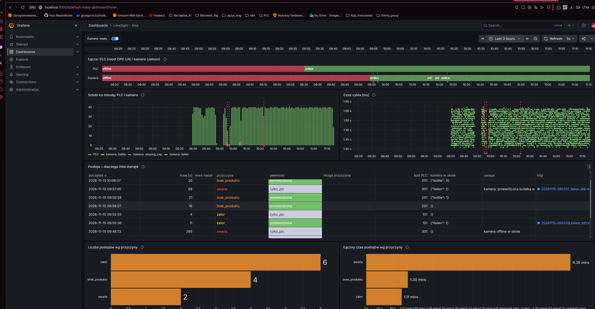
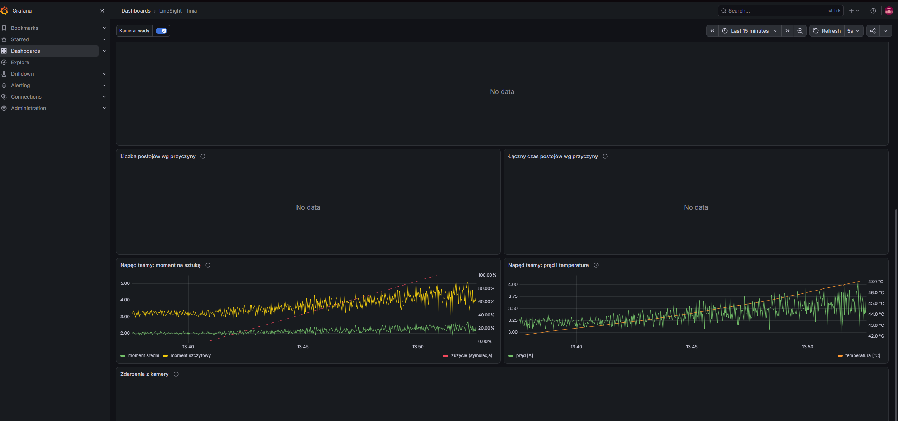
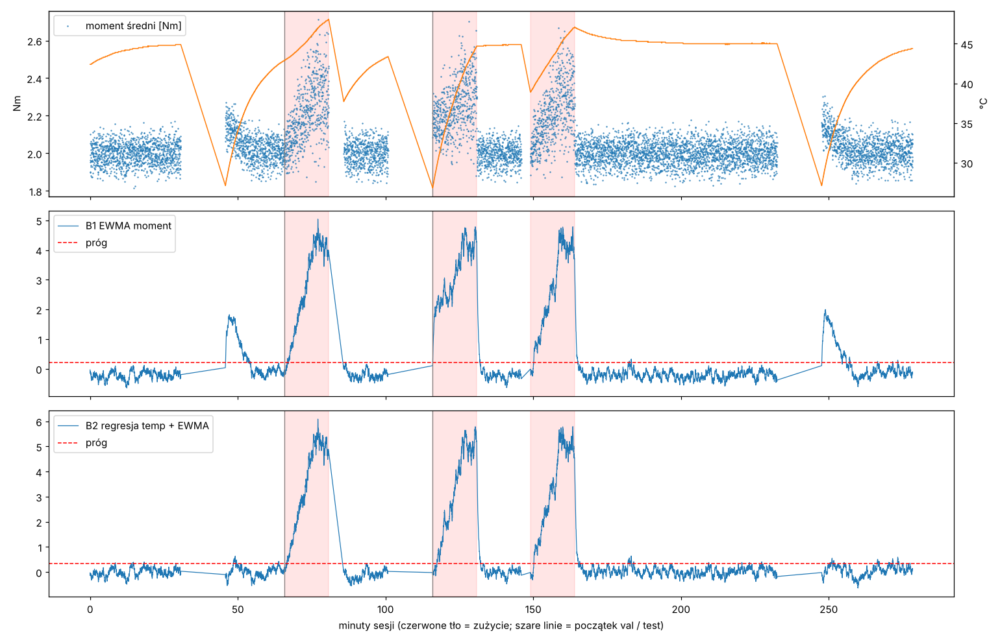
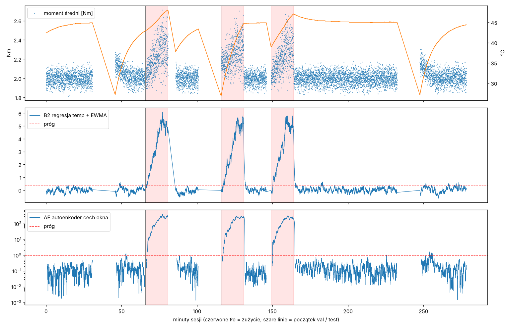
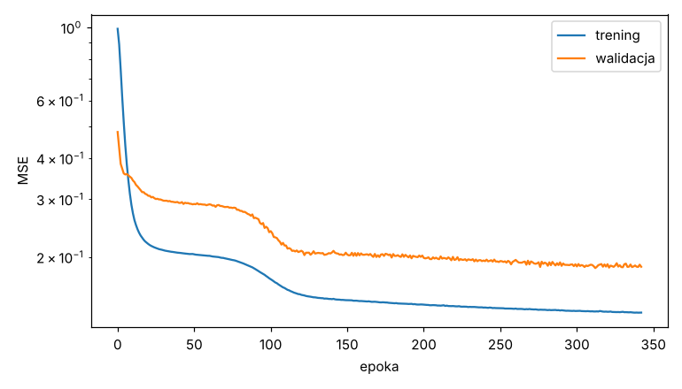

# Etap 4 – diagnostyka postojów

Cel: na pytanie „dlaczego linia stanęła” odpowiada zdarzenie postoju z przyczyną, dowodami (sygnały PLC
z 30 s wstecz, zdarzenia z kamery) i linkiem do klipu. Osobno model PyTorch (własna pętla treningowa)
wykrywa anomalie czasu cyklu, zanim linia stanie. Plan zadań: `docs/backlog.md`, sekcja „Etap 4”.

## E4-01 – Mosquitto: kolejka i trwałość (laptop)

Luka znaleziona przy pytaniach z etapu 3: ingest ma sesję trwałą, więc broker kolejkuje dla niego
wiadomości QoS 1, gdy ingest nie działa – ale:

| Problem | Przyczyna | Poprawka (`infra/mosquitto/mosquitto.conf`) |
|---|---|---|
| Przerwa ingest > ok. 8 min gubi dane | domyślnie `max_queued_messages 1000` na klienta, most wysyła ok. 120 wiad./min; nadmiar broker po cichu odrzuca | `max_queued_messages 100000` (≈ 14 h) |
| Restart brokera kasuje kolejkę, sesje trwałe i retained | `persistence false` – wszystko w RAM | `persistence true`, `persistence_location /mosquitto/data/`, wolumen `mosquitto-data` |
| Twarde zabicie brokera gubi do 30 min | zapis na dysk przy zatrzymaniu i co `autosave_interval` (domyślnie 1800 s) | `autosave_interval 60` |

Po co diagnostyce: postój bez sygnałów z 30 s wstecz jest nie do wyjaśnienia, a dziura w danych wygląda
jak postój. Wolumen nazwany (`mosquitto-data`) tworzy Docker; katalog `/mosquitto/data` w obrazie należy
do użytkownika `mosquitto`, więc broker ma prawo zapisu.

Uruchomienie (LAPTOP, w folderze repo):
```
git pull
docker compose -f infra/docker-compose.yml up -d mosquitto
docker logs --tail 20 linesight-mosquitto
```
Compose odtwarza tylko kontener `mosquitto` (zmieniona konfiguracja i wolumen). Most i ingest same się
połączą ponownie.

Test 1 – przerwa ingest 10 min (linia w `Execute`, 40 szt./min):
```
docker stop linesight-ingest
:: odczekać 10 min (ok. 1200 wiadomości > dawny limit 1000)
docker start linesight-ingest
docker exec linesight-db psql -U linesight -d linesight -c "SELECT count(*) AS wiersze, max(value)-min(value)+1 AS oczekiwane FROM plc_signal WHERE name='udiProdProcessed' AND time > now() - interval '15 minutes'"
```
`wiersze` = `oczekiwane` → licznik bez dziur (każda sztuka to jedna zmiana licznika).

Test 2 – restart brokera przy zatrzymanym ingest:
```
docker stop linesight-ingest
:: odczekać 2 min
docker restart linesight-mosquitto
docker start linesight-ingest
:: ponownie zapytanie z testu 1, okno '5 minutes'
```

Wynik (14.11, linia cały czas w `Execute`, 40 szt./min):
- Test 2 (restart brokera, ingest zatrzymany 2 min): 595 = 595 – kolejka i sesja trwała przetrwały restart.
- Test 1 (ingest zatrzymany 12 min): w ciągu 30 min `udiProdProcessed` 2038 → 3226, 1189 wierszy = 1189 oczekiwanych.
  Most wysyła 3 zmienne na sztukę (`udiProdProcessed`, `udiCycleTime_ms`, `rMachSpeed`) ≈ 120 wiad./min,
  więc w kolejce było ok. 1400 wiadomości – ponad dawny limit 1000. Bez dziur.
- Pułapka: zapytanie zaraz po `docker start` pokazało 30 = 30 – ingest dopiero oddawał kolejkę (zapis po jednej
  wiadomości). Dane z przerwy docierają z opóźnieniem; diagnostyka postoju (E4-02) musi na nie poczekać,
  zanim policzy okno 30 s.

## E4-02 – zdarzenie postoju (laptop)

Postój = od wyjścia ze stanu `Execute` (6) do powrotu do `Execute`. Cały łańcuch stanów (np. Stopping → Stopped →
Resetting → Idle → Starting) to jeden postój; zapisujemy **pierwszy** stan po Execute, bo on mówi, co zatrzymało linię:

| Pierwszy stan | Znaczenie | `iStopReason` |
|---|---|---|
| 11 Held | zator w maszynie | 101 |
| 5 Suspended | brak produktu na wejściu | 201 |
| 8 Aborting | awaria | 301 / 302 |
| 7 Stopping | zatrzymanie przez operatora | 1 |

Pliki:
- `infra/db/30-diag.sql` – tabela `stop_event` (zwykła, nie hypertabela: kilkadziesiąt wierszy dziennie);
  kolumny `cause`, `evidence`, `clip` wypełnią E4-03 i E4-04.
- `diag/stops.py` – `find_stops()`: czysta funkcja (lista zmian stanu → postoje), bez bazy; `diag/test_stops.py` – 8 testów
  (zator, pełny łańcuch operatora, awaria + drugi postój, powtórzona wartość po ponownym połączeniu mostu, postój trwający,
  start linii poza Execute to nie postój, brak wartości).
- `diag/diag.py` – usługa: co 5 s czyta historię `iStateCurrent` z ostatnich 24 h, wylicza postoje i zapisuje je
  **UPSERT-em** (`INSERT … ON CONFLICT (t_start) DO UPDATE` – wstaw, a gdy wiersz o tym kluczu już jest, zaktualizuj).
  Kod PLC: ostatnia wartość `iStopReason` najpóźniej 1 s po początku postoju.

Dlaczego odpytywanie bazy, a nie reakcja na wiadomość MQTT: dane z przerwy docierają z opóźnieniem (E4-01); każdy przebieg
liczy od nowa i zapisuje idempotentnie, więc spóźnione dane same poprawiają wynik, restart usługi niczego nie gubi ani nie
dubluje, a pierwszy przebieg odtwarza postoje z ostatniej doby. Koszt: opóźnienie do 5 s. Zakres zaczyna się najpóźniej
od początku najstarszego trwającego postoju – postój dłuższy niż 24 h też zostanie zamknięty.

Ograniczenie: gdy most nie ma połączenia z PLC, a linia w tym czasie stanie i ruszy, postoju nie zobaczymy
(most wysyła zmiany, nie historię). Oznaczanie takich luk – E4-03 (`link_status`).

Uruchomienie (LAPTOP):
```
git pull
git checkout etap4/e4-02-stop-event
docker exec -i linesight-db psql -U linesight < infra\db\30-diag.sql
python diag\test_stops.py
docker compose -f infra/docker-compose.yml up -d --build diag
docker logs linesight-diag
docker exec linesight-db psql -U linesight -d linesight -c "SELECT to_char(t_start, 'MM-DD HH24:MI:SS') AS start_utc, round(extract(epoch FROM t_end - t_start)) AS s, state, stop_reason FROM stop_event ORDER BY stop_event.t_start"
```
Test na żywo: w CODESYS `xInjJam := TRUE` → w ciągu 5 s w logu `NOWY postój …, stan 11 (Held), kod PLC 101`;
`xInjJam := FALSE` → `ZMIANA postój … – <koniec>`.

Wynik (15.11):
- `8 testów zaliczonych`; pierwszy przebieg odtworzył 5 postojów z 14.11 (16:25–17:49 UTC).
- Test na żywo, 3 × `xInjJam`: postoje 12, 16 i 13 s, stan 11 (Held), kod 101; wiersz pojawia się w ciągu 5 s
  jako „trwa”, w następnym przebiegu po powrocie do Execute dostaje koniec.
- Stan **0** (14.11 17:08:47–17:14:14, 327 s, kod 0): wgrywanie poprawionego programu – po pobraniu zmienne startują
  od 0. Linia naprawdę nie pracowała, więc postój zostaje; przyczyna „restart PLC / brak danych” w E4-03.
- Held do 17:02:33.131, Suspended od 17:02:33.328: między postojami jeden cykl zadania (200 ms) w Execute.
  Dla operatora to jeden postój z dwiema przyczynami → w E4-03 łączenie postojów oddzielonych pracą < 2 s.
- Pułapka w zapytaniu: `ORDER BY t_start` po `t_start::time` sortowało wg aliasu (sama godzina, bez daty) –
  postoje z 15.11 wyszły przed 14.11. Poprawka: `ORDER BY stop_event.t_start` i data w wyniku.

## E4-03 – reguły przyczyny (laptop)

`diag/rules.py` – `classify()`: czysta funkcja, 10 testów w `diag/test_rules.py`. `diag.py` dla każdego postoju zbiera
z bazy: kod `iStopReason`, `signals_before(t_start, 30 s)`, zdarzenia kamery od −30 s do +10 s (klasa jest ustalana
ok. 5 s po przecięciu linii) i stan łącza z PLC (`link_status`). Wynik: `cause`, `confidence`, `evidence` (JSON).

| Przyczyna (`cause`) | Skąd | `confidence` |
|---|---|---|
| `zator` | kod 101 / stan Held | `potwierdzona`, gdy kamera widziała przewróconą butelkę (`fallen`) w oknie; inaczej `tylko_plc` |
| `brak_produktu` | kod 201 / Suspended | `potwierdzona`, gdy żadna butelka nie przeszła przez ≥ 10 s przed postojem; `sprzeczna`, gdy przeszła |
| `awaria` | kod 301, 302 / Aborting | `tylko_plc` (kamera nie widzi awarii napędu) |
| `operator` | kod 1 / Stopping | `tylko_plc` |
| `restart_plc` | stan spoza PackML (0 po wgraniu programu) | `tylko_plc` |

Dodatkowo:
- Łączenie postojów (`merge_stops`): praca krótsza niż 2 s między postojami = jeden postój; druga przyczyna
  w `evidence.secondary`. Rekord połączonego postoju usługa usuwa (`USUNIĘTY` w logu).
- Brak połączenia z PLC w oknie → `tylko_plc` (nie ufamy kolejności zdarzeń).
- Kamera offline w oknie (`link_status`, źródło `vision`) → `tylko_plc` z notatką: brak zdarzeń z wyłączonej kamery
  nie jest dowodem „braku produktu” *(poprawka po teście 15.11)*.
- Okno kamery zaczyna się najwcześniej na końcu poprzedniego postoju: przewrócona butelka, która wyjaśniła poprzedni
  zator, nie potwierdza kolejnego *(poprawka po teście 15.11)*.
- Zmienne `xInj*` **nie są wejściem reguł** – to „prawda” symulacji, w zakładzie jej nie ma. Trafiają do `evidence.sim`
  i posłużą do oceny trafności reguł. Użycie ich w regułach dawałoby 100 % trafności z przecieku etykiety.
- Pewność to zgodność dwóch niezależnych źródeł, nie prawdopodobieństwo. `sprzeczna` jest najcenniejsza: albo czujnik
  PLC się myli, albo kamera – w obu przypadkach ktoś powinien to obejrzeć.

Sprawdzone lokalnie (PostgreSQL 16): zator z `fallen` 4 s wcześniej → `zator / potwierdzona`, połączony z Suspended
200 ms później (`secondary: brak_produktu`, stary rekord usunięty); brak produktu z butelką 2 s wcześniej → `sprzeczna`;
stan 0 → `restart_plc`; drugi przebieg bez zmian.

Uruchomienie (LAPTOP):
```
git pull
git checkout etap4/e4-03-rules
docker exec -i linesight-db psql -U linesight < infra\db\30-diag.sql
python diag\test_rules.py
docker compose -f infra/docker-compose.yml up -d --build diag
docker logs linesight-diag
docker exec linesight-db psql -U linesight -d linesight -c "SELECT to_char(t_start, 'MM-DD HH24:MI:SS') AS start_utc, round(extract(epoch FROM t_end - t_start)) AS s, cause, confidence, evidence->'vision'->'counts' AS kamera, evidence->'sim' AS sim FROM stop_event ORDER BY stop_event.t_start"
```

Scenariusze na żywo (każdy oddzielony ≥ 30 s pracy, żeby okna się nie nakładały):

| # | Na scenie | W CODESYS | Oczekiwane |
|---|---|---|---|
| A | przeciągnąć przewróconą butelkę przez linię | po ok. 5 s `xInjJam` TRUE, po 10 s FALSE | `zator / potwierdzona` |
| B | nic (albo stojące butelki) | `xInjJam` TRUE → FALSE | `zator / tylko_plc` |
| C | ≥ 15 s nic nie przesuwać | `xInjNoProduct` TRUE → FALSE | `brak_produktu / potwierdzona` |
| D | przesuwać butelki do samego końca | `xInjNoProduct` TRUE → FALSE | `brak_produktu / sprzeczna` |
| E | przeciągnąć przewróconą butelkę | `xInjFault` TRUE → FALSE, Clear, Reset, Start | `awaria / tylko_plc`, w dowodach `fallen` |

Wynik – pierwsza próba (15.11, 08:47–08:57 UTC), przed poprawkami:

| Postój | Scenariusz | Wynik | Ocena |
|---|---|---|---|
| 08:47:48 | brak produktu, **kamera wyłączona** | `brak_produktu / potwierdzona` | **błąd reguły**: brak zdarzeń z wyłączonej kamery uznany za dowód |
| 08:48:13 | awaria | `awaria / tylko_plc` | OK |
| 08:55:36 | A: przewrócona + zator | `zator / potwierdzona`, `fallen: 1` | OK |
| 08:55:55 | B: zator bez wady, **19 s po A** | `zator / potwierdzona`, `fallen: 1` | **błąd reguły**: butelka z A w oknie B |
| 08:56:07 | C: brak produktu, scena pusta | `brak_produktu / potwierdzona` | OK |
| 08:56:28 | D: brak produktu, butelki płyną | `brak_produktu / potwierdzona`, `bottle: 1` | do wyjaśnienia (czas butelki względem postoju) |
| 08:57:00 | E: przewrócona + awaria | `awaria / tylko_plc`, `fallen: 1` | OK |

Połączenie postojów z 14.11 zadziałało: 17:01:59 trwa 36 s (zator + brak produktu), rekord Suspended z 17:02:33 usunięty.
Po poprawkach (ta sama doba przeliczona przez usługę): 08:47:48 → `tylko_plc` (`offline_in_window: true`),
08:55:55 → `tylko_plc` (puste `counts`), 08:56:28 → `potwierdzona` słusznie (`last_item_s_before: null` – butelka
przeszła dopiero po postoju). Powtórka D (09:06:07): 6 butelek, ostatnia 15,7 s przed postojem → `potwierdzona` –
reguła poprawna, to czas przełączenia zmiennej w CODESYS (jedna osoba nie przesunie butelki i nie kliknie naraz).
Progu 10 s nie zmieniamy pod test (40 szt./min = sztuka co 1,5 s, 10 s ciszy ≈ 6 brakujących sztuk);
`sprzeczna` pokrywa test jednostkowy. Ułatwienie na przyszłość: Prepared value + Ctrl+F7 (Write values).
Obie poprawki sprawdzone lokalnie (11 testów + przypadek „przewrócona butelka w czasie poprzedniego postoju” → `tylko_plc`).

## E4-04 – klip przy postoju (Jetson + laptop)

- **Jetson:** katalog klipów udostępnia wbudowany serwer HTTP Pythona: `cd ~/linesight_clips && python3 -m http.server 8080`
  (Python 3.6 nie ma jeszcze opcji `--directory`, dodanej w 3.7). Tylko odczyt plików, bez instalacji czegokolwiek;
  w zakładzie: nginx z hasłem albo wysyłka klipów do magazynu (etap 6).
- **Jetson, `linesight_app.py`:** ffmpeg z `-movflags +faststart` – indeks pliku MP4 (`moov`) na początku, więc przeglądarka
  zaczyna odtwarzać od razu, bez pobierania całego pliku (`http.server` nie obsługuje zapytań o zakres bajtów). Dotyczy
  klipów nagranych po aktualizacji.
- **Laptop, `diag`:** `pick_clip()` w `rules.py` (3 testy): spośród zdarzeń kamery w oknie postoju z klipem wybiera klasę
  pasującą do przyczyny (`fallen` przy zatorze), potem zdarzenie najbliższe początkowi postoju (przy remisie wcześniejsze).
  `stop_event.clip` = `CLIP_URL` + nazwa pliku (`CLIP_URL` w `docker-compose.yml`), `evidence.clip_at_s` = czas klipu
  względem postoju. Brak klipu (`NULL`) = kamera nie widziała wady – informacja, nie błąd.

Uruchomienie:
```
# SSH1 (Jetson): Ctrl+C w działającej aplikacji, potem
cd ~/linesight && git pull
cd deepstream && python3 linesight_app.py --rtsp --clips --mqtt 192.168.0.203
# SSH2 (Jetson)
cd ~/linesight_clips && python3 -m http.server 8080
# LAPTOP
git pull
git checkout etap4/e4-04-clips
python diag\test_rules.py
docker compose -f infra/docker-compose.yml up -d --build diag
```
Przeglądarka: http://192.168.0.124:8080/ – lista klipów. Test: przewrócona butelka przez linię, po ok. 5 s `xInjJam` TRUE → FALSE;
po ok. 20 s (klip: 10 s przed i 5 s po zdarzeniu + domknięcie kawałka):
```
docker exec linesight-db psql -U linesight -d linesight -c "SELECT to_char(t_start, 'HH24:MI:SS') AS start_utc, cause, confidence, evidence->'clip_at_s' AS klip_s, clip FROM stop_event WHERE t_start > now() - interval '1 hour' ORDER BY stop_event.t_start"
```

Wynik (15.11): zator 09:23:02 UTC → `zator / potwierdzona`, klip `20261115-102252_fallen_id1.mp4` (−10,5 s względem
postoju), odtwarzany w przeglądarce z http://192.168.0.124:8080/. Usługa dopisała też klipy do wcześniejszych postojów:
08:55:36 zator (−6,7 s), 08:57:00 awaria (+7,1 s – przewrócona butelka po zatrzymaniu, jako dowód, nie przyczyna).
Postoje bez wady w kadrze (B, C, D) – bez klipu, zgodnie z założeniem.
Poprawka po teście Grafany: stary klip (bez `faststart`) nie ładował się, a serwer przestawał odpowiadać.
`python3 -m http.server` w Pythonie 3.6 jest **jednowątkowy** (`ThreadingHTTPServer` jest od 3.7) – przeglądarka, która trzyma
połączenie z klipem, blokuje wszystkie kolejne zapytania. Zamiast niego `jetson/serve_clips.py` (`ThreadingMixIn`, wątek na
zapytanie): `python3 ~/linesight/jetson/serve_clips.py`. Stare klipy można przepakować z `faststart` (bez kodowania):
`for f in ~/linesight_clips/2026111[34]*.mp4 ~/linesight_clips/20261115-09*.mp4; do ffmpeg -loglevel error -y -i "$f" -c copy -movflags +faststart /tmp/x.mp4 && mv /tmp/x.mp4 "$f"; done`.
Pułapka: serwer żyje tylko w otwartym oknie SSH (Ctrl+C / `exit` go zatrzymuje) – trwałe uruchomienie
(usługa systemd) w etapie 7, jeśli będzie potrzebne do demo.

## E4-05 – Grafana: postoje (laptop)

Dashboard „LineSight – linia” (`infra/grafana/dashboards/linesight.json`), nowe panele pod wykresami sztuk i czasu cyklu:

| Panel | Dane |
|---|---|
| **Postoje – dlaczego linia stanęła** (tabela) | `stop_event` z zakresu czasu: początek, czas trwania, „trwa nadal”, przyczyna (kolor), pewność (tło: zielone potwierdzona, czerwone sprzeczna), druga przyczyna, kod PLC, co kamera widziała w oknie, uwaga, **klip** – nazwa pliku jako link do serwera HTTP na Jetsonie |
| **Liczba postojów wg przyczyny** (słupki) | `count(*)` wg `cause` |
| **Łączny czas postojów wg przyczyny** (słupki) | suma czasu postojów **przycięta do zakresu** (`LEAST`/`GREATEST`) – postój dłuższy niż zakres liczy się tylko w części, która się w nim mieści; to analiza Pareto: od której przyczyny zacząć poprawę |

Postój „należy” do zakresu, gdy na niego zachodzi (`t_start <= koniec zakresu AND koniec postoju >= początek zakresu`),
a nie tylko gdy w nim się zaczął – inaczej postój trwający od wczoraj zniknąłby z widoku. Link do klipu: mapowanie wartości
typu regex skraca URL do nazwy pliku, a łącze danych (`${__value.raw}`) otwiera pełny adres w nowej karcie.

Uruchomienie (LAPTOP): Grafana czyta pliki dashboardów co kilkanaście sekund; restart przyspiesza.
```
git pull
git checkout etap4/e4-05-grafana
docker restart linesight-grafana
```
http://localhost:3000, zakres „Last 3 hours” (postoje z porannych testów).

Wynik (15.11, zakres 3 h): tabela pokazuje wszystkie postoje dnia z przyczyną, pewnością i uwagami („kamera offline w oknie”
dla porannych zatorów sprzed uruchomienia Jetsona, „kamera: przewrócona butelka w oknie” przy awarii 09:57); klipy klikalne.
Słupki: zator 6, brak produktu 4, awaria 2; łączny czas: awaria 6,39 min (295 + 89 s), brak produktu 1,30 min, zator 1,11 min –
mało częste awarie kosztują najwięcej czasu, czyli dokładnie to, co pokazuje analiza Pareto.



## E4-06 – napęd taśmy: symulacja i dane

**Zmiana planu (15.11):** zamiast anomalii czasu cyklu – kondycja napędu. Ogłoszenie wprost: „analiza trendów parametrów
i ocena kondycji napędów na podstawie momentu obrotowego”. Czas cyklu był złym sygnałem: skok +40 % łapie zwykły próg,
model niczego by nie wniósł.

### Symulacja w PLC (`plc/src/FB_DriveSim.st`, `F_Gauss.st`)

| Sygnał | Model | Po co |
|---|---|---|
| `rTorqueMean_Nm` | 2,0 Nm × (1 + 0,15·zużycie + zimno) + szum 0,06 Nm × (1 + 1,5·zużycie) | główny sygnał kondycji |
| `rTorquePeak_Nm` | średni × (1,6 + 0,25·zużycie) + szum 0,08 Nm × (1 + 2·zużycie) | zużycie zmienia kształt cyklu (udary), nie tylko średnią |
| `rCurrent_A` | 0,8 A + 1,2 A/Nm × moment + szum 0,02 A | prąd, który w zakładzie mierzy falownik |
| `rMotorTemp_C` | dT/dt = (22 °C + 2,25·I² − T) / 600 s, poza Execute I = 0 | inercja cieplna: ok. 45 °C w pracy, stygnie w postoju |
| `rSimWear` | 0 → 1 liniowo przez `tWearRamp` (20 min) przy `xInjWear`; bez = 0 (naprawa) | **prawda symulacji** – tylko do oceny |

**Zimny start** (zimno = 0,12 × (40 °C − T) / 18 °C, w zakresie 0..0,12): zimny smar zwiększa tarcie, więc po każdym dłuższym
postoju moment jest wyższy o do 12 %, tyle co średnie zużycie. To celowa pułapka dla prostych metod: symulacja w Pythonie
(sesja z postojem 15 min) – EWMA na samym momencie była w alarmie przez ok. 1/3 normalnej pracy. Metoda, która zna temperaturę
(regresja albo model wielu cech), musi odróżnić zimny start od zużycia.

Wartości na sztukę (jak napęd raportujący parametry cyklu), zaokrąglone (moment, prąd 0,001; temperatura 0,1 °C; zużycie 0,01),
żeby OPC UA nie wysyłał zmian co 10 ms. Dochodzi ok. 3 wiadomości na sztukę + kilka na minutę temperatury.

Grafana: „Napęd taśmy: moment na sztukę” (średni, szczytowy, zużycie przerywaną linią na prawej osi) i „prąd i temperatura”.



### Wgranie (CODESYS, online change)
1. Application → Add Object → **POU** → `F_Gauss`, typ *Function*, zwracany typ `REAL` → wkleić `plc/src/F_Gauss.st`.
2. Application → Add Object → **POU** → `FB_DriveSim`, typ *Function Block* → wkleić `plc/src/FB_DriveSim.st`.
3. `GVL_Line` – dopisać zmienne z `plc/src/GVL_Line.st` (`xInjWear`, `tWearRamp`, blok „napęd taśmy”).
4. `PLC_PRG` – zmiany z `plc/src/PLC_PRG.st` (`xPiece`, `fbDrive` w deklaracjach; `xPiece := tonCycle.Q;`; blok „napęd taśmy”
   przed „Status na zewnątrz”).
5. Build (F11) → 0 błędów; **Symbol Configuration**: nowe zmienne `GVL_Line` zaznaczone (Build odświeża listę).
6. Online → Login → **Login with online change** (nie pełne pobranie: wartości liczników zostają).

Laptop: most z nowymi zmiennymi i dashboard:
```
git pull
git checkout etap4/e4-06-drive
docker compose -f infra/docker-compose.yml up -d --build bridge
docker restart linesight-grafana
docker exec linesight-db psql -U linesight -d linesight -c "SELECT name, count(*), round(min(value)::numeric,3) AS min, round(max(value)::numeric,3) AS max FROM plc_signal WHERE time > now() - interval '5 minutes' GROUP BY name ORDER BY name"
```

Wynik (15.11): most subskrybuje 15 zmiennych; w pracy (silnik 34–35 °C) moment średni 1,94–2,20 Nm, szczytowy 3,02–3,57 Nm,
prąd 3,12–3,43 A, ok. 40 wartości na minutę (1 na sztukę). Pułapki: (1) laptop na starej gałęzi – most zbudowany ze starą listą
zmiennych (log: „subskrypcja 9 zmiennych”); (2) w CODESYS zmienna `s` – `S` i `R` to słowa kluczowe IEC (Set/Reset), stąd `rSum`.

### Sesja danych (`tools/scenario.py`)

Skrypt steruje linią przez OPC UA (zapis komend PackML jako zbocza, `xInjWear`, `tWearRamp` = 10 min) według planu
(ok. 2 h 50 min): praca, postoje 3/5/15 min (zimne starty), 3 epizody zużycia po 15 min, w tym jeden zaraz po zimnym starcie.
Dziennik kroków: `data/scenario_<czas>.csv`. Prawdą o zużyciu dla modelu jest `rSimWear` w bazie.
```
python tools\scenario.py --dry
python tools\scenario.py --scale 0.05
python tools\scenario.py
```
`--scale 0.05` – próba mechaniki w ok. 9 min (każdy krok 20× krótszy).

### Zbiór i baseline (`anomaly/`)

| Plik | Co robi |
|---|---|
| `anomaly/data.py` | surowe sygnały → jedna sztuka = jeden wiersz (kotwica: licznik sztuk; moment i prąd z tej samej próbki ±0,3 s, inaczej ostatnia znana; temperatura, zużycie, stan – ostatnia znana), odcinki pracy, epizody zużycia, **podział wg czasu**: train = przed 1. epizodem, val = do 2. epizodu, test = reszta |
| `anomaly/metrics.py` | alarm = wynik nad progiem przez ≥ 20 sztuk (ok. 30 s, jak opóźnienie alarmu w SCADA); próg = kwantyl 99,9 % wyniku w normalnej części walidacji; wykrycie i opóźnienie dla każdego epizodu, zużycie w chwili alarmu, fałszywe alarmy na godzinę pracy normalnej (bez 2 min po naprawie) |
| `anomaly/baseline.py` | B1: EWMA (λ = 0,05) na momencie; B2: wielomian 2. stopnia moment ~ temperatura (temperatura przycięta do zakresu treningu) + EWMA na reszcie; tabela, `data/baseline.png` |
| `anomaly/sim.py` | kopia `FB_DriveSim` i scenariusza w Pythonie – **tylko do testów kodu** bez sterownika, nie do treningu |

Dlaczego podział wg czasu, nie losowy: sąsiednie sztuki są prawie identyczne – losowe tasowanie przeniosłoby
informację z testu do treningu, a model w produkcji i tak widzi tylko przeszłość.

Dokładka `python tools\scenario.py --extra` (postój 15 min + praca 20 min): część testowa bez niej nie miała zimnego
startu bez zużycia, czyli nie sprawdzała fałszywych alarmów po postoju – głównej pułapki dla B1.

Na danych z `anomaly/sim.py` (sprawdzenie kodu): B1 – 18 % normalnej pracy testu w alarmie (zimny start), B2 – 0 fałszywych
alarmów, wykrycie przy 19–24 % zużycia. Poprzeczka dla modelu: wcześniej niż B2, bez fałszywych alarmów.



Eksport z bazy i uruchomienie (LAPTOP, po sesji i dokładce):
```
docker exec linesight-db psql -U linesight -d linesight -c "\copy (SELECT extract(epoch FROM time) AS t, name, value FROM plc_signal WHERE name IN ('udiProdProcessed','iStateCurrent','rTorqueMean_Nm','rTorquePeak_Nm','rCurrent_A','rMotorTemp_C','rSimWear','xInjWear') AND time > '2026-11-15 11:35:00+00' ORDER BY time) TO STDOUT WITH CSV HEADER" > data\drive_raw.csv
python anomaly\data.py data\drive_raw.csv
python anomaly\baseline.py data\drive_raw.csv
```

Wynik na danych z PLC (sesja 15.11, 12:35–17:03; 8918 sztuk: train 2010, val 1189, test 5719; 3 epizody zużycia):

| Metoda | Część | Wykryte | Opóźnienie [min] | Zużycie przy alarmie | Fałszywe alarmy/h | Normalna praca w alarmie |
|---|---|---|---|---|---|---|
| B1 EWMA moment | val | 1/1 | 1,9 | 18 % | 0 | 0 % |
| B1 EWMA moment | test | 2/2 | 0,5; 1,6 | 5 %; 16 % | 1,10 | **6,6 %** |
| B2 regresja temp + EWMA | val | 1/1 | 1,4 | 13 % | 0 | 0 % |
| B2 regresja temp + EWMA | test | 2/2 | 1,9; 1,6 | 19 %; 16 % | 0,55 | 0,2 % |

Wnioski: B1 alarmuje po każdym zimnym starcie (6,6 % normalnej pracy w alarmie), a jego „wykrycie” 2. epizodu po 0,5 min
to zasługa zimnego startu, nie zużycia. B2 zna temperaturę – wykrywa przy 16–19 % zużycia, 1 fałszywy alarm na ok. 2 h.
Poprzeczka dla modelu: wcześniej niż B2, bez fałszywych alarmów.

Jakość danych: 7 na ok. 9000 zmian licznika sztuk nie dotarło do bazy (licznik +2 po ok. 3 s, bez postoju) – pojedyncza
zgubiona wiadomość nie przerywa odcinka pracy (`data.py`); przyczyna (próbkowanie OPC UA czy most) do sprawdzenia.
Pułapka eksportu: przed pierwszą zmianą stanu w oknie eksportu stan jest nieznany (most wysyła zmiany) – sztuka i tak
oznacza Execute, inaczej wypadało pierwsze 30 min sesji.

## E4-07 – model kondycji napędu w PyTorch (laptop)

`anomaly/model.py`: autoenkoder **cech okna**, własna pętla treningowa (`Dataset`, `DataLoader`, Adam, MSE, walidacja,
early stopping z zapisem najlepszych wag), eksport ONNX i parametrów wdrożenia (`models/drive_ae.json`).

- Okno: ostatnie 32 sztuki (ok. 50 s) w obrębie odcinka pracy → 7 cech: średni moment średni i szczytowy, średni prąd,
  temperatura, odchylenie momentu średniego i szczytowego, średni stosunek szczyt/średni. Normalizacja z treningu.
- Sieć: 7 → 16 → **2** → 16 → 7 (Tanh), 329 parametrów; uczona tylko na pracy normalnej (z zimnym startem).
- Wynik = błąd odtworzenia cech okna (MSE); próg i alarm jak w baseline (99,9 % walidacji, 20 sztuk nad progiem).

**Pierwsza wersja nie wyszła:** autoenkoder surowego okna (32 × 4 wartości → 16 → 32 × 4) wykrywał przy 29–30 % zużycia,
gorzej niż B2. Uczył się głównie odtwarzać szum pojedynczych sztuk, którego nie da się przewidzieć. Uśrednienie w oknie
usuwa szum. W (16/32) i gardło (2/3) wybrane po wynikach na **walidacji**; test uruchomiony raz, na końcu.

Wynik (te same dane, ziarno 0):

| Metoda | Część | Wykryte | Opóźnienie [min] | Zużycie przy alarmie | Fałszywe alarmy/h |
|---|---|---|---|---|---|
| B2 regresja temp + EWMA | val | 1/1 | 1,4 | 13 % | 0 |
| B2 regresja temp + EWMA | test | 2/2 | 1,9; 1,6 | 19 %; 16 % | 0,55 |
| AE cech okna | val | 1/1 | 1,6 | 15 % | 0 |
| AE cech okna | test | 2/2 | 1,8; 1,4 | **17 %; 14 %** | **0** |

Uczciwie: na teście AE wykrywa ok. 2 punkty procentowe zużycia wcześniej i bez fałszywego alarmu, na walidacji B2 jest
o 2 p.p. lepszy. To 3 epizody – różnica w granicach przypadku. Przewaga AE to **margines przy zużyciu**: wynik rośnie
do 100–300× progu (oś log. na `data/model.png`), B2 do ok. 15× progu – przy realnym zużyciu alarm jest pewny.
Słabe miejsce: przy zimnym starcie z dokładki (ok. 255. minuta) wynik AE przez chwilę dotknął progu (ok. 1,3×) –
alarmu nie było tylko dzięki regule 20 sztuk; w pracy normalnej margines obu metod jest podobny (próg to kwantyl 99,9 %).
Laptop 15.11 (torch 2.11 + CUDA): te same liczby co w sprawdzeniu (ziarno 0), early stopping w 343. epoce.
Decyzja do wdrożenia (E4-08): AE (ONNX Runtime, 329 parametrów), B2 liczony obok jako kontrola – na rozmowie:
„model musiał pobić regresję; pobił nieznacznie i bez fałszywych alarmów, przy zużyciu wyraźniej, przy zimnym starcie
jest blisko progu – kolejny krok to więcej zimnych startów w treningu”.





Uruchomienie (LAPTOP, .venv; torch, jeśli brak: `pip install torch`):
```
python anomaly\model.py data\drive_raw.csv
start data\model.png
start data\model_train.png
```

## E4-08 – kondycja napędu na żywo (laptop)

- `diag/drive_health.py` w pętli usługi `diag` (co 5 s): surowe sygnały z ostatnich 10 min + ostatnia wartość każdego
  sprzed okna (most wysyła tylko zmiany; temperatura w ustalonej pracy nie zmienia się minutami) → **te same funkcje co
  w treningu** (`anomaly/data.pieces`, `anomaly/features.window_features`) → normalizacja i próg z `models/drive_ae.json`
  → model ONNX (onnxruntime, bez PyTorcha) → tabela `drive_health` (wynik, wynik / próg, alarm po 20 sztukach, kondycja %).
- `anomaly/features.py`: cechy okna wydzielone z `model.py` – jeden kod dla treningu i produkcji (bez rozjazdu
  trening/produkcja, ang. *training-serving skew*). Obraz `diag` budowany z głównego folderu (`context: ..`), do kontenera
  trafiają tylko potrzebne pliki (`.dockerignore` w głównym folderze: lista dozwolonych).
- Model poza repo i obrazem: `models/` podmontowany tylko do odczytu (`../models:/models:ro`). Nowy model = nowy plik
  i restart kontenera, bez przebudowy (wersjonowanie modeli w GCP – etap 6). Brak modelu = kondycja wyłączona,
  postoje działają dalej; błąd modelu nie zatrzymuje diagnostyki postojów.
- Kondycja [%] dla operatora (`features.health_pct`): skala log. wyniku / progu – 100 % przy ≤ 0,3 progu, ok. 66 % na
  progu, 0 % przy ≥ 10 progach. Kolory: zielony ≥ 80 %, pomarańczowy 66–80 %, czerwony < 66 %.
- Grafana: **Kondycja napędu** (wskaźnik), **Napęd taśmy – schemat i kondycja** (panel Canvas: silnik w kolorze kondycji,
  taśma, bieżący moment średni i szczytowy, prąd, temperatura, stan „praca normalna / ALARM”), **wynik / próg** (log.,
  linia progu, czerwone tło przy alarmie).

Sprawdzone lokalnie (PostgreSQL 16, dane z sesji 15.11 przesunięte do „teraz”): ostatnie 10 min pracy normalnej –
359 sztuk, kondycja ≥ 80 %, 0 alarmów; drugi przebieg bez duplikatów; okno z 3. epizodem zużycia – alarm, kondycja 0 %.

Uruchomienie (LAPTOP; `models\drive_ae.onnx` i `.json` z `python anomaly\model.py`):
```
git pull
git checkout etap4/e4-08-drive-online
docker exec -i linesight-db psql -U linesight < infra\db\31-drive-health.sql
docker compose -f infra/docker-compose.yml up -d --build diag
docker restart linesight-grafana
docker logs --tail 10 linesight-diag
```
Test na żywo: `xInjWear := TRUE` (zużycie narasta przez `tWearRamp` = 10 min) → po ok. 2 min alarm; `xInjWear := FALSE`.

Wynik: *(uzupełnić po teście)*
