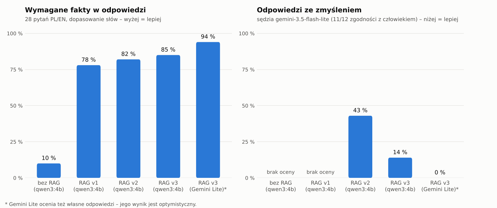
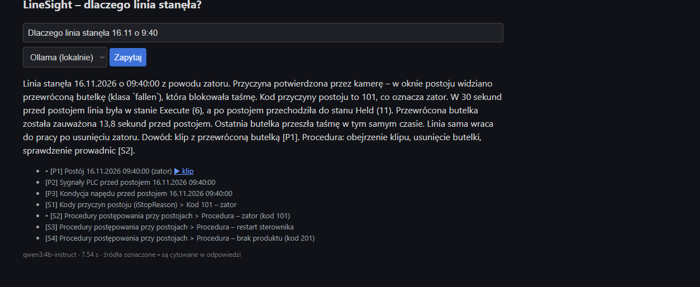
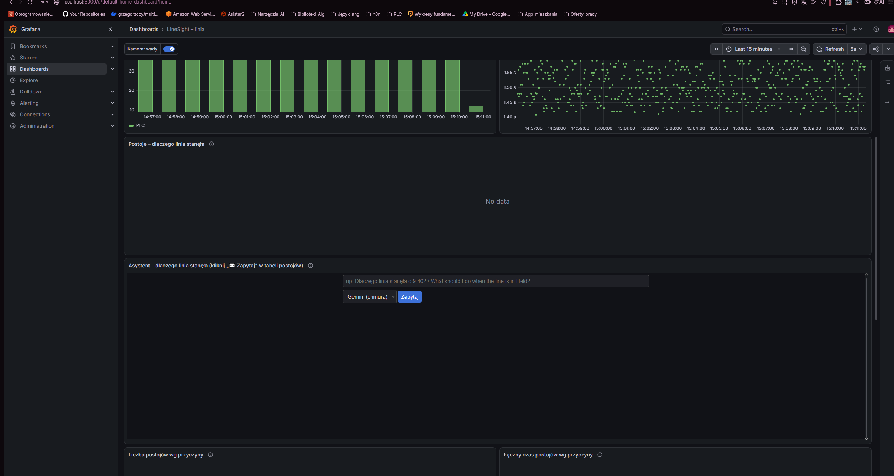

# Etap 5 – asystent RAG z ewaluacją

Pytanie „dlaczego linia stanęła o 9:04 i co zrobić?” dostaje odpowiedź, która łączy postój z bazy (przyczyna, pewność,
dowody, klip), sygnały PLC z 30 s przed nim, kondycję napędu i fragmenty instrukcji linii – z cytatami źródeł.
Jakość mierzy automatyczna ewaluacja na 28 pytaniach PL/EN. Wszystko na laptopie (Docker + Ollama na GPU); Jetson
tylko dostarcza klipy i zdarzenia z kamery.

Okna: **LAPTOP** (cmd, `.venv`), **OLLAMA** (cmd z `ollama serve`), **SSH1/SSH2** (Jetson, tylko do sesji danych).

## Architektura

```
pytanie ──► rag.py ──┬─ czas w pytaniu / link z Grafany ──► SQL: stop_event + signals_before(30 s) + drive_health
                     │                                       = [P1] postój, [P2] sygnały, [P3] napęd
                     ├─ embedding pytania (+ przyczyna z [P1]) ─► pgvector: instrukcja docs/kb = [S1..S4]
                     ├─ pytanie o historię ───────────────────► pgvector: opisy zamkniętych postojów = [H1, H2]
                     └─ instrukcja systemowa + źródła ────────► LLM: qwen3:4b-instruct (Ollama) | Gemini Flash Lite
                                                                └─► odpowiedź z [ID], lista źródeł, link do klipu
```

Zasada: **konkretny postój bierzemy deterministycznie z SQL**, wyszukiwanie wektorowe tylko dla tekstu (instrukcja,
podobne przypadki). Embeddingi nie odróżniają godzin, a warunki strukturalne (data, pewność, kod) to robota SQL.

| Element | Wybór | Dlaczego |
|---|---|---|
| Baza wektorowa | pgvector 0.8.1 w tej samej bazie (TimescaleDB) | już był w obrazie; postoje i wiedza w jednym SQL |
| Indeks | brak (dokładne przeszukanie) | ok. 70 wierszy: < 1 ms, recall 100 %; HNSW byłby przerostem formy |
| Embeddingi | `intfloat/multilingual-e5-small` (384), na CPU | PL + EN; przedrostki `query:` / `passage:`; VRAM zostaje dla LLM |
| Podział tekstu | jeden nagłówek `##` = jeden fragment (33) | instrukcja pisana pod to: sekcja zrozumiała bez sąsiednich |
| LLM lokalnie | `qwen3:4b-instruct` w Ollamie (Windows, GPU) | bez kosztów, dane nie wychodzą z zakładu |
| LLM w chmurze | `gemini-3.5-flash-lite` (darmowy poziom) | porównanie i sędzia w ewaluacji |
| Usługa | FastAPI `/ask` + strona `/`, kontener `assistant` | link i panel w Grafanie |

## E5-01 – pgvector w bazie

`infra/db/40-kb.sql`: `CREATE EXTENSION vector`, tabela `kb_chunk` (kind `manual`/`case`, source, chunk_no, section,
content, `embedding vector(384)`).

```cmd
docker exec linesight-db psql -U linesight -d linesight -c "SELECT name, default_version, installed_version FROM pg_available_extensions WHERE name IN ('vector','timescaledb');"
docker exec -i linesight-db psql -U linesight < infra\db\40-kb.sql
docker exec linesight-db psql -U linesight -d linesight -c "\dx vector" -c "\d kb_chunk" -c "SELECT '[1,0,0]'::vector <=> '[0,1,0]'::vector AS cos_dist;"
```

`<=>` = odległość kosinusowa (wektory prostopadłe → 1).

## E5-02 – baza wiedzy

`docs/kb/01…06*.md`: budowa linii i sygnały, stany PackML, kody postojów 1/101/201/301/302, procedury, kondycja napędu,
jak czytać diagnostykę. Szkic z kodu PLC (`plc/src`) i reguł `diag/rules.py`, zweryfikowany przez Grzegorza. Wartości
nominalne napędu policzone ze wzorów `FB_DriveSim` (2,0 Nm, 3,2 A, ok. 45 °C).

## E5-03 – indeksowanie

```cmd
pip install -r assistant\requirements.txt
python assistant\index_kb.py
python assistant\index_kb.py --query "co zrobić, gdy linia stoi w Held"
python assistant\index_kb.py --query "what does stop code 201 mean" --kind manual
```

Idempotentne (DELETE + INSERT po źródle w transakcji). Zamknięte postoje → opisy `kind='case'` **bez** `evidence.sim`
(prawda symulacji `xInj*` – w zakładzie jej nie ma). Wynik: 33 fragmenty + 37 postojów; pytanie EN trafia w polską sekcję.
**Odległości wszystkich trafień i pudeł: 0,11–0,18** – e5 daje wysokie podobieństwo każdej parze, więc progu „nie wiem”
nie opieramy na odległości (decyduje LLM, sprawdza ewaluacja).

## E5-04 – kontekst postoju z SQL

`assistant/context.py`: czas z pytania (`9:40`, `14.11 o 18:01`, `10:23:05`) → postój:
najpierw ten, który **zaczął się w podanej minucie**, potem trwający w tej chwili, potem najbliższy w ± 2 min
(ewaluacja: „8:54” brało postój z 8:53:23). Źródła [P1] postój, [P2] sygnały 30 s (wartość na początku i końcu okna,
min–max, przebieg stanów, bez `xInj*`), [P3] kondycja napędu 30 min wstecz.

```cmd
python assistant\context.py "dlaczego linia stanęła o 10:23?"
python assistant\context.py "co się stało o 03:00?"
```

## E5-05 – odpowiedź i usługa

`assistant/llm.py` – jedna funkcja `generate()` dla Ollamy i Gemini (HTTP bez SDK), `temperature 0`, `seed 42`,
jawne `num_ctx 4096` (Ollama przycina za długi prompt bez błędu), ponowienia Gemini przy 429/503/timeout.
`assistant/rag.py` – źródła + instrukcja systemowa (odpowiadaj tylko ze źródeł, `[ID]` po każdym fakcie, „Nie wiem”,
język pytania), wykrywanie cytatów nieistniejących źródeł.

**Ollama na 4 GB VRAM** (ustawienia serwera, `setx` + ponowne uruchomienie Ollamy):

```cmd
ollama pull qwen3:4b-instruct
setx OLLAMA_FLASH_ATTENTION 1
setx OLLAMA_KV_CACHE_TYPE q8_0
ollama serve
ollama ps
```

| | przed | po |
|---|---|---|
| model | `qwen3:4b` = wariant **thinking-2507** (rozumowanie ok. 600 słów na jedno zdanie, `--think=false` nie działa) | `qwen3:4b-instruct` |
| KV cache | f16, ok. 600 MiB, 3,6 GB, 20/80 % CPU/GPU | q8_0, 306 MiB, 3,3 GB, **37/37 warstw na GPU** |
| odpowiedź | 17–24 s | 6–8 s (ok. 40 tok/s); ładowanie modelu 19 s → `keep_alive 30m` |

Embeddingi na CPU (na GPU zabierały 0,5 GB i spychały LLM na CPU).

## E5-06 – sesja danych i zestaw pytań

Dotychczasowe postoje miały kamerę offline i pustą kondycję napędu – zestaw nie sprawdziłby łączenia obrazu z PLC.
`tools/scenario_rag.py` (laptop) prowadzi operatora przed kamerą i wstrzykuje usterki przez OPC UA po Enter:

```bash
# SSH1
cd ~/linesight/deepstream && python3 linesight_app.py --rtsp --clips --mqtt 192.168.0.203
# SSH2
python3 ~/linesight/jetson/serve_clips.py
```
```cmd
python tools\scenario_rag.py --dry
python tools\scenario_rag.py
python tools\scenario_rag.py --only E1
python assistant\dump_contexts.py --since 2026-11-14 > data\eval_contexts.json
```

| Zdarzenie | Postój | Pewność |
|---|---|---|
| E1 (powtórzone `--only`) | zator, przewrócona butelka w kadrze | potwierdzona + klip |
| E2 | zator, tylko stojące butelki | tylko_plc |
| E3 / E4 | brak produktu, pusty kadr / butelki płyną | potwierdzona / **sprzeczna** |
| E5 | zator, potem brak produktu | potwierdzona + klip |
| E6 | 8 min zużycia napędu → awaria 301 | tylko_plc, alarm napędu, kondycja 0 % |
| E7 / E8 | abort 302 / stop operatora | tylko_plc |

Pierwsze E1 nie wyszło (kamera nie zliczyła leżącej butelki przed Enter) – zostało w danych jako „zator, kamera nic
nie widziała”; Enter dopiero po `ZLICZONO … "fallen"` w SSH1.

`eval/questions.jsonl` – **28 pytań** (19 PL, 9 EN): 12 o konkretne postoje (łańcuch przyczyn, pewność sprzeczna,
awaria z alarmem napędu, restart PLC, dwa postoje w 2 min, butelka po początku awarii), 2 o chwilę bez postoju,
9 o instrukcję, 1 agregujące (pułapka: RAG nie liczy), 4 bez odpowiedzi w źródłach. Każde: wymagane fakty (warianty
PL/EN), sekcje wzorcowe, odpowiedź wzorcowa. Zestawu nie zmieniamy pod wynik. Dane: `eval/sesja/`.

## E5-07 – ewaluacja

```cmd
python eval\run_eval.py --name rag_ollama_v3 --judge gemini --judge-model gemini-3.5-flash-lite
python eval\run_eval.py --name norag_ollama --mode norag
python eval\run_eval.py --name rag_gemini_v3 --backend gemini --judge gemini --judge-model gemini-3.5-flash-lite --delay 6
python eval\run_eval.py --rejudge rag_ollama_v2 --judge gemini --judge-model gemini-3.5-flash-lite --only P01 P02 P05 P10 P08 M01 M02 M03 M04 M07 H01 P14 --judge-check
python eval\run_eval.py --summary
```

**Miary deterministyczne:** właściwy postój, recall@k instrukcji, odsetek wymaganych faktów (PL/EN osobno), cytaty,
cytaty nieistniejących źródeł, poprawne i zbędne odmowy. **Sędzia LLM:** dzieli odpowiedź na twierdzenia
(supported / unsupported / contradicted), poprawność 0–2 względem wzorca.



| przebieg | postój | recall@4 | fakty | PL | EN | odmowy OK | zbędne odmowy | zmyślenia | poprawność | s/odp. |
|---|---|---|---|---|---|---|---|---|---|---|
| bez RAG (qwen3:4b) | – | – | 10 % | 11 % | 8 % | 80 % | 91 % | – | – | 3,8 |
| RAG v1 | 93 % | 81 % | 78 % | 86 % | 64 % | 80 % | 4 % | – | – | 6,3 |
| RAG v2 | 100 % | 100 % | 82 % | 92 % | 62 % | 100 % | 9 % | 43 % | 1,61 | 5,8 |
| **RAG v3 (qwen3:4b, lokalnie)** | **100 %** | **100 %** | **85 %** | **94 %** | 68 % | 100 % | 9 % | **14 %** | 1,86 | 5,8 |
| RAG v3 (Gemini 3.5 Flash Lite) | 100 % | 100 % | 94 % | 100 % | 83 % | 100 % | 4 % | 0 %* | 2,00* | 1,4 |

\* ten sam model odpowiadał i oceniał – wynik optymistyczny. Pełne wyniki: `eval/results/` (`summary.md`).

**Co zmieniano (klasy błędów, nie pojedyncze pytania):**

| Wersja | Błąd | Zmiana |
|---|---|---|
| v2 | zły postój przy dwóch w ± 2 min | postój z podanej minuty |
| v2 | pytanie „dlaczego stanęła o 9:07” nie trafia w procedurę (abort 302 nazwany „usterką”) | przyczyna i kod z [P1] dopisane do zapytania wektorowego |
| v2 | „przewrócone butelki w chwilach **brak** s”, „ostatnia sztuka **None**”, liczby ze znakiem | dowody kamery pełnymi zdaniami, „X s PO początku postoju” |
| v2 | liczenie historii z 2 przykładów [H] | [H] tylko dla pytań o historię, tytuł „przykład (NIE pełna historia)” |
| v3 | „confirmed” przy tylko_plc | pewność słownie: „kamera NIE potwierdziła przyczyny” |
| v3 | odwrócony łańcuch przyczyn | „Przyczyny po kolei: 1) zator, 2) brak_produktu” |
| v3 | brak procedury przy alarmie napędu | alarm z [P3] dopisany do zapytania wektorowego |
| v3 | „I don't know” na „did the line stop at 3:00” | „brak postoju” także po angielsku |

Przy małym modelu najwięcej dały zmiany **danych w kontekście**, nie promptu.

**Sędziego też trzeba ocenić.** `eval/judge_labels.jsonl` – 12 odpowiedzi v2 ocenionych ręcznie (5 ze zmyśleniem).

| Sędzia | zgodność | wykryte zmyślenia | fałszywe alarmy | limit darmowy |
|---|---|---|---|---|
| gemini-3.6-flash, prompt v1 (jedno pytanie o poprawność) | – | przepuścił „confirmed as a jam” przy tylko_plc | – | 20 / dzień |
| gemini-3.6-flash, prompt twierdzenie po twierdzeniu | 11/12 | 4/5 (nie wykrył odwróconego łańcucha) | 0/7 | 20 / dzień |
| **gemini-3.5-flash-lite**, ten sam prompt | **11/12** | 4/5 (nie wykrył „źródła tego nie zawierają”) | 0/7 | 500 / dzień |

Sędzia znalazł też błąd w mojej ręcznej etykiecie (P14: odmowa „źródła tego nie zawierają” przeczy [P1]) – etykietę
poprawiono z adnotacją. Próba 12 odpowiedzi jest mała: liczby zmyśleń traktujemy jako przybliżenie.

**Znaleziska w potoku danych (przed modelem):**
1. **Zgubiona druga przyczyna** – Held → Execute (jeden cykl PLC, 200 ms, most go nie zobaczył) → Suspended dawało
   postój z samym Held. `diag/stops.py`: zmiana na inny stan-przyczynę w trakcie postoju trafia do `states` (+ testy).
2. **Postoje usuwane na granicy horyzontu** – `diag` przelicza 24 h i usuwa postoje, których nie wykrył ponownie. Gdy
   granica wypadła między NULL (zła jakość OPC UA przy restarcie PLC) a stanem 0, stan początkowy był nieznany i dwa
   prawdziwe postoje `restart_plc` zniknęły (37 → 35). Poprawka: stan początkowy bez NULL; odtworzenie:
   `docker exec -e HORIZON_H=72 linesight-diag python diag.py --once`.
3. **Ujemna liczba sztuk** po wyzerowaniu licznika przy restarcie → „nieznana”. **NULL w sygnałach** wywracał kontekst.
4. **Ollama przy `temperature 0` nie jest w pełni deterministyczna** (ta sama odpowiedź P01 różna w dwóch przebiegach)
   → `seed`, a etykiety sędziego sprawdzają początek odpowiedzi.

**Znane ograniczenia:**
- **EN → PL w wyszukiwaniu:** „bearing wear vs cold start” nie znajduje sekcji „Objawy zużycia” – oba modele odmawiają
  (M05). Kierunek: większy model embeddingów (`multilingual-e5-base`, `bge-m3`) albo wyszukiwanie hybrydowe (wektor +
  pełnotekstowe), oceniane tym samym zestawem.
- **qwen3:4b dopisuje interpretacje** („wskazuje na zaburzenie przepływu”) i raz zaprzecza pewności („na pewno był brak
  produktu” przy sprzecznej) – granica modelu 4B; Gemini Flash Lite tych błędów nie robi.
- **Pytania agregujące** („ile razy…”) wymagają SQL (np. narzędzie text-to-SQL albo gotowe zapytania), nie RAG – dziś
  asystent uczciwie odmawia.

**Lokalnie czy w chmurze?** Gemini Flash Lite: +9 p.p. faktów, mniej zmyśleń, 4× szybciej. qwen3:4b: dane zakładu nie
wychodzą poza sieć, zero kosztu, działa offline. Domyślnie `ollama`; `LLM_BACKEND=gemini`, jeśli klient się zgadza.

## E5-08 – asystent w Dockerze i w Grafanie

`assistant/Dockerfile` (python:3.12-slim, PyTorch CPU – ok. 200 MB zamiast 2,5 GB z CUDA, model embeddingów w wolumenie
`hf-cache`), usługa `assistant` w compose (port 8000, Ollama na hoście przez `host.docker.internal:11434`,
`GEMINI_API_KEY` ze zmiennej Windows). `.dockerignore` przepuszcza `assistant/` i `docs/kb/`.

```cmd
docker compose -f infra/docker-compose.yml up -d --build assistant grafana
docker logs -f linesight-assistant
```

- `http://localhost:8000` – strona dla technika: pytanie, odpowiedź, źródła (cytowane oznaczone •), ▶ klip, wybór modelu.
- Grafana, tabela postojów: kolumna **asystent** → „💬 Zapytaj” ustawia ukrytą zmienną `$stop`; panel „Asystent” pod
  tabelą (iframe `http://localhost:8000/?embed=1&stop=${stop}`) od razu odpowiada o tym postoju. Drugi link otwiera
  asystenta w nowej karcie. `GF_PANELS_DISABLE_SANITIZE_HTML=true` – iframe w panelu tekstowym; **tylko lokalnie**
  (na współdzielonej Grafanie: wtyczka panelu albo reverse proxy pod jedną domeną).




## Pytania z rozmowy technicznej (etap 5)

**1. Dlaczego pytanie o konkretny postój nie idzie przez wyszukiwanie wektorowe?**
Embedding koduje znaczenie, nie wartości: „postój o 9:04” i „postój o 9:07” to prawie ten sam wektor. Postój ma jedną
poprawną odpowiedź w bazie – bierzemy ją SQL-em po czasie (deterministycznie, testowalnie), a wektory tylko do tekstu.
To samo dla warunków strukturalnych (pewność, kod, data) i agregacji („ile razy”) – to robota SQL. Dodatkowo przyczyna
z [P1] trafia do zapytania wektorowego (rozszerzenie zapytania o kontekst strukturalny) – recall wzrósł z 81 do 100 %.

**2. Jak mierzysz zmyślenia i skąd wiesz, że miara działa?**
Trzy warstwy: (a) twarde – cytat źródła, którego nie było w kontekście; (b) deterministyczne – wymagane fakty
i poprawne odmowy na pytaniach bez odpowiedzi; (c) sędzia LLM – twierdzenie po twierdzeniu: poparte / niepoparte /
sprzeczne. Sędziego walidowałem na 12 ręcznie ocenionych odpowiedziach: pierwsza wersja promptu przepuściła
„confirmed” przy pewności tylko_plc; po zmianie 11/12, czułość 4/5, 0 fałszywych alarmów. Słaby punkt: mała próba,
błędne wnioski z poprawnych faktów wykrywa gorzej niż fakty sprzeczne. Inny model niż oceniany – mniejsze ryzyko
łagodnego oceniania samego siebie (dla Gemini jako odpowiadającego wynik oznaczam jako optymistyczny).

**3. Co dało najwięcej przy małym modelu: prompt, model czy dane?**
Dane w kontekście. Zmyślenia 43 % → 14 % przez: pewność słownie („kamera NIE potwierdziła”), czasy względem postoju
słownie zamiast liczb ze znakiem, ponumerowany łańcuch przyczyn, brak `None`/„brak s”. Model 4B źle czyta skróty
i liczby ze znakiem – trzeba mu podać fakty tak, jak człowiekowi. Każdą zmianę mierzyłem na tym samym zestawie
przed i po, zmiany dotyczyły klas błędów, a zestawu pytań nie dopasowywałem do wyniku.

**4. Lokalny model czy API w chmurze dla fabryki?**
Liczby: Gemini Flash Lite 94 % faktów, ok. 0 % zmyśleń, 1,4 s; qwen3:4b 85 %, 14 %, 5,8 s na laptopowej karcie 4 GB.
Za lokalnym: dane procesu nie opuszczają zakładu (często warunek klienta), brak kosztu i limitów (darmowy poziom: 20
zapytań/dzień dla mocniejszych modeli – sędzia na nich nie przeszedł pełnego zestawu), działa bez internetu. Za chmurą:
jakość i szybkość. Architektura pozwala przełączyć zmienną; w produkcji lokalnie – większy model na serwerze z GPU.
Na 4 GB VRAM: wariant instruct (thinking dawał 600 słów rozumowania), flash attention i KV cache q8_0, embeddingi na CPU.

**5. Jakie błędy w systemie znalazła ewaluacja asystenta i dlaczego to ważne?**
Dwa błędy w potoku danych, nie w LLM: zgubiona druga przyczyna postoju (przejście Held → Suspended przez Execute
krótszy niż próbkowanie mostu) i usuwanie prawdziwych postojów przy przesuwaniu okna przeliczania (NULL przed
restartem PLC). Bez zestawu pytań z wzorcowymi odpowiedziami z logu sesji nikt by tego nie zauważył – asystent mówił
„linia nie stała”, a dashboard po prostu miał o dwa wiersze mniej. Wniosek: ewaluacja asystenta to też test całego
potoku od PLC po bazę, a wzorce muszą pochodzić z niezależnego źródła (dziennik sesji), nie z bazy.

## Podsumowanie etapu 5 (16.11)

- **Wiedza i wyszukiwanie:** instrukcja linii (6 plików, 33 sekcje), pgvector w TimescaleDB, embeddingi
  multilingual-e5-small (PL/EN), opisy 37 zamkniętych postojów jako przypadki.
- **Asystent:** postój z SQL ([P1] postój, [P2] sygnały 30 s, [P3] napęd) + instrukcja z pgvector + LLM
  (qwen3:4b-instruct w Ollamie na GPU albo Gemini 3.5 Flash Lite), cytaty, odmowy, PL/EN; FastAPI w Dockerze, panel
  i link w Grafanie.
- **Ewaluacja:** sesja 8 postojów z kamerą i alarmem napędu, 28 pytań, miary deterministyczne + sędzia LLM
  zwalidowany na ręcznych ocenach. Fakty 10 % → 85 %, zmyślenia 43 % → 14 % (qwen3:4b); Gemini Flash Lite 94 %, ~0 %.
- **Poprawki potoku znalezione przez ewaluację:** druga przyczyna postoju, postoje usuwane na granicy horyzontu `diag`,
  NULL w sygnałach, ujemna liczba sztuk.
- **Otwarte:** wyszukiwanie EN → PL (M05), pytania agregujące przez SQL, zgubione ~7/9000 zmian licznika (z etapu 4).
