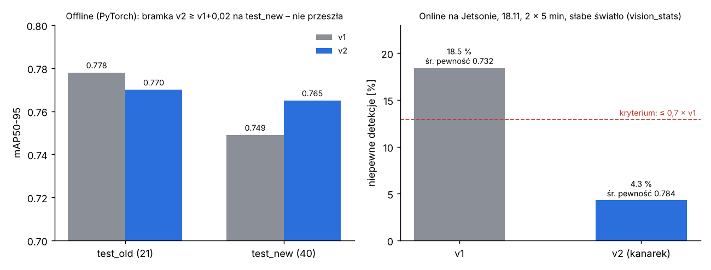

# Etap 6 – chmura GCP i pętla MLOps

Rejestr wersji modelu w Cloud Storage, Jetson pobierający wskazaną wersję i budujący silnik TensorRT,
niepewne klatki wracające do chmury i retrening v2 z bramką jakości. Dokument uzupełniany w trakcie etapu.

Okna: **LAPTOP** (cmd), **SSH1/SSH2** (Jetson).

## Projekt i koszty (E6-01)

| Element | Wartość |
|---|---|
| Projekt | `linesight-514914` (organizacja `gczyrnianski202001-org`) |
| Konto rozliczeniowe | płatne – Free Trial na tym koncie Google był już wykorzystany |
| Budżet | 20 zł / miesiąc, alerty e-mail 50 / 90 / 100 % rzeczywistych i 100 % prognozowanych |
| Region | `us-central1` – darmowy poziom Cloud Storage (5 GB-mies. Standard, 5 tys. operacji A, 50 tys. B) |

Budżet **nie zatrzymuje** wydatków, tylko wysyła alerty. Spend caps (twardy limit, GA 11.2026) działają tylko
dla budżetu z jednym projektem i jedną kwalifikującą się usługą (głównie AI) i nie wstrzymują trwałych zasobów
jak magazyn – dla Cloud Storage nic nie dają. Ryzyko kosztów ograniczamy więc w projekcie: darmowy region,
klatki usuwane po 30 dniach, limit wysyłanych klatek w kodzie Jetsona, konto usługi Jetsona z dostępem tylko
do dwóch zasobników (wyciek klucza nie pozwala uruchomić maszyn wirtualnych).

### gcloud na laptopie
`gcloud` – oficjalne CLI Google Cloud (instalator `GoogleCloudSDKInstaller.exe`); po instalacji **nowe** okno cmd,
bo stare nie widzi zmienionego PATH.

```cmd
gcloud init
gcloud auth application-default login
gcloud config set project linesight-514914
gcloud auth application-default set-quota-project linesight-514914
gcloud services enable storage.googleapis.com
```
- `gcloud init` – logowanie samego CLI i domyślny projekt.
- `application-default login` – osobne poświadczenia ADC dla bibliotek Pythona (skrypty `publish` / `promote`);
  na stronie zgody trzeba zaznaczyć **wszystkie** pola, inaczej błąd „cloud-platform scope is required but not consented”.
- `set-quota-project` – projekt, któremu biblioteki przypisują zużycie API (inaczej mógłby to być stary projekt).
- `services enable` – w GCP każde API włącza się osobno dla projektu.

Sprawdzenie: `gcloud config list` (konto, `project = linesight-514914`), `gcloud billing projects describe
linesight-514914` (`billingEnabled: true`), `gcloud storage ls` („matched no objects” = brak zasobników, poprawnie).

Na liście projektów są też `gen-lang-client-…` – projekty zakładane przez AI Studio dla kluczy Gemini; nie ruszamy ich.

## Zasobniki i konto usługi (E6-02)

| Zasobnik | Zawartość | `jetson-edge` |
|---|---|---|
| `gs://linesight-514914-models` | wersje modelu: ONNX + `metrics.json`, wskazanie wersji dla urządzenia | `roles/storage.objectViewer` – odczyt i lista |
| `gs://linesight-514914-frames` | niepewne klatki z Jetsona do retreningu | `roles/storage.objectCreator` – **tylko dodawanie** |

Oba: `us-central1`, klasa STANDARD, `uniform_bucket_level_access: true` (uprawnienia tylko przez IAM zasobnika,
bez ACL na plikach), `public_access_prevention: enforced`. Klatki: reguła cyklu życia `Delete` po 30 dniach
(`infra/gcp/frames-lifecycle.json`). Domyślny soft delete trzyma usunięte obiekty 7 dni (`604800` s) – przy
kilkuset MB koszt pomijalny.

`objectCreator` nie ma odczytu ani usuwania, a nadpisanie obiektu wymaga usunięcia starego – przejęty Jetson
nie podmieni ani nie skasuje danych. Dwa zasobniki zamiast jednego z uprawnieniami warunkowymi na prefiksach:
prościej i czytelniej w polityce IAM.

```cmd
gcloud storage buckets create gs://linesight-514914-models --location=us-central1 --uniform-bucket-level-access --public-access-prevention
gcloud storage buckets create gs://linesight-514914-frames --location=us-central1 --uniform-bucket-level-access --public-access-prevention
gcloud storage buckets update gs://linesight-514914-frames --lifecycle-file=infra\gcp\frames-lifecycle.json
gcloud services enable iam.googleapis.com
gcloud iam service-accounts create jetson-edge --display-name="Jetson Nano edge"
gcloud storage buckets add-iam-policy-binding gs://linesight-514914-models --member=serviceAccount:jetson-edge@linesight-514914.iam.gserviceaccount.com --role=roles/storage.objectViewer
gcloud storage buckets add-iam-policy-binding gs://linesight-514914-frames --member=serviceAccount:jetson-edge@linesight-514914.iam.gserviceaccount.com --role=roles/storage.objectCreator
```
„Service account … does not exist” zaraz po `service-accounts create` – IAM jest *eventually consistent*;
po minucie ta sama komenda przechodzi.

### Klucz JSON zablokowany → krótkotrwałe tokeny
`gcloud iam service-accounts keys create` kończy się `constraints/iam.disableServiceAccountKeyCreation`.
Google sam utworzył organizację `gczyrnianski202001-org` przy koncie rozliczeniowym i włączył polityki
„secure by default” (organizacje od 3.05.2024). Konto Gmail nie jest jej administratorem
(`organizations add-iam-policy-binding` → brak `getIamPolicy`), więc wyjątku dla projektu nie zrobimy.

Rozwiązanie bez klucza – **impersonation**: konto użytkownika dostaje `roles/iam.serviceAccountTokenCreator`
na samym koncie `jetson-edge` i może wystawiać w jego imieniu tokeny ważne 1 h (IAM Credentials API).
```cmd
gcloud services enable iamcredentials.googleapis.com
gcloud iam service-accounts add-iam-policy-binding jetson-edge@linesight-514914.iam.gserviceaccount.com --member=user:<twoj-email> --role=roles/iam.serviceAccountTokenCreator
```
Rola działa po kilku minutach (wcześniej `iam.serviceAccounts.getAccessToken denied`).

Sprawdzenie najmniejszych uprawnień z laptopa – komendy wykonywane jako `jetson-edge`:
```cmd
gcloud storage ls gs://linesight-514914-models --impersonate-service-account=jetson-edge@linesight-514914.iam.gserviceaccount.com
gcloud storage ls gs://linesight-514914-frames --impersonate-service-account=jetson-edge@linesight-514914.iam.gserviceaccount.com
```
Wynik 16.11: models – bez błędu (pusto); frames – `storage.objects.list denied` (zamierzone).

| Wariant | Sekret na Jetsonie | Zależność | Uwagi |
|---|---|---|---|
| klucz JSON konta usługi | długoterminowy, ważny do ręcznego unieważnienia | brak | zablokowany polityką; Google odradza |
| **broker tokenów na laptopie (wybrany)** | token 1 h + sekret do brokera w sieci lokalnej | laptop musi działać, by odnowić token | w produkcji: brama brzegowa |
| Workload Identity Federation | brak | dostawca tożsamości (OIDC / certyfikat X.509) | wymaga nowszych bibliotek niż Python 3.6 |

## Broker tokenów i klient na Jetsonie (E6-03)

```
Jetson (gcs.py, Python 3.6, urllib) ── GET /token + sekret ──► laptop: linesight-tokens (Docker, :8010)
        │                                                       └─ ADC użytkownika → IAM Credentials API
        │                                                          → token jetson-edge (1 h, w pamięci brokera)
        └── Bearer token ──► storage.googleapis.com (JSON API): models = odczyt, frames = tylko dodawanie
```
- `cloud/token_broker.py` – `GET /token` z nagłówkiem `Authorization: Bearer <BROKER_SECRET>`; token odświeżany,
  gdy zostało < 5 min; w logach tylko adres i kod odpowiedzi, nigdy token. ADC montowane z
  `%APPDATA%\gcloud` tylko do odczytu.
- `jetson/gcs.py` – lista, pobranie (plik `.part` + zmiana nazwy), wysyłka z `ifGenerationMatch=0` (tylko nowy
  obiekt), `selftest`. Bez `google-cloud-storage`: ostatnia wersja dla Pythona 3.6 to 2.0.0 (2022) z
  zależnościami protobuf/api-core; trzy wywołania REST są prostsze.
- Sekret brokera: zmienna Windows `BROKER_SECRET` (laptop) i plik `~/.config/linesight/broker_secret`, prawa 600
  (Jetson). Sieć domowa, HTTP bez TLS – jak MQTT; w produkcji TLS albo sieć zarządzana.

Uruchomienie i test (16.11): wynik `selftest` – 8/8 zgodnych z uprawnieniami, token z brokera w 0,03 s.
```cmd
python -c "import secrets; print(secrets.token_urlsafe(32))"
setx BROKER_SECRET <sekret>
set BROKER_SECRET=<sekret>
gcloud storage cp README.md gs://linesight-514914-models/selftest/hello.txt
docker compose -f infra/docker-compose.yml up -d --build tokens
curl -s -o NUL -w "%{http_code}\n" -H "Authorization: Bearer %BROKER_SECRET%" http://localhost:8010/token
echo %BROKER_SECRET%> %TEMP%\bs.txt
scp %TEMP%\bs.txt grzegorz@192.168.0.124:.config/linesight/broker_secret
del %TEMP%\bs.txt
```
```bash
chmod 600 ~/.config/linesight/broker_secret
python3 jetson/gcs.py selftest
```
- Sekret na Jetsona przez `scp`, nie przez wklejanie: SSH w oknie cmd buforował wklejony tekst i `read -s`
  dostawał resztki poprzednich komend (plik 87 B zamiast 44–45 B).
- Ponowne wysłanie tej samej nazwy kończy się **412 Precondition Failed**, nie 403: warunek
  `ifGenerationMatch=0` jest sprawdzany przed uprawnieniami. Obie odpowiedzi znaczą „nie nadpiszesz”.
- Jetson był na starej gałęzi z etapu 5 (`git pull` → „Already up to date”) – `git checkout main && git pull`.

## Rejestr modeli (E6-04)

```
gs://linesight-514914-models/
  yolo26n/v1/model.onnx        ONNX, zapis tylko gdy nie istnieje (wersje niezmienne)
  yolo26n/v1/metrics.json      zapisywany OSTATNI: jego obecność = wersja kompletna
  deployments/jetson-01.json   wskazanie wersji dla urządzenia + poprzednia (rollback)
```
`metrics.json`: sha256 i rozmiar ONNX, opset, wejścia/wyjścia, commit kodu (`+dirty` przy niezacommitowanych
zmianach), zbiór (`linesight-5b628dbc`, `split_v1.csv`), parametry treningu, metryki val/test z `summary.json`
i parametry wdrożenia (wejście 384x640, FP16, workspace 2048 MB, conf 0,45) – Jetson bierze je stąd,
a nie z własnej konfiguracji.

Dlaczego tak, a nie MLflow / Vertex AI Model Registry: jeden model i jedno urządzenie; dwa pliki JSON w Cloud
Storage dają wersje, metryki, pochodzenie (commit + zbiór) i wskazanie wdrożenia bez dodatkowej usługi.
Klient na Jetsonie potrzebuje tylko odczytu z zasobnika.

Publikacja v1 (16.11):
```cmd
pip install google-cloud-storage==3.17.1
python cloud\registry.py publish --version v1 --onnx models\yolo26n_v1_384x640.onnx --run runs\detect\yolo26n_v1 --notes "pierwszy model, 214 zdjęć, światło sztuczne (E1-06)"
python cloud\registry.py promote --version v1 --device jetson-01 --reason "wdrożenie początkowe"
python cloud\registry.py list
python cloud\registry.py show
```
Wynik: v1, commit `0d89cba`, sha256 `924f2a96…`, test mAP50 0,987 / mAP50-95 0,778, wdrożona na `jetson-01`;
ponowne `publish --version v1` → „już opublikowana – wersje są niezmienne”.

## Synchronizacja modelu na Jetsonie (E6-05)

`jetson/model_sync.py` (Python 3.6, klient `gcs.py`):
1. czyta `deployments/jetson-01.json`; ta sama sha256 co w `models/current.json` → nic nie robi,
2. wersja już na dysku (`registry/<model>/<wersja>/meta.json` z tą samą sha256) → tylko przełączenie,
3. inaczej: odmowa, gdy działa `linesight_app.py` (RAM), pobranie ONNX, sprawdzenie sha256, `trtexec --fp16
   --workspace=2048` (składnia TRT 8.2), test `trtexec --loadEngine --duration=5`: `&&&& PASSED` i ≥ 15 qps,
4. atomowe przełączenie dowiązania `models/current.engine` (`os.replace`) i zapis `current.json` z poprzednią wersją.

`deepstream/configs/nvinfer_yolo26.txt` wskazuje `../../models/current.engine`. Po przełączeniu trzeba
zrestartować `linesight_app.py` – nvinfer wczytuje silnik przy starcie.

Silnik budujemy na Jetsonie, a nie na laptopie: plan TensorRT jest związany z GPU (architektura, liczba SM) i wersją
TensorRT – silnik z RTX 3050 nie wczyta się na Nano. Do rejestru trafia przenośny ONNX.

Rollback:
- **trwały** – na laptopie `registry.py promote --version v1`; Jetson przy następnym sync przełącza się bez budowy,
  bo v1 jest już na dysku,
- **awaryjny, bez sieci** – na Jetsonie `model_sync.py rollback`; chmura dalej wskazuje nowszą wersję, więc
  następny sync ją przywróci.

Wynik 16.11: pobranie 9,8 MB w 2 s, sha256 zgodny, budowa silnika 872 s (14,5 min, Nano bez `jetson_clocks`),
silnik 8,7 MB, test 33,3 qps; drugi sync – „aktualny … nic do zrobienia”; `linesight_app.py` ładuje
`registry/yolo26n/v1/model_384x640_fp16.engine` przez `current.engine`.

## Niepewne klatki (E6-06)

Pętla aktywnego uczenia: do etykietowania trafiają klatki, na których model się waha – one najwięcej zmieniają
w retreningu, a losowe klatki z działającej linii to w 99 % łatwe przypadki.

`linesight_app.py --uncertain` (moduł `deepstream/uncertain.py`) – sonda na wejściu `nvdsosd` (RGBA, jeszcze bez
narysowanych ramek). Klatka jest niepewna, gdy:
- **low_conf** – detekcja z pewnością w [0,45; 0,6): próg wdrożenia 0,45 obcina nvinfer, więc pasmo tuż nad
  nim to detekcje „ledwo przepuszczone”,
- **class_flip** – ślad z ≥ 10 klatkami dostaje klasę inną niż jego dotychczasowa większość (np. butelka pod
  światło skacze między `bottle` a `missing_cap` – przesunięcie domeny z E2-04).

Limit: ≥ 5 s odstępu, ≤ 60 klatek na godzinę – długi problem (cały dzień innego światła) nie zapcha karty SD
ani zasobnika prawie identycznymi klatkami. Mapowanie bufora NVMM do CPU (`get_nvds_buf_surface`) tylko dla
zapisywanej klatki. `unmap_nvds_buf_surface` nie istnieje w pyds 1.1.1 (DS 6.0.1) – pierwsze uruchomienie
kończyło każdą próbę zapisu `AttributeError`; wywołujemy go tylko, gdy jest.

Na dysku `~/linesight_uncertain/<RRRRMMDD>/<czas>_f<klatka>.jpg` + `.json` (powody, detekcje z pewnością
i ramkami, wersja modelu z `models/current.json`); JSON zapisywany drugi = para kompletna.

`jetson/upload_frames.py` – osobny proces: sieć nie blokuje potoku wideo, a klatki czekają na dysku przy braku
internetu. Wysyła pary do `gs://linesight-514914-frames/jetson-01/<RRRR-MM-DD>/` (`ifGenerationMatch=0`,
412 = już wysłane), potem przenosi je do `sent/`.

Wynik 16.11 (2,5 min, sztuczne światło, prowokowane trudne sytuacje): 4278 klatek przy 30 FPS, 1047 detekcji,
**98 low_conf (9,4 %)**, średnia pewność 0,794, 95 niepewnych klatek, zapisane 5 (limit 5 s), 0 class_flip; RAM
w `tegrastats` stały (1796 → 1800 MB). Wysłane 5/5 par (0,2 MB).

| Klatka | Powód | Co widać |
|---|---|---|
| f3085 | bottle 0,475 | butelka ucięta przy prawej krawędzi, ręka, rozmycie |
| f3298 | fallen 0,518 (druga, 0,853 – pewna) | leżąca butelka w ruchu; druga ramka ucięta na krawędzi (56 px) |
| f3466 | fallen 0,546 | butelka niesiona ręką, przechylona ok. 20° |
| f3636 | fallen 0,523 | butelka przechylona ok. 30° w trakcie przewracania |
| f3787 | bottle 0,51 | ta sama sytuacja, przechylenie ok. 20° – tym razem bottle |

Wnioski:
- kryterium działa: zapisane klatki to przypadki graniczne, nie losowy szum,
- f3636 i f3787 to ta sama sytuacja z różną klasą – przed etykietowaniem (E6-08) trzeba zapisać regułę dla
  butelki przechylonej (np. „fallen, gdy oś butelki odchylona > 45° od pionu”), inaczej etykiety będą niespójne,
- `class_flip` = 0: tracker IOU z `checkClassMatch: 1` kojarzy tylko detekcje tej samej klasy, więc przy zmianie
  klasy zwykle zaczyna nowy ślad zamiast zmienić klasę w starym – sygnał działa słabo przy tym trackerze,
- pobranie z laptopa: `mkdir data\frames_inbox` i `gcloud storage cp -r gs://linesight-514914-frames/jetson-01 data\frames_inbox\`
  (właściciel projektu czyta, `jetson-edge` nie).

## Sygnał dryfu w Grafanie (E6-07)

Monitorowanie modelu w produkcji bez etykiet: nie wiemy, czy detekcja jest poprawna, ale widzimy, jak pewny jest
model. Spadek średniej pewności i wzrost odsetka detekcji tuż nad progiem to typowy objaw przesunięcia danych
(światło, nowy produkt, zabrudzona lub przestawiona kamera) albo starzenia się modelu.

```
linesight_app.py --uncertain --mqtt   co 60 s:  linesight/vision/stats  {t, window_s, frames, dets, low_conf,
                                                                          class_flip, uncertain_frames, saved,
                                                                          mean_conf, model, version}
ingest (mqtt_to_db.py) ──► vision_stats (hipertabela, infra/db/50-vision-stats.sql) ──► Grafana: panel 15
```
Panel: odsetek niepewnych detekcji, średnia pewność i odsetek zmian klasy; czerwona linia 10 %. Okna z < 20 detekcjami pomijamy – za mała próba. Kolumna `version` pozwala porównać
modele przed i po wdrożeniu v2.

Wynik 16.11 (`vision_stats`, okna 60 s, v1):

| okno (UTC) | detekcje | niepewne | % | średnia pewność | sytuacja |
|---|---|---|---|---|---|
| 16:07 | 1473 | 23 | 1,6 | 0,849 | normalna praca |
| 16:08 | 1799 | 0 | 0,0 | 0,850 | normalna praca |
| 16:09 | 1481 | 41 | 2,8 | 0,842 | częściowo trudne |
| 16:10 | 1037 | 50 | 4,8 | 0,829 | trudne (przechylanie, ręka) |

Kierunek zgodny z oczekiwaniem, ale efekt mały: pierwotny próg 20 % (2× wynik z E6-06, liczony w całości
z prowokowanych sytuacji) nie złapałby niczego. Próg ustawiony na **10 %** = ok. 3–4× normalnej pracy. W zakładzie
próg wyznacza się z kilku dni normalnej pracy (np. kwantyl 99 % okien) i alarmuje dopiero przy kilku oknach z rzędu.

## Retrening v2 – dane (E6-08)

Sesja w nowej domenie 16.11, 22:54–23:07 (górne światło zgaszone, lampka z boku, przechylone butelki, ręka, ruch),
`--uncertain --unc-interval 2 --unc-max-hour 400`: 24 638 klatek przy 30 FPS, 34 602 detekcje, **2693 niepewne (7,8 %)**,
średnia pewność **0,808**, zapisane 184.

`vision_stats` w tym czasie: 5 z 13 okien powyżej progu 10 % (szczyty 17,8 % i 27,2 %, średnia pewność do 0,70) –
sygnał dryfu zareagował na zmianę światła bez żadnej etykiety. Okna 22:02–22:04 UTC: dokładnie 3600 detekcji,
0 niepewnych, 0,861 = 2 butelki × 30 FPS × 60 s, scena nieruchoma.

| Zbiór | Skąd | Wybór | Podział |
|---|---|---|---|
| `20261116_al_uncertain` (209) | gs://…-frames → `data/frames_inbox` | niepewne wg v1 (aktywne uczenie) | 167 train / 42 val |
| `20261116_230831_e6_newdomain_test` (40) | `capture.py` co 4 s, `scp -O` z Jetsona | losowe – niezależne od v1 | 40 test |
| v1 (214) | bez zmian (`split_v1.csv`) | – | stary test 21 zamrożony |

Zbiór v2: train 317 / val 85 / test 61 (`training/splits/split_v2.csv`). Paczka do Platform tylko z nowymi
zdjęciami: `data/upload/linesight_v2_nowe.zip` (10,9 MB).

```cmd
gcloud storage cp -r gs://linesight-514914-frames/jetson-01 data\frames_inbox\
scp -O -r grzegorz@192.168.0.124:dataset/raw/20261116_230831_e6_newdomain_test data\raw\
python training\add_to_dataset.py --base v1 --version v2 --al-from data\frames_inbox\jetson-01 --al-session 20261116_al_uncertain
```
- `scp -O` – stary protokół SCP; domyślny w nowym OpenSSH dla Windows (SFTP) kończył pobieranie katalogu
  z Jetsona komunikatem „Connection closed”.
- Test nowej domeny celowo **nie** pochodzi z niepewnych klatek: zbiór wybrany przez v1 jako „trudny dla v1”
  z góry przesądzałby porównanie v1 vs v2.
- Sąsiednie niepewne klatki dzieli 2–5 s, więc podział losowy na train/val daje zawyżone val (prawie te same
  klatki po obu stronach); o wdrożeniu v2 rozstrzyga niezależny test.

### Etykiety i eksport (18.11)

Wgrane do istniejącego zbioru `linesight` na Platform (te same klasy i ID co v1). Etykietowanie według
`docs/etykietowanie.md` (reguła 45°: butelka trzymana poziomo w ręku to też `fallen` – model widzi tylko
orientację; o zatorze decyduje logika wyżej: przejście przez linię + sygnały PLC).

`prepare_dataset.py data\export\linesight_v2.ndjson --split v2`:

| część | zdjęcia | z ramkami | bottle | missing_cap | fallen |
|---|---|---|---|---|---|
| train | 310 | 300 | 343 | 125 | 170 |
| val | 80 | 77 | 79 | 34 | 49 |
| test | 61 | 59 | 70 | 21 | 35 |
| razem | 451 | 436 | 492 | 180 | 254 |

- „w innej części: -” – stary test nietknięty; zdjęcia bez ramek to tylko sesja `empty` z v1,
- brak 12 niepewnych klatek (z 463 planowanych): usunięte przy etykietowaniu (40–50° albo bez butelki)
  lub pominięte przez Platform przy wgrywaniu,
- zbiór YOLO: `data\datasets\linesight_v2-c8f8f70f\data.yaml`.

### Trening v2 i bramka (18.11)

Ten sam przepis co v1 (wagi startowe COCO `yolo26n.pt`, 640 px, batch 16, ziarno 42, do 100 epok, patience 30) –
różnica wyników = różnica danych.
```cmd
python training\train.py --data data\datasets\linesight_v2-c8f8f70f\data.yaml --name yolo26n_v2
python training\compare_models.py --data data\datasets\linesight_v2-c8f8f70f\data.yaml --ndjson data\export\linesight_v2.ndjson --baseline v1 --candidate v2
```
Trening: 62 epoki w 7 min (najlepsza 32.), val mAP50 0,988 / mAP50-95 0,757.

| test | model | P | R | mAP50 | mAP50-95 |
|---|---|---|---|---|---|
| test_old (21 zdj., 10.11) | v1 | 0,965 | 0,989 | 0,987 | 0,778 |
| | v2 | 0,963 | 0,989 | 0,978 | 0,770 (−0,008 ✓) |
| test_new (40 losowych zdj., nowe światło) | v1 | 0,980 | 0,931 | 0,959 | 0,749 |
| | v2 | 0,992 | **0,970** | 0,965 | 0,765 (+0,016 ✗) |

test_new według klas (mAP50-95): bottle 0,769 → 0,810, missing_cap 0,734 → 0,741, fallen 0,745 → 0,745.

**Bramka nie przeszła** (wymagane +0,02 na test_new). Wynik ostateczny – progu ani metryki nie zmieniamy po
zobaczeniu wyniku. Interpretacja: v1 w nowym świetle na *losowych* zdjęciach jest prawie tak dobry jak w starym
(0,749 vs 0,778) – dryf widoczny w Grafanie dotyczył przypadków brzegowych (ruch, ręka, przechylenie), których
w 40 losowych zdjęciach jest mało; +0,016 przy 74 obiektach nie odróżnia się od szumu.

Dwa błędy w `compare_models.py` przy pierwszym uruchomieniu: pliki zbioru YOLO mają nazwy `<skrót>_<nr>.jpg`
(w NDJSON `<skrót>.jpg`), a `data.yaml` z Platform nie ma klucza `path` (ścieżka się podwajała). Po drugim
poprawka sprawdzona na atrapie zbioru przed wysłaniem.

## Wdrożenie kanarkowe, test A/B i rollback (E6-09)

```cmd
python training\export_onnx.py --version v2 --only 384x640
python cloud\registry.py publish --version v2 --onnx models\yolo26n_v2_384x640.onnx --run runs\detect\yolo26n_v2 --split training/splits/split_v2.csv --notes "..."
python cloud\registry.py promote --version v2 --device jetson-01 --reason "wdrożenie produkcyjne"
python cloud\registry.py promote --version v2 --device jetson-01 --force --reason "kanarek: test online A/B 2x10 min, bramka offline nie przeszła"
```
- `publish` – v2 w rejestrze z `gate.passed: false`, `metrics.test_old` / `test_new` (sha256 `c3f522d7…`, commit `86cc489`),
- zwykłe `promote` → *„v2 nie przeszła bramki względem v1 ({'test_old': -0.008, 'test_new': 0.016}) – wdrożenie tylko z --force”*,
- `--force` z powodem zapisanym w `deployments/jetson-01.json` (jawny wyjątek – kanarek na jednej linii).

Jetson (`model_sync.py`): chmura wskazuje v2 → pobranie 9,8 MB w 2,6 s → sha256 zgodny → budowa silnika 876 s →
test 33,4 qps → przełączenie. Rollback (`promote --version v1` na laptopie + `model_sync.py`): „ta wersja jest już
na dysku” – przełączenie w **tej samej sekundzie** (15:37:54), bez pobierania i 14,5 min budowy.

Test online (kryterium ustalone przed pomiarem: niepewne detekcje v2 ≤ 0,7 × v1). Słabe światło jak 16.11 (okno
zasłonięte, lampka z boku), cykl co minutę: 20 s stojące butelki, 20 s przewracanie i przechylanie, 20 s ręka
i szybki ruch; `timeout -s INT 300 python3 deepstream/linesight_app.py --rtsp --mqtt 192.168.0.203 --uncertain`.

| model | okna (60 s) | detekcje | niepewne | % | średnia pewność | ślady (tracks_seen) |
|---|---|---|---|---|---|---|
| v2 (kanarek) | 5 | 9930 | 429 | **4,32** | **0,784** | 90 |
| v1 | 5 | 8474 | 1565 | 18,47 | 0,732 | 184 |

Kryterium spełnione z dużym zapasem: 4,32 % ≤ 12,9 % (0,7 × 18,47). v1 ma też 2× więcej śladów przy podobnej
liczbie detekcji – detekcje z pewnością przy progu znikają na pojedyncze klatki i tracker zakłada nowe ID dla tej
samej butelki; v2 lepiej trzyma ciągłość, co przekłada się na dokładniejsze zliczanie. Zastrzeżenie: scena
odtwarzana ręcznie, więc obie sesje nie są identyczne – przy różnicy 4× nie zmienia to wniosku.



```cmd
docker exec linesight-db psql -U linesight -d linesight -c "SELECT version, count(*) AS okna, sum(dets) AS dets, sum(low_conf) AS niepewne, round(100.0*sum(low_conf)/sum(dets),2) AS pct, round((sum(mean_conf*dets)/sum(dets))::numeric,3) AS srednia_pewnosc FROM vision_stats WHERE time > (current_date + time '15:30') AT TIME ZONE 'Europe/Warsaw' AND dets >= 20 GROUP BY version"
```

**Decyzja (ustalona przed testem): v1 zostaje modelem produkcyjnym** – bramka offline nie przeszła. Wniosek:
test nowej domeny był za mały i za łatwy (40 losowych zdjęć), żeby zobaczyć poprawę widoczną online. Następna
iteracja: większy test z przypadkami brzegowymi, zebrany **niezależnie od modelu** (capture.py z instrukcją scen:
ruch, ręka, przechylenie), potem ponowna ocena v2 tą samą bramką.

## Podsumowanie etapu 6

```
laptop: train.py → compare_models.py (bramka) → export_onnx.py → registry.py publish ─► gs://…-models/yolo26n/vN/
                                                                    registry.py promote ─► deployments/jetson-01.json
Jetson: model_sync.py ◄── token 1 h z brokera (laptop, impersonation jetson-edge) ── pobranie, sha256, trtexec, test,
        current.engine ─► DeepStream ─► niepewne klatki ─► upload_frames.py ─► gs://…-frames ─► etykiety ─► v(N+1)
                                    └─► vision_stats co minutę (MQTT → TimescaleDB → Grafana: sygnał dryfu)
```

| Wymaganie z ogłoszenia | Co jest w projekcie |
|---|---|
| GCP | Cloud Storage (2 zasobniki, IAM najmniejszych uprawnień, reguła cyklu życia), IAM Credentials (impersonation), budżet z alertami |
| wersjonowanie modeli | niezmienne wersje ONNX + metrics.json (metryki, sha256, commit, zbiór, bramka), wskazanie wersji dla urządzenia, rollback |
| monitoring modeli, wykrywanie degradacji | odsetek niepewnych detekcji i średnia pewność co minutę w Grafanie, próg z pomiaru |
| automatyczny retrening | aktywne uczenie (niepewne klatki → chmura → etykiety), trening tym samym przepisem, bramka jakości, kanarek A/B |

Otwarte:
- większy test nowej domeny z przypadkami brzegowymi → ponowna ocena v2,
- `class_flip` prawie zawsze 0 przy trackerze IOU z `checkClassMatch: 1`,
- token brokera wymaga działającego laptopa (w produkcji: brama brzegowa albo Workload Identity Federation),
- 18.11 w Grafanie łącze PLC na zmianę online/offline i brak sztuk z PLC – sprawdzić sterownik i most przed etapem 7,
- asystent w Cloud Run – pominięty (opcjonalny, bez nowego wymagania).
